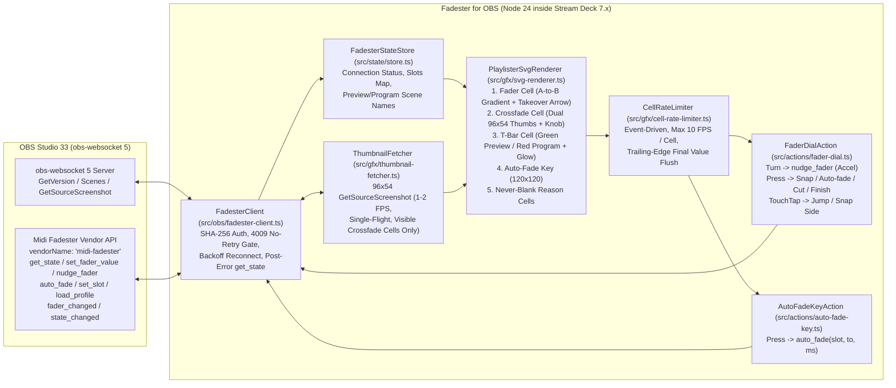

# Fadester for OBS — Implementation Plan

Status: 2026-10-27. Approved by the operator on 2026-10-27 (decisions `D-1..D-4` recorded in Section 7).
Companion to [REQUIREMENTS.md](REQUIREMENTS.md), [API-CONTRACT.md](API-CONTRACT.md), [GRAPHICS-NOTES.md](GRAPHICS-NOTES.md), [UI-NOTES.md](UI-NOTES.md), and [IDEAS.md](IDEAS.md).
Phase 1 is implemented against [API-CONTRACT.md](API-CONTRACT.md) and verified against our fake `obs-websocket` 5 server (`tests/helpers/fake-obs-server.ts`), with a live OBS 33 websocket conformance test (`tests/obs-live-conformance.ts`) ready to run as soon as Midi Fadester's vendor API is pushed.

---

## 1. Local Machine, Stream Deck Runtime & Toolchain Audit (Verified 2026-10-27)

| Component | Verified Path / Version | Notes |
|---|---|---|
| **Workspace** | `C:\streamdeck-fadester` (`origin`: `https://github.com/jbrick2070/streamdeck-fadester`) | Branch `main`, `LICENSE` is `GPL-2.0` (`22e076a`). |
| **Elgato Stream Deck App** | `C:\Program Files\Elgato\StreamDeck\StreamDeck.exe` (`7.4.2.22730`) | Installed and verified on this machine. |
| **Bundled Node.js Runtimes** | `C:\Users\jeffr\AppData\Roaming\Elgato\StreamDeck\NodeJS\24.22.1\node.exe` (`v24.22.1`)<br>`C:\Users\jeffr\AppData\Roaming\Elgato\StreamDeck\NodeJS\20.20.2\node.exe` (`v20.20.2`) | Shipped inside the Stream Deck app so end users install nothing (`R-STK-1`). |
| **Elgato Stream Deck SDK** | `@elgato/streamdeck` **`3.0.3`** (current major), `@elgato/cli` **`1.10.3`** | Verified on npm (`engines.node >= 20.5.1`, `SDKVersion: 3`, `Nodejs.Version: "24"`). |
| **Host Node / npm (Build & Test)** | Node `v25.9.0`, npm `11.12.1` | Used for local TypeScript build (`rollup`) and headless unit tests (`vitest`). |
| **Portable OBS Studio 33.0.0** | `C:\Users\jeffr\OBS-Studio-33-Portable\bin\64bit\obs64.exe` | Target for live hardware verification with `midi-fadester.dll` (`R-TST-3`). |
| **Sister Repositories (Read-Only)** | `C:\midi-fadester` and `C:\Users\jeffr\Documents\obs-playlister` | Inspected in strictly read-only mode (`R-STD-1`). |

### 1.1 Why We Pin `@elgato/streamdeck` `3.0.3` and `Nodejs.Version: "24"` (`D-1`)
- `@elgato/streamdeck` **`3.0.3`** is the current major release of Elgato's official TypeScript SDK. It pairs with `SDKVersion: 3` and `Nodejs.Version: "24"` in `manifest.json` (`Software.MinimumVersion: "7.1"`).
- Stream Deck `7.4.2.22730` on this machine already ships Node **`v24.22.1`** inside `%APPDATA%\Elgato\StreamDeck\NodeJS\24.22.1\node.exe`, providing native `node:crypto` SHA-256 and modern ES2022 performance out of the box with zero user setup.
- If compatibility with older Stream Deck `6.9–7.0` installations is ever desired, switching `manifest.json` to `SDKVersion: 2` and `Nodejs.Version: "20"` (`v20.20.2`) requires changing only two lines in `manifest.json`.

### 1.2 Why We Recommend Our Own Small Typed `obs-websocket` 5 Client (`D-2`)
- Rather than pulling in `obs-websocket-js` (`5.0.8`), we recommend a focused, strictly-typed client of our own (`src/obs/fadester-client.ts`, ~220 lines) built directly on `ws` (which `@elgato/streamdeck` already includes) and Node's built-in `node:crypto`:
  1. **Exact Protocol Surface:** We only need `OpCode 0 Hello` → SHA-256 challenge-response → `OpCode 1 Identify` (`eventSubscriptions: (1 << 9) | (1 << 2)` = `516` for `Vendors | Scenes`) → `OpCode 2 Identified`, `OpCode 6/7` for `GetVersion`, `GetCurrentPreviewScene`, `GetCurrentProgramScene`, `GetSourceScreenshot`, and `CallVendorRequest("midi-fadester", ...)`, and `OpCode 5 Event` for `VendorEvent`, `CurrentPreviewSceneChanged`, and `CurrentProgramSceneChanged`.
  2. **Deterministic Error & Close-Code Handling:** On WebSocket close code `4009` (`AuthenticationFailed`), our client immediately transitions to `"Wrong password. Check OBS Tools > WebSocket Server Settings > Show Connect Info."` and **halts automatic retries** (`R-CON-3`). On `CallVendorRequest` status `600` after `GetVersion` succeeds, it deterministically reports `"Midi Fadester is not installed in OBS"`.
  3. **Zero Extra Runtime Dependencies:** Keeps the bundled plugin lean, eliminates third-party wrapper quirks, and makes fake-server unit and mutation testing 100% deterministic.

---

## 2. Pre-Planning Technical Audit Findings (`API-CONTRACT.md` & `GRAPHICS-NOTES.md`)

### 2.1 Two-Layer Error Reporting & Post-Error State Resync (`API-CONTRACT.md` Lines 50–55)
- In `obs-websocket` 5, transport-level failures (such as calling an unregistered vendor `"midi-fadester"` when Midi Fadester is not installed, or calling an unknown `requestType`) return `requestStatus: { result: false, code, comment }` on the outer `RequestResponse` message.
- Because `obs-websocket-api.h`'s `obs_websocket_request_callback_function` returns `void` and cannot set the outer `requestStatus`, Midi Fadester returns vendor-level validation errors (such as unknown slot ID or unknown source name) inside `responseData` as `{ error: "<sentence>", comment: "<sentence>" }`.
- **Our Client Rule (`R-API-4`):** `FadesterClient.callVendor()` checks both `requestStatus.result === false` AND `typeof responseData?.error === "string"`. On either error, it surfaces the human-readable `comment` sentence directly (never guessing) and automatically invokes `get_state` to resync local state (`API-CONTRACT.md` line 14: *"Surfaces call it on connect and after any error"*).

### 2.2 Playlister Runtime SVG Architecture on Stream Deck + (`200 × 100` & `120 × 120`)
- Each Stream Deck + dial has a `200 × 100` px touch cell; each key is a `120 × 120` px LCD (`GRAPHICS-NOTES.md`).
- Instead of relying only on rigid stock bars that cannot draw dual `96 × 54` live source thumbnails, soft-takeover pickup arrows at the bar's end, or green Preview / red Program T-bar scene labels with transition glow, we define a custom full-canvas layout (`layouts/fader-cell.json` containing a single `200 × 100` `pixmap` item named `canvas`) and render crisp SVG strings (`data:image/svg+xml;utf8,...`) at runtime via `setFeedback({ canvas })` (for dials) and `setImage(svgDataUri)` (for keys).
- **Playlister Visual Grammar (`R-GFX-1`):**
  - Dark background (`#0B1020` → `#111827` vertical panel gradient).
  - Playlister blue-to-violet gradient (`#2563EB` → `#7C3AED`) for fader bars, with source-pair tinting on A-to-B crossfades.
  - Crisp white glyphs and text (`#F8FAFC`, bold sans-serif), maximum **two lines of text** per cell, and **nothing thinner than `3 px`** (`stroke-width >= 3`, bar heights `>= 16 px`).
  - Orange accents (`#F97316` / `#D97706`) for active fader caps, the soft-takeover pickup arrow (`▲` / `▼`) at the bar's target end, and T-bar active transition glow.
  - Green (`#22C55E`) for Preview scene name (left) and Red (`#EF4444`) for Program scene name (right) in the T-bar cell.

### 2.3 Event-Driven Updates, Per-Cell Rate Cap (10 FPS), and Live Thumbnails (1–2 FPS)
- **No Polling Loops (`R-GFX-6`):** Cell redraws happen only in response to events (`fader_changed`, `state_changed`, `CurrentPreviewSceneChanged`, `CurrentProgramSceneChanged`, connection status changes, and Stream Deck action events).
- **Per-Cell 10 FPS Cap (`src/gfx/cell-rate-limiter.ts`):** Even though Midi Fadester coalesces `fader_changed` to 30/sec per slot, `GRAPHICS-NOTES.md` specifies ~10 updates/sec per cell. Our per-cell rate limiter enforces a minimum `100 ms` spacing between `setFeedback` / `setImage` calls per cell, coalescing intermediate values during a fast fader sweep and always scheduling a trailing flush so the final resting value (`0%`, `100%`, or takeover lock) is guaranteed to render.
- **1–2 FPS Live Thumbnails in Crossfade Cell (`src/gfx/thumbnail-fetcher.ts`):**
  - Active only when a visible **Fader** dial is bound to a slot with `target_mode === "crossfade_ab"`, `available === true`, and per-action `showThumbnails === true` (on by default for the crossfade cell, off on keys).
  - Requests `GetSourceScreenshot` (`imageWidth: 96, imageHeight: 54, imageFormat: "jpg", imageCompressionQuality: 75`) for `source_a` and `source_b` at **1 to 2 FPS** (`750 ms` default interval while visible, with single-flight deduplication so a slow frame never queues overlapping requests) and stops immediately on `willDisappear`, slot mode change, or disconnect.

---

## 3. Target Architecture & File Layout



### 3.1 Repository File Layout (`C:\streamdeck-fadester`)

```text
C:\streamdeck-fadester\
  API-CONTRACT.md                          Shared vendor API contract (source of truth)
  GRAPHICS-NOTES.md                        Deck graphics design notes (launch vs later phases)
  UI-NOTES.md                              Shared Fadester UI notes
  IDEAS.md                                 Future Visual Sidechain & Playlister ideas
  MIDI-FADESTER-PROPOSAL.md                Original Midi Fadester proposal notes
  LICENSE                                  GPL-2.0
  README.md                                Project overview, third-party & AI disclosures
  REQUIREMENTS.md                          Numbered requirements (R-*) & decisions (D-*)
  PLAN.md                                  This implementation plan
  package.json                             Pinned @elgato/streamdeck 3.0.3, vitest, rollup, typescript
  tsconfig.json                            Strict TypeScript configuration (ES2022)
  rollup.config.mjs                        Bundles src/plugin.ts -> com.jbrick2070.fadester-for-obs.sdPlugin/bin/plugin.js
  com.jbrick2070.fadester-for-obs.sdPlugin/
    manifest.json                          Name: "Fadester for OBS", SDKVersion: 3, Nodejs: "24", 2 launch actions
    layouts/
      fader-cell.json                      200x100 full-canvas pixmap layout for runtime Playlister SVG dial cells
    imgs/
      plugin/                              Original Playlister-styled plugin & category icons (no OBS/Elgato logos)
      actions/
        fader/                             Fader dial action icon
        auto-fade/                         Auto-fade key action icon
    ui/
      fader-dial.html                      Property Inspector for Fader (dial) + shared Connection panel
      auto-fade-key.html                   Property Inspector for Auto-fade (key) + shared Connection panel
      pi-common.js                         Shared Property Inspector controller (global connection, status, live slots)
  src/
    plugin.ts                              Entry point: registers actions, initializes FadesterClient & store
    types/
      contract.ts                          Exact TypeScript types for API-CONTRACT.md requests, Slot, events, errors
      settings.ts                          Global connection settings & per-action settings types
    obs/
      fadester-client.ts                   Typed obs-websocket 5 + midi-fadester vendor client, auth, 4009 gate, backoff
    state/
      fadester-store.ts                    Reactive state store (connection status sentence, slots, scene names)
    gfx/
      palette.ts                           Playlister family colors, gradients, >= 3 px geometry constants
      svg-renderer.ts                      Pure functions generating 200x100 dial SVGs & 120x120 key SVGs
      cell-rate-limiter.ts                 Event-driven per-cell rate limiter (max 10 FPS, trailing flush)
      thumbnail-fetcher.ts                 1-2 FPS 96x54 GetSourceScreenshot manager with single-flight guard
    actions/
      dial-math.ts                         Pure step-per-tick, velocity acceleration, press target, and tapPos math
      fader-dial.ts                        Stream Deck + Encoder action ("Fader")
      auto-fade-key.ts                     Stream Deck Keypad action ("Auto-fade")
  tests/
    helpers/
      fake-obs-server.ts                   Real-WebSocket fake obs-websocket 5 + midi-fadester server for tests
    fadester-client.test.ts                Connect, SHA-256 auth, 4009 no-retry, reconnect, all 6 requests, events, errors
    dial-math.test.ts                      Step sizes (1/2/5%), acceleration curve, press actions, touchTap coordinate math
    svg-renderer.test.ts                   Fader, Crossfade thumbnail, T-bar, Auto-fade key, Never-Blank reasons, >= 3px rule
    rate-limiter-thumbnails.test.ts        10 FPS cell cap, trailing flush, 1-2 FPS thumbnail cap, single-flight, visibility stop
    actions-integration.test.ts            End-to-end Fader dial & Auto-fade key interaction against fake-obs-server
```

---

## 4. Phased Implementation Plan, Per-Step Tests & Mutation Checks

### Phase 0 — Requirements, Plan, and README (Current Step — No Code)
1. Read `START-PROMPT.md`, `API-CONTRACT.md`, `UI-NOTES.md`, `MIDI-FADESTER-PROPOSAL.md`, `GRAPHICS-NOTES.md`, `IDEAS.md`, and `C:\midi-fadester`'s `REQUIREMENTS.md` and `PLAN.md`.
2. Write `README.md`, `REQUIREMENTS.md`, and `PLAN.md` in `C:\streamdeck-fadester`.
3. Commit and push once to `origin/main`, run post-push checks (`HEAD == origin/main`, zero 0-byte files, zero BOMs, zero banned words), and **STOP** for operator review.

---

### Phase 1 — Launch Set: `Fader` (Dial), `Auto-fade` (Key), and Launch Runtime SVG Cells

#### Step 1.1: Project Scaffold, `manifest.json`, `layouts/fader-cell.json`, and Own Icons
- Create `package.json`, `tsconfig.json`, `rollup.config.mjs`, `.gitignore`, and the `com.jbrick2070.fadester-for-obs.sdPlugin/` bundle layout.
- Author `manifest.json` with `Name: "Fadester for OBS"`, `SDKVersion: 3`, `Nodejs.Version: "24"`, `Software.MinimumVersion: "7.1"`, and the two launch actions (`com.jbrick2070.fadester-for-obs.fader` on `["Encoder"]` with `Encoder.layout: "layouts/fader-cell.json"`, and `com.jbrick2070.fadester-for-obs.auto-fade` on `["Keypad"]`).
- Create original Playlister-styled SVG/PNG icons (`imgs/`).
- **Step 1.1 Automated Tests:**
  - `manifest-hygiene.test.ts`: Verifies `manifest.json` parses cleanly, `Name === "Fadester for OBS"`, `Actions.length === 2`, `layouts/fader-cell.json` exists and defines a `200 × 100` `pixmap` canvas, all referenced icon files exist and are non-empty, and all repo files have UTF-8 without BOM, `SPDX-License-Identifier: GPL-2.0-or-later` headers on code files, and zero occurrences of the banned placeholder word.
- **Step 1.1 Mutation Checks:**
  - *Mutation 1.1a:* Change `manifest.json` `Name` away from `"Fadester for OBS"` or add a 3rd action → `manifest-hygiene.test.ts` MUST fail.
  - *Mutation 1.1b:* Inject a UTF-8 BOM (`0xEF 0xBB 0xBF`) or missing SPDX header into a `.ts` file → `manifest-hygiene.test.ts` MUST fail.

#### Step 1.2: Typed `obs-websocket` 5 Client & Fake `obs-websocket` 5 Server (`src/obs/`, `tests/helpers/`)
- Implement `tests/helpers/fake-obs-server.ts` speaking real WebSocket (`ws`) for `obs-websocket` 5 (`Hello` with optional SHA-256 auth challenge, `Identify`, `Identified`, `GetVersion`, `GetCurrentPreviewScene`, `GetCurrentProgramScene`, `GetSourceScreenshot`, `CallVendorRequest` for all 6 `midi-fadester` requests, `VendorEvent` emission, close code `4009`, transport error `600`, and vendor `{ error, comment }` responses).
- Implement `src/obs/fadester-client.ts` and `src/state/fadester-store.ts`:
  - Connection handshake, SHA-256 auth challenge response, `GetVersion` + `get_state` on connect.
  - All 6 contract requests: `get_state`, `set_fader_value`, `nudge_fader`, `auto_fade`, `set_slot`, `load_profile`.
  - Vendor events (`fader_changed`, `state_changed`) and OBS scene events (`CurrentPreviewSceneChanged`, `CurrentProgramSceneChanged`).
  - Automatic `get_state` call after any transport or vendor validation error (`R-API-4`).
  - Exponential backoff reconnect on socket drop/refusal, and **strict retry halt on `4009` wrong password** (`R-CON-3`).
- **Step 1.2 Automated Tests (`fadester-client.test.ts`):**
  - Connects without password and with password; verifies status string `"Connected: OBS 33.0.0, Midi Fadester 0.1.0"`.
  - Verifies wrong password (`4009`) sets status `"Wrong password. Check OBS Tools > WebSocket Server Settings > Show Connect Info."` and makes **0 reconnect attempts** over fake-timer advancement until `updateSettings()` or `reconnectNow()` is called.
  - Verifies OBS unreachable (`ECONNREFUSED`) sets status `"OBS is not running or the websocket is off (Tools > WebSocket Server Settings)"` and reconnects with backoff when the server starts.
  - Verifies missing vendor (`code: 600`) sets status `"Midi Fadester is not installed in OBS"` with release link metadata.
  - Exercises all 6 requests (`get_state`, `set_fader_value` with/without `release: true`, `nudge_fader`, `auto_fade`, `set_slot`, `load_profile`) and verifies exact request/response payloads.
  - Exercises vendor validation error (`{ error, comment }` on `fader_9` or unknown source in `set_slot`), verifying the exact `comment` sentence is surfaced and `get_state` is automatically called immediately afterward.
  - Exercises `fader_changed` (`midi`, `ui`, `api`, `auto_fade` origins) and `state_changed` events updating the store.
- **Step 1.2 Mutation Checks:**
  - *Mutation 1.2a:* Remove the `closeCode === 4009` guard in the reconnect scheduler → the wrong-password no-retry test MUST fail (detecting extra connection attempts).
  - *Mutation 1.2b:* Remove the post-error `this.getState()` call in `callVendor()` → the error-resync test MUST fail (verify `get_state` call count after error drops from `2` to `1`).
  - *Mutation 1.2c:* Ignore `responseData.error` when outer `requestStatus.result === true` → the vendor validation error test MUST fail.

#### Step 1.3: Playlister Runtime SVG Renderer, Per-Cell Rate Limiter, and 1–2 FPS Thumbnail Manager (`src/gfx/`)
- Implement `src/gfx/palette.ts` and `src/gfx/svg-renderer.ts`:
  - **Fader Cell (`200 × 100` SVG):** Dark Playlister background, slot label + big percent (`<= 2` lines of text), `>= 3 px` strokes, A-to-B blue-to-violet gradient bar (`#2563EB → #7C3AED`), orange fader cap, and orange soft-takeover arrow (`▲` for `"up"`, `▼` for `"down"`) at the bar's end when `takeover_pending !== "none"`.
  - **Crossfade Cell with Live Thumbnails (`200 × 100` SVG):** Two `96 × 54` `<image>` elements for `source_a` (left) and `source_b` (right) with active-mix border highlights, the A-to-B crossfade bar and orange fader knob drawn between/below them, and live percent readout. Falls back cleanly to the standard Fader cell if thumbnails are disabled on that action or before the first screenshot arrives.
  - **T-Bar Cell (`200 × 100` SVG):** Preview scene name in green (`#22C55E`) on the left, Program scene name in red (`#EF4444`) on the right, T-bar track and fill bar between them, and an orange/violet glow border (`stroke-width >= 3`) while a transition is in progress (`0 < value < 1`).
  - **Auto-Fade Key (`120 × 120` SVG):** Slot label, big live percent (`0%`–`100%`), target indicator (`→ 100%` or `→ 0%`), and Playlister blue-to-violet bottom bar.
  - **Never-Blank Status Cells (`200 × 100` and `120 × 120` SVG):**
    - `target_mode === "unassigned"` → `"Unassigned, set in OBS"`
    - `available === false` → `slot.reason` verbatim (e.g., `"Studio Mode is off"`, `"Source 'Loop 3' not found"`)
    - Disconnected → one-line connection status reason.
- Implement `src/gfx/cell-rate-limiter.ts` (event-driven, max 10 FPS / `100 ms` per cell with trailing flush) and `src/gfx/thumbnail-fetcher.ts` (1–2 FPS `GetSourceScreenshot` at `96 × 54`, single-flight deduplication, active only for visible crossfade cells with `showThumbnails: true`).
- **Step 1.3 Automated Tests (`svg-renderer.test.ts`, `rate-limiter-thumbnails.test.ts`):**
  - Verifies valid XML/SVG structure, `viewBox="0 0 200 100"` (dials) and `viewBox="0 0 120 120"` (keys), Playlister palette colors, max 2 text lines, and that every `stroke-width` attribute in generated SVGs is `>= 3`.
  - Verifies Fader cell includes takeover arrow glyph when `takeover_pending` is `"up"` or `"down"` and omits it when `"none"`.
  - Verifies T-bar cell renders Preview name in green (`#22C55E`), Program name in red (`#EF4444`), and transition glow only when `0 < value < 1`.
  - Verifies Crossfade thumbnail cell embeds both `96 × 54` `data:image/jpeg;base64,...` screenshots and the fader knob.
  - Verifies Never-Blank rule: unassigned renders `"Unassigned, set in OBS"`, unavailable renders exact `slot.reason`, disconnected renders exact connection reason, and no state ever produces an empty SVG or blank text.
  - Verifies `CellRateLimiter`: feeding 30 `fader_changed` events over `1000 ms` emits at most 10–11 renders and always flushes the final value `1.0`.
  - Verifies `ThumbnailFetcher`: fetches `GetSourceScreenshot` at `96 × 54` at `<= 2 FPS`, skips concurrent requests when one is in flight, does not fetch when `showThumbnails === false` or `target_mode !== "crossfade_ab"`, and stops immediately on `willDisappear`.
- **Step 1.3 Mutation Checks:**
  - *Mutation 1.3a:* Set any SVG `stroke-width` to `1` or `2` → `svg-renderer.test.ts` (`>= 3 px` rule assertion) MUST fail.
  - *Mutation 1.3b:* Replace `slot.reason` with a hardcoded string when `available === false` → `svg-renderer.test.ts` MUST fail.
  - *Mutation 1.3c:* Disable trailing-edge flush in `CellRateLimiter` → `rate-limiter-thumbnails.test.ts` final-value delivery test (`100%` endpoint check) MUST fail.
  - *Mutation 1.3d:* Remove the single-flight guard in `ThumbnailFetcher` while simulating a slow `GetSourceScreenshot` response → `rate-limiter-thumbnails.test.ts` MUST fail.

#### Step 1.4: Launch Actions (`Fader` Dial & `Auto-fade` Key) and Property Inspector (`src/actions/`, `ui/`)
- Implement `src/actions/dial-math.ts`:
  - `computeDialDelta(ticks, stepPerTick, acceleration, elapsedMs)`: applies `1%`, `2%` (default), or `5%` per tick with velocity acceleration (`1×`, `2×`, `3×`).
  - `resolveDialPressCommand(slotValue, pressAction)`: maps `Snap 0/100`, `Auto-fade 1 s`, `Auto-fade 2 s`, `Cut`, and `Finish T-bar` (plus `Auto-fade 3 s` on long press `>= 800 ms` with an on-cell `HOLD 3s FADE` indicator during the hold per `D-3`) to exact `set_fader_value` or `auto_fade` requests.
  - `mapTouchTapToValue(tapX, targetMode)`: maps `0..200` px tap coordinate with `20 px` left/right snap zones (`x <= 20 → 0.0`, `x >= 180 → 1.0`, linear `(x - 20) / 160` in between; in Crossfade thumbnail mode, tapping the left `96 px` thumbnail snaps to `0.0` and tapping the right `96 px` thumbnail snaps to `1.0`).
- Implement `src/actions/fader-dial.ts` (`Fader`) and `src/actions/auto-fade-key.ts` (`Auto-fade`).
- Implement `ui/fader-dial.html`, `ui/auto-fade-key.html`, and `ui/pi-common.js` (host/port/password inputs, live status banner with clickable Midi Fadester link when missing, **Connect / Test** button, and live Slot dropdown showing each slot's `name`, `label`, and `reason` when unavailable).
- **Step 1.4 Automated Tests (`dial-math.test.ts`, `actions-integration.test.ts`):**
  - Verifies `computeDialDelta` for `1%`, `2%`, `5%`, clockwise/counter-clockwise ticks, and acceleration on/off.
  - Verifies all 5 press modes (`Snap 0/100`, `Auto-fade 1 s`, `Auto-fade 2 s`, `Cut`, `Finish T-bar`) and long-press `Auto-fade 3 s` at `800 ms` (including the hold indicator rendered while held `< 800 ms` and cleared on release or fire).
  - Verifies `onTouchTap` coordinate mapping at left edge (`x = 10 → 0.0`), center (`x = 100 → 0.5`), right edge (`x = 190 → 1.0`), and thumbnail left/right snap.
  - End-to-end integration test with `fake-obs-server`: dropping `Fader` on a dial binds to `"crossfader"`, turning calls `nudge_fader`, pressing runs `auto_fade` / `set_fader_value`, external `fader_changed` from `"midi"` updates the dial's SVG feedback (`0%` → `42%` → `100%`), and pressing the `Auto-fade` key calls `auto_fade` while displaying live percent on the key SVG.
- **Step 1.4 Mutation Checks:**
  - *Mutation 1.4a:* Invert the `< 0.5` toggle threshold or omit `release: true` in `Finish T-bar` / `Snap 0/100` → `dial-math.test.ts` MUST fail.
  - *Mutation 1.4b:* Unsubscribe `FaderDialAction` from `fader_changed` store updates → `actions-integration.test.ts` APC40-to-dial sync test MUST fail.
  - *Mutation 1.4c:* Omit the Hold indicator during `onDialDown` or fire the short press on `onDialUp` after the `800 ms` hold already fired → `actions-integration.test.ts` MUST fail.

#### Step 1.5: Bundle Validation, Live OBS 33 Conformance Runner & Hardware Verification (`streamdeck validate` + Portable OBS 33)
- Implement `tests/obs-live-conformance.ts` (`npm run test:obs-live`) per `D-2`: connects `FadesterClient` to a real OBS 33 websocket (or local harness) to verify SHA-256 password auth, wrong password (`4009` close code, retries stop, status sentence shown), one vendor request (`get_state`), one vendor event (`fader_changed`), and automatic reconnect after OBS restarts.
- Build the plugin bundle (`npm run build`), run the full automated test suite (`npm test`), validate with `@elgato/cli` (`npx streamdeck validate`), package `.streamDeckPlugin` (`npx streamdeck pack`), and execute the Manual Hardware Verification Checklist (Section 5) against portable OBS 33 (`C:\Users\jeffr\OBS-Studio-33-Portable`) and the physical Stream Deck +.

---

### Phases 2–4 Roadmap (Listed from `GRAPHICS-NOTES.md` and `IDEAS.md` — Not Built at Launch)

#### Phase 2 — Extended Fader & Scene Graphics (`GRAPHICS-NOTES.md` #4, #7, #11, #12)
- **Auto-Fade Countdown Cell (`#4`):** While a timed `auto_fade` is active on a slot, sweep the dial bar and render a live remaining-time countdown (`1.8 s → 0.0 s`).
- **Status Key (`#12`):** `120 × 120` key displaying OBS + APC40 connection state and a MIDI activity dot that blinks on incoming `fader_changed` (`origin: "midi"`); pressing triggers immediate Reconnect.
- **Fade-to-Black Key (`#11`):** `120 × 120` gradient square key that progressively darkens as a timed Fade-to-Black runs.
- **Scene Keys with Live Thumbnails (`#7`):** `120 × 120` scene keys with optional `1 FPS` live `GetSourceScreenshot` thumbnails (off by default on keys), framed in red (`#EF4444`) when live in Program and green (`#22C55E`) when in Preview.

#### Phase 3 — Visual Sidechain Meters, 800 px Idle Strip & VJ Performance Controls (`GRAPHICS-NOTES.md` #5, #6, #8–#10; `IDEAS.md` #1–#8)
- **Meter Dial Cells (`GRAPHICS-NOTES.md` #5, `IDEAS.md` #7):** Render bass, mid, and high bars on dial touch cells from Visual Sidechain signal events, flash on kick detections, and draw a beat-phase sweep indicator.
- **800 × 100 Idle Strip Spectrum (`GRAPHICS-NOTES.md` #6):** When dial cells are unassigned, coordinate all four `200 × 100` cells into one continuous `800 × 100` VU spectrum display between songs.
- **Safety & Performance Keys (`GRAPHICS-NOTES.md` #8–#10, `IDEAS.md` #1–#6):**
  - **Panic Key:** Red `120 × 120` key with a bold glyph that inverts while held and zeroes every strobe and flash amount at once.
  - **Freeze Key:** Snowflake glyph that turns ice-blue while holding visual analysis state.
  - **Tap Tempo & Beat Nudge:** Key displays live BPM, flashes on each tap, and pulses on the beat; companion dial nudges beat phase.
  - **Fade on the One:** Dial press or key arms an `auto_fade` quantized to the next downbeat / bar / 4 bars from the beat phase.
  - **Ride the Reactivity, Visual EQ & Recorded Rides:** Bind fader slots to Visual Sidechain reactivity drive, 8-band FFT scaling, and looping hand-drawn fader rides.

#### Phase 4 — Playlister Tie-Ins & Elgato Marketplace Submission (`IDEAS.md` #9, #10; `START-PROMPT.md`)
- **Playlister Integration (`IDEAS.md` #9, #10):** Cut-on-the-kick playlist advance and dial folder scrubbing / live still-duration fader.
- **Elgato Marketplace Release (`D-4`):** Finalize store assets, descriptions, and release package for Elgato Marketplace review.

---

## 5. Manual Hardware Verification Checklist (Real Stream Deck + & Portable OBS 33)

Target environment:
- **OBS Studio 33.0.0 Portable:** `C:\Users\jeffr\OBS-Studio-33-Portable\bin\64bit\obs64.exe` with `midi-fadester.dll` installed in `plugins\midi-fadester\`.
- **Stream Deck Desktop App:** `7.4.2.22730` with a physical **Stream Deck +** (4 rotary dials, `800 × 100` touch strip, 8 LCD keys) and **Akai APC40 mkII**.

| # | Check | Expected Result |
|---|---|---|
| `M-1` | **OBS Closed / WebSocket Off** | Close OBS. Every **Fader** dial cell and **Auto-fade** key shows the one-line reason `"OBS is not running or websocket is off"`, and the Property Inspector status reads `"OBS is not running or the websocket is off (Tools > WebSocket Server Settings)"`. |
| `M-2` | **Wrong Password (No Silent Retries)** | Start portable OBS 33 with WebSocket auth enabled; enter an invalid password in the Property Inspector. Status immediately shows `"Wrong password. Check OBS Tools > WebSocket Server Settings > Show Connect Info."` and OBS WebSocket logs show **no** repeated failed login attempts. |
| `M-3` | **Missing Midi Fadester Detection** | Temporarily rename `plugins\midi-fadester` and start OBS 33. Property Inspector shows `"Midi Fadester is not installed in OBS"` with a clickable link to Midi Fadester, and dials show `"Midi Fadester is not installed in OBS"`. Restore `plugins\midi-fadester`. |
| `M-4` | **Connected Status & Live Slot Dropdown** | With OBS 33 + Midi Fadester running, Property Inspector status turns green: `"Connected: OBS 33.0.0, Midi Fadester 0.1.0"`. Dropping **Fader** on Dial 1 binds to `Crossfader` automatically; opening the Slot dropdown lists `Crossfader`, `Fader 1..8`, and `Master` with their live labels and `reason` when unavailable. |
| `M-5` | **Never-Blank Cells (`Unassigned` & `Unavailable`)** | Bind a dial to an unassigned slot (`Fader 8`) → dial cell displays `"Unassigned, set in OBS"`. Bind a dial to `Crossfader` (`tbar`) and turn Studio Mode **off** in OBS → dial cell immediately displays `"Studio Mode is off"`. |
| `M-6` | **T-Bar Dial Cell (`tbar` Mode)** | Turn Studio Mode **on** in OBS. Dial 1 (`Crossfader`) renders the **T-bar cell**: Preview scene name in green on the left, Program scene name in red on the right, T-bar bar in between. Turn Dial 1 slowly (2% steps) and quickly (accelerated sweep): OBS T-bar moves smoothly, an orange/violet glow appears mid-transition, and reaching 100% or pressing the dial (`Finish T-bar` / `Snap 0/100`) completes the transition and updates the green/red scene names. |
| `M-7` | **Fader Cell (`layer_opacity` / `audio_volume`) & Soft-Takeover Arrow** | Bind Dial 2 to `Fader 1` (`Layer Opacity`). Dial cell shows the Playlister **A-to-B blue-to-violet gradient bar** and big percent. Turn Dial 2 to `80%`, then move physical Track Fader 1 on the APC40 mkII from `10%`: while `takeover_pending` is `"up"`, Dial 2 draws the orange **`▲`** arrow at the bar's end; as the APC40 fader crosses `80%`, the arrow clears and both surfaces track together at 30 Hz coalesced / 10 FPS rendered. |
| `M-8` | **Crossfade Cell with Live `96 × 54` Thumbnails (`crossfade_ab`)** | Configure `Fader 2` in OBS as a Two-Source Crossfade (`Cam 1 -> Loop 3`) and bind Dial 3 with **Live Thumbnails** enabled. Dial 3 renders two live `96 × 54` screenshots of `Cam 1` and `Loop 3` updating at 1–2 FPS with the fader knob between them. Tap the left thumbnail on the touch strip → snaps to `0%` (`Cam 1`); tap the right thumbnail → snaps to `100%` (`Loop 3`). |
| `M-9` | **Dial Press & Long Press Modes** | Test `Snap 0/100`, `Auto-fade 1 s`, `Auto-fade 2 s`, `Cut`, `Finish T-bar`, and `Long Press (3 s)` on Dial 1/2/3. Each press executes the exact transition or timed fade in OBS. |
| `M-10` | **Auto-Fade Key (`120 × 120` LCD)** | Drop **Auto-fade** on Key 1 (`Slot: Fader 2`, `To: 100%`, `Duration: 2 s`). Key displays the live percent (`0%`) and Playlister progress bar. Press Key 1: OBS runs the 2 s fade to `100%` while both Key 1 and Dial 3 animate to `100%`. |

---

## 6. Risk Register (`R1 .. R6`)

| ID | Risk | Mitigation |
|---|---|---|
| `R1` | **`obs-websocket` 5 Vendor Callback Cannot Set Outer `requestStatus`** | Per `API-CONTRACT.md` lines 52–54, `FadesterClient` inspects both outer `requestStatus.result === false` (transport/missing-vendor errors) and inner `responseData.error` / `responseData.comment` (vendor validation errors), and calls `get_state` after any error. |
| `R2` | **Wrong Password Causes Endless Reconnect Spam in OBS Logs** | Explicitly detect WebSocket close code `4009` (`AuthenticationFailed`), display `"Wrong password. Check OBS Tools > WebSocket Server Settings > Show Connect Info."`, and halt automatic reconnect timers until credentials change or the user clicks **Connect / Test** (`R-CON-3`). |
| `R3` | **`GetSourceScreenshot` Traffic Overwhelms `obs-websocket` or Stream Deck** | Thumbnails are `96 × 54` compressed JPEG (`quality: 75`), capped at 1–2 FPS, guarded by a single-flight lock, active only on visible dials (`willAppear` → `willDisappear`) in `crossfade_ab` mode, and toggleable per action (`R-GFX-3`, `R-GFX-6`). |
| `R4` | **Fast APC40 Fader Sweeps Flood Stream Deck `setFeedback` IPC** | Midi Fadester coalesces `fader_changed` to 30/sec per slot, and our `CellRateLimiter` caps Stream Deck `setFeedback` / `setImage` calls to 10/sec (`100 ms`) per cell with a guaranteed trailing-edge flush (`R-GFX-6`). |
| `R5` | **Stream Deck + Touch Strip Has No Drag Event for T-Bar Scrubbing** | Documented in `START-PROMPT.md`: rotary dial turning (`nudge_fader` with acceleration) handles continuous scrubbing, while `onTouchTap` uses `tapPos[0]` to jump to the tapped position or snap to the left/right source (`R-ACT-1`). |
| `R6` | **Unassigned or Unavailable Slot Leaves a Dial Seemingly Dead** | `SvgRenderer` enforces the Never-Blank Rule (`R-GFX-5`): `unassigned` shows `"Unassigned, set in OBS"`, `available: false` shows `slot.reason` verbatim (`"Studio Mode is off"`, `"Source 'X' not found"`), and disconnected cells show the connection reason. |

---

## 7. Approved Operator Decisions (`D-1 .. D-4`, Approved 2026-10-27)

1. **`D-1` — SDK & Node.js Versions (Approved):**
   - Pin **`@elgato/streamdeck` `3.0.3`** (`SDKVersion: 3`), **`@elgato/cli` `1.10.3`**, **`Nodejs.Version: "24"`**, and **`Software.MinimumVersion: "7.1"`**. `README.md` states explicitly that Stream Deck 6.x is not supported.
2. **`D-2` — `obs-websocket` 5 Client Library (Approved with Conformance Test Condition):**
   - Use **our own small, strictly-typed client (`src/obs/fadester-client.ts`)** over `ws` and `node:crypto` SHA-256, paired with a conformance test (`tests/obs-live-conformance.ts`) against the real OBS 33 websocket covering password auth, wrong password (close `4009`, retries stop, status sentence shown), one vendor request, one vendor event, and reconnect after OBS restarts. (If that test is hard to keep green, switch to `obs-websocket-js`.)
3. **`D-3` — Dial Long-Press (`Auto-fade 3 s` at `800 ms` with Hold Indicator — Approved):**
   - Holding a dial for **`>= 800 ms`** triggers a **3-second auto-fade (`ms: 3000`)** toward the opposite rail (`Auto-fade 3 s` default, or `None`). While the dial is held down prior to `800 ms`, the cell renders a bold orange **Hold indicator (`HOLD 3s FADE`)** so a fade never starts by surprise during a show.
4. **`D-4` — Elgato Marketplace Listing (Approved):**
   - Ship `.streamDeckPlugin` releases on GitHub in Phase 1 while building all icons, manifest metadata, and `streamdeck validate` checks to Elgato Marketplace rules from day one; submit to the Elgato Marketplace in Phase 4.

---

## 8. Translations (`R-I18N-1..5`; requested by the operator 2026-10-31)

Goal: Fadester for OBS speaks Stream Deck's seven languages besides English, as VJster does in the same repository.
Inventory (2026-10-31, after 0.7.7): about 24 manifest strings, about 150 drawn on the deck or in status and error
sentences, about 415 in the property inspectors, 38 English captions stored in the bundled profiles. Only Fadester's
files change (`com.jbrick2070.fadester-for-obs.sdPlugin/`, `src/` outside `src/vjster/`,
`packages/streamdeck-fadester-shared/`, `scripts/` except `scripts/vjster/`, its tests); VJster's translation work in
the same repository is done separately. Each step ends with `npx vitest run`, `npx tsc --noEmit`,
`npm run test:mutation` and, when the plugin folder changes, `npm run validate`, all green; Sonnet 5.5 QA of the
step's diff before its build; one commit per step; one push at the end.

1. **Step 8.1 -- Codes, not words (no visible change).** `src/i18n/strings.ts`: the English table keyed by id (no
   dots in keys), templates with `{name}` placeholders, `t(key, vars)`, and number formatting. The literals drawn on
   the deck and the status and error sentences move to keys. `DirectObsError` gains a message key and parameters (an
   OBS `comment` or a Midi Fadester text keeps its own wording); status objects carry a kind and parameters and are
   worded at render time. The three `.replace(" (automatic)", "")` calls become separate role keys; the
   `label !== "Scene transition"` test (`direct-obs-renderer.ts:105`) becomes a default-label flag. The mutation
   entries that quote changed lines (M-3.2 "CLEAN FX", M-1.3b "Unassigned, set in OBS", and any other) are updated in
   the same step; the tests keep asserting English.
   *As built (2026-10-31, worktree `fadester-i18n`):* `src/i18n/strings.ts` holds `EN` (the shared package's
   `SHARED_EN` plus the plugin's words), `t()`, `translate()` (the same, typed for the shared package),
   `lookupText()` (English for a missing, empty, key-echo or placeholder-changed text, as VJster), `setLanguage()`,
   `formatNumber()` (Intl, "1,5" in German). `packages/streamdeck-fadester-shared/src/i18n.ts` has `LocalText`
   (`{ key, params }` for our words, `{ verbatim }` for OBS and Midi Fadester texts), `wordText()`, and
   `LocalizedError`, which `ObsVendorError`, `DirectObsError` and `FadesterVendorError` extend: a string argument is
   foreign and shown verbatim, our own messages pass `ownText(key, params)`; `message`/`comment` keep the English
   wording, so logs and the `toThrow("...")` tests read English. `ConnectionStatusInfo` lost `sentence` and
   `cellReason`; it carries `pluginName`, `surfaceName`, `apiVersion`, `supportedApiVersion`, and
   `status-text.ts` words it (`statusSentence`, `statusCellReason`); `setStatus` diffs `statusSignature` (kind
   plus the parameters the words use, no more). The shared renderers take `t` in their input (English when
   omitted); `SurfaceStore` starts with empty Preview/Program names and keeps the last error as `LocalText`.
   Decisions: the T-bar's default label is now empty (a stored "Scene transition" is treated as generated), so the
   `!== "Scene transition"` test is gone; "40 %" and "40%" are one `percent` template (English "{n}%", German
   "{n} %"), the one visible English change; the fade key's seconds use `formatNumber`; `READY_LAYOUTS` carry the
   profile `title` (kept as named, R-I18N-1) and the picker shows it after a translated mode tag; the "OBS"
   version fallback stays (a kept term); "Could not queue the next scene." is not shown anywhere and stays.
   `en.json` and `de.json` exist from this step with `Localization` only (the deck table; 8.4 adds the
   manifest texts); `tests/helpers/languages.ts` holds `REQUIRED_LANGUAGES` (en, de; extend there) and takes
   every other list from the files present; `tests/i18n-strings.test.ts` checks keys, placeholders, BOM, the
   fallbacks, German renders, own-versus-foreign errors and status diffing. Mutations M-3.2 and M-1.3b follow the
   new lines; M-8.1a (lookup bypass) and M-8.1b (status diff by kind only) are new; the runner now requires a
   failing test, not just a non-zero exit.
2. **Step 8.2 -- Stored English captions shown translated.** `src/obs/preset-captions.ts` lists the 38 captions the
   bundled profiles store (English, compare-only) with each one's role; the scene, fader, fade and layer controllers
   treat a matching caption as generated and draw the translated role (extending today's scene and audio rule to the
   layer and "Scene blend" captions). The inspectors' generated-label logic uses the same list. Profiles are not
   rebuilt and keep English captions. Tests: each caption maps to a role; a German render shows no English caption.
   *As built (2026-10-31):* `src/obs/preset-captions.ts` holds the 38 shipped captions (14 layer: 10 key, 4 dial;
   5 fader; 8 fade; 11 scene; a test asserts set equality with `profiles/layouts.json`) and the legacy spellings,
   per action and context (scene target; T-bar or any automatic audio role; layer operation; layer dial mode),
   compared case- and space-insensitively. `customCaption()` returns "" for a generated caption, so the scene key
   draws the live OBS scene or its translated role, fader and fade draw the live input or role (the T-bar its
   press hint), and the layer key its translated operation; any other caption is drawn as typed. It replaces the
   three older rules (`isAutomaticInputPresetLabel`, the scene key's lists, the "Scene transition" test); the
   migrations and their English literals are unchanged. Small unifications: a scene caption now matches only its
   own index ("Scene 2" on Scene 2's target, as the inspector did; the key used to accept any A-D/1-4 on any
   automatic target), "Random scene" is recognised on the deck as well, and an audio role caption is generated on
   any automatic audio target (the key's rule; the inspectors used to tie Music to Main, Mic to Mic, Aux to Aux),
   but no longer on a T-bar dial (whose context is the T-bar); every comparison now ignores case, so "cut next"
   typed on a Next key counts as the default too.
   The inspectors read the same table from the generated `ui/preset-captions.js`
   (`scripts/generate-ui-i18n.ts`, run by hand; a test fails when it is stale), loaded before `direct-pi.js` on
   the four direct pages; a generated caption shows as an empty label field (its placeholder is translated in
   8.5) and is still released on retarget, now also when a layer key's job or a layer dial's mode changes. The vm
   inspector tests load a page's own helper scripts through `tests/helpers/inspector-scripts.ts`.
   `tests/preset-captions.test.ts` renders every distinct shipped assignment on a German deck against the fake OBS
   and finds no English caption; M-8.2a (captions drawn as typed) is new.
3. **Step 8.3 -- Width.** `textFitAttributes` and the fit checks measure CJK, kana, Hangul and accented capitals at
   their real widths; the three Midi Fadester status texts and the 120 px key status line that are never shrunk today
   get the same fit. A test renders every deck string of every language present and checks its box.
   *As built (2026-10-31):* `packages/streamdeck-fadester-shared/src/text-fit.ts` holds the estimate (`textEm`:
   CJK, kana and Hangul 1 em, combining marks 0, capitals of any script 0.74, narrow letters and punctuation 0.36,
   m/w/@/%/…/— 0.95, others 0.6; a little above Segoe UI Bold), `fitsBox` (fits when squeezed no further than
   `MIN_SQUEEZE` 0.8), `fitText` (shortens by width with "…", never by a count of characters), the moved
   `textFitAttributes`, `splitTitle` (two lines at a space; CJK also between characters; one long Latin word stays
   whole) and `fontFamilyFor` (VJster's CJK font lists, by script). The old estimate (capitals 1 em, every
   non-ASCII character 1.2 em) is gone, so English is squeezed less often than before, and `truncateLabel` is
   removed. So English output is not byte-identical to 0.7.7: besides "40 %" becoming "40%", a long scene or
   source name is now cut by measured width rather than at a fixed character count, so its cut point can
   differ, and some names that were squeezed before are drawn at full size. Every text on the direct key and dial, the scene mixer (LIVE/NEXT too), the layer dial and the Midi
   Fadester cells is fitted to its box and gets its font list; the direct key title wraps by width (14 px, else
   12 px, else two lines), the Midi Fadester key title too (14 px, else two lines at 13, 11 or 10 px); the dial
   status title and reason, the hold badge (now 112 to 188 px wide), the T-bar scene names (16, 14 or 12 px in
   66 px each) and percent, the readouts (the label gets what the readout leaves) and the Clean FX lines were not
   fitted before and are now; the key status reason (often Midi Fadester's own sentence) gets two lines. Tests
   that looked for a wrapped reason read the drawn words through `tests/helpers/svg-text.ts`.
   `tests/deck-fit.test.ts` lists every deck key with the boxes it is drawn in (composites with their parts, an
   Info Bar line as native text that must fit 220 px unsqueezed) or as not drawn on the deck, and for every
   language present requires each text to fit wherever the English fits; status and error sentences that do not
   fit a 9 px key line even in English are shortened there by design, and may be at most half again as wide as
   the English. `textFitAttributes` still sets `textLength` whenever the estimate exceeds the box, as before (a
   text a little narrower in reality is then stretched slightly; overflow was judged worse). German deck texts were shortened to fit
   (for example "Von OBS getrennt.", "{role} fehlt", and OBS's "Negativ multiplizieren" as "Negativ mult." in the
   9 px key line). M-8.3a (CJK at Latin width) and M-8.3b (no shortening) are new.
4. **Step 8.4 -- Stream Deck files.** `en.json` plus de, es, fr, ja, ko, zh_CN, zh_TW at the plugin root: Name,
   Description, Category, the seven action UUIDs' Name, Tooltip and Encoder TriggerDescription, and a `Localization`
   object holding the strings table (and `Localization.pi` for the inspectors). The plugin takes the language from
   `streamDeck.info.application.language` at start and uses its own `t()` over the tables (the SDK's translate has no
   placeholders and returns the bare key when the files are not in the working folder, as in tests).
   *As built (2026-11-01):* `en.json` and `de.json` now hold `Name`, `Description`, `Category`, every action UUID's
   `Name` and `Tooltip`, and `Encoder.TriggerDescription` (Rotate, Push, Touch) where the manifest has one, as
   VJster's files do; `Name` and `Category` stay "Fadester for OBS" (R-ID-1) and the English file repeats the
   manifest's texts (a test compares them). `src/i18n/load.ts` maps Stream Deck's language to one it offers
   (`zh-CN` to `zh_CN`, `de_AT` to `de`, anything else to English), reads that file's `Localization` (without the
   inspectors' `pi`) from the plugin folder, and English stands when the file is missing or broken; `plugin.ts`
   calls it once with `streamDeck.info.application.language` before any action draws. Whether Stream Deck
   reloads the plugin on a language change is left to the device check (8.7). Tests check every present file's
   shape against `manifest.json` (no missing or extra UUIDs, the same trigger names) and the loader; es, fr, ja,
   ko, zh_CN and zh_TW are not written yet (step 8.6). M-8.4a (start always in English) is new.
5. **Step 8.5 -- Property inspectors.** All seven pages read `JSON.parse(inInfo).application.language` before their
   first render, set `<html lang>`, and fill texts from the plugin's `<lang>.json` `Localization.pi` (the same pattern
   as VJster; if the vm-based inspector tests cannot load JSON, a generated `ui/i18n.js` checked against the
   `<lang>.json` files by a test). Static markup uses `data-i18n`; dynamic texts are keyed; scene and filter counts get
   one/many pairs. The vm test stubs and `pi-harness.ts` take a language.
   *As built (2026-11-01):* the inspectors' texts live in each `<lang>.json` under `Localization.pi` (about 280
   keys; English in `en.json` is the source). `scripts/generate-ui-i18n.ts` writes `ui/i18n.js` from every present
   file plus the runtime in `scripts/ui-i18n-runtime.js` (run by hand; a test fails when it is stale), loaded
   synchronously before `direct-pi.js` / `pi-common.js` on all seven pages: `window.FadesterI18n` with `t`,
   `plural` (one/many pairs: scene count, filter count), `number` (Intl, "-3,5 dB"), `apply` (`data-i18n`,
   `data-i18n-placeholder`, `data-i18n-label` for the optgroup; an element with `data-slot` children keeps them
   where its template has `{slot}`, so "choose **OBS Fader** instead" is one sentence to translate) and
   `setLanguage`, which both runtimes call first in `connectElgatoStreamDeckSocket` from `inInfo`, setting
   `<html lang>` and refilling the page before anything is drawn; English until then. Fallback as on the deck. The
   shared markup and every dynamic text in `direct-pi.js`, `pi-common.js` and the inline page scripts are keyed;
   texts that come from Midi Fadester or OBS (slot name, label, reason, display_value, device name and error,
   filter property labels and suffixes, scene/source/filter names, the status sentence and errors the plugin
   words) are filled in as parameters, never looked up; sentences that were glued are separate keys joined as
   whole sentences. The offline slot names stay English (they mirror the API). Placeholders of generated labels
   describe the default ("From OBS (leave blank)", "Automatic"), translated, rather than repeating the deck word.
   `pi.css` lets the 105 px label column wrap long words. `scripts/pi-harness.ts --lang de` sets the plugin side
   and the page alike. The vm tests load the page's `i18n.js` (`tests/helpers/inspector-scripts.ts`, and
   `pi-dom.test.ts` before `pi-common.js`); `tests/inspector-i18n.test.ts` checks currency, keys and placeholders
   per language, that every used key exists and every text is used, that each page loads `i18n.js` first and
   marks every static word, the runtime's fallback, counts, numbers and slot filling, and a German page. The
   German deck sentence for the Studio layout button now quotes the German button. M-8.5a (inspectors stay
   English; the behaviour test kills it on its own too) is new. The pages' `<title>` stays English (Stream Deck
   does not show it). Not done here: es, fr, ja, ko, zh_CN, zh_TW (step 8.6) and a look at the pages in a real
   Stream Deck window (8.7).
6. **Step 8.6 -- Translations and checks.** Claude drafts the seven languages using OBS's own translated terms for that
   language (from OBS 33's frontend locale files); Gemini 4 Argon reviews each language; corrections are applied
   unless one breaks a rule. The fit test (8.3) passes for all; `npm run build` leaves the profiles unchanged;
   `npm run validate`; the package builds. README gets a Languages paragraph.
7. **Step 8.7 -- Device check (pending, operator).** On a real Stream Deck: CJK and accented glyphs render in key, dial
   and Info Bar SVG, nothing clips, a language change reloads the texts. The version changes on the operator's word.

**Review round 1 (2026-10-31, Codex GPT-6.1 Sol ultra and Gemini 4 Argon High via agy): taken, and binding for the
steps above where they differ.**

- *Where the work happens*: a separate git worktree on its own branch (VJster is being translated in the main
  checkout at the same time; `run-mutation-checks.ts` mutates tracked files in place and the hygiene test scans the
  whole tree). Shared files (`tests/manifest-hygiene.test.ts`, `scripts/run-mutation-checks.ts`, README) are edited
  only in Fadester's own sections and merged after VJster lands. README gets a Fadester-owned Languages paragraph.
- *Owned vs foreign text*: every error and status carries its origin. Our own messages have a key and parameters;
  OBS `requestStatus.comment`s, Midi Fadester texts (`reason`, `label`, `name`, `display_value`, `error`) and catalog
  property labels go through a verbatim path that never reaches `t()` or a caption table, even when their wording
  equals ours. This covers `DirectObsError`, `ObsVendorError`, the plain `Error`s in `direct-obs-bridge.ts` and
  `pi-bridge.ts`, and `status.sentence` reused as error text. `ObsVendorClient.setStatus` diffs the status kind and
  parameters, so a change still emits `statusChanged`. The "Preview"/"Program" defaults in `SurfaceStore` become empty
  and are worded only when shown; the "Source" and "OBS" fallbacks likewise; `__cut__` is drawn as the translated Cut.
- *Captions (8.2)*: matching is by context, `(action, target or operation or dial mode, caption)`, not a flat set:
  the 38 shipped captions (14 layer, 5 fader, 8 fade, 11 scene; a test asserts set equality with
  `profiles/layouts.json`) plus the legacy aliases still parsed today ("Desktop", "Desktop down/up", "Scene A".."D",
  "Scene 1".."4", "Random" and "Random scene", "Scene transition"). The English comparison literals and the existing
  audio and scene migrations stay and run before presentation; bindings are unchanged. A resolved automatic target
  still shows the live OBS name. Layer dials get the same generated-caption rule. In the inspectors a generated
  caption shows as an empty input with the translated caption as its placeholder, never as a saved value.
- *Inspectors (8.5)*: one loader for all seven pages: a generated, SPDX-headered `ui/i18n.js` (plain script, loaded
  synchronously before `direct-pi.js` / `pi-common.js`), defaulting to English and re-applying the texts when
  `connectElgatoStreamDeckSocket` supplies `inInfo`; a vitest checks it against the `<lang>.json` `Localization.pi`
  objects (or it is generated from them with a currency test). No fetch from the page (unreliable under Stream Deck's
  `file://` pages; the vm tests have no fetch). The four vm-based inspector tests and `pi-harness.ts` learn to load
  `i18n.js` and take a language; bridge-pushed labels (`PROFILE_TIER_LABELS`, `TARGET_MODE_LABELS`, `CURVE_LABELS`,
  `CONTRACT_SLOT_FALLBACK`, `READY_LAYOUTS`, blend labels) are worded in the plugin or by key. Placeholders and
  accessibility attributes are covered; fixed-width PI labels (`pi.css:65`) wrap.
- *Fit (8.3)*: no character-count truncation before fitting: `truncateLabel`, `keyTitleLines`, `compactKeyTitle` and
  `fit` measure width; the unfitted texts (`svg-renderer.ts` 158, 262-264, 365-366, 439-440; LIVE/NEXT) fit too; CJK
  font fallbacks as in VJster. The Neo Info Bar is native text, not SVG: its strings are kept short enough for the
  220 px, 13 px boxes, with a measured test per language.
- *Numbers*: one display rule for percent and seconds per language (the deck's "40 %" vs "40%" unified); values sent
  to OBS or parsed by machines are unchanged; Midi Fadester's readouts are shown as they come.
- *Identity*: R-ID-1's "Fadester for OBS" stays untranslated as the product name.
- *Tests and mutations*: English and German fixtures from step 8.1 on; file completeness (eight files), shape, keys,
  placeholders, encoding and fallback tests; new mutations for a lookup bypass and the CJK width; the shared package
  takes `t` by injection (default English) rather than importing `src/`.
- *Host*: this PC runs Stream Deck 7.6.0 (checked 2026-10-31), so the 7.6 minimum of 0.7.7 is met; no Neo hardware
  here, so the Info Bar's device check stays pending.

---

## 9. Playlister transport (design by Codex, reviewed 2026-10-31; requested by the operator 2026-11-01)

Goal: six Fadester for OBS keys (Previous, Next, Play/Pause, Stop, Restart, Status) drive one Playlister source
(`obs_playlister_source`, `C:\Users\jeffr\Documents\obs-playlister\src\obs\playlister-source.c:118`) through OBS's own
`GetMediaInputStatus` and `TriggerMediaInputAction` (obs-websocket 5.6.3 protocol.md). The binding design is Codex's
(ChatGPT), reviewed in four rounds by Gemini 4 Argon and Claude:
`C:\Users\jeffr\Documents\obs-playlister\kibitz-runs\2026-10-31-playlister-tempo\r4\final.md` with `r4\judgment.md`.
Out of scope here: any speed or tempo control (Properties Speed stays as it is), presets or per-item selection,
vendor requests (`CallVendorRequest`), VJster's browser rate, and every dial (the starter leaves all four unassigned).
Only Fadester's files change. Each step ends with `npx vitest run`, `npx tsc --noEmit`, `npm run test:mutation` and,
when the plugin folder changes, `npm run validate`, all green; Sonnet 5.5 QA of the step's diff before its build; one
commit per step; one push at the end; SPDX headers on every new file. The version changes on the operator's word.

Wire constants, pinned in `src/obs/direct-obs-client.ts` and `tests/helpers/fake-obs-server.ts` (protocol.md 5.6.3):
states `OBS_MEDIA_STATE_NONE|PLAYING|OPENING|BUFFERING|PAUSED|STOPPED|ENDED|ERROR`; actions
`OBS_WEBSOCKET_MEDIA_INPUT_ACTION_PLAY|PAUSE|STOP|RESTART|NEXT|PREVIOUS` (`NONE` never sent); `GetMediaInputStatus`
and `TriggerMediaInputAction` take `inputUuid`; `mediaDuration` and `mediaCursor` are `null` when not playing;
`GetVersion.availableRequests` is `Array<String>`; `InputRemoved` carries `inputName` and `inputUuid`;
`InputNameChanged` carries `inputUuid`, `oldInputName`, `inputName`. No `MediaInputs` (1 << 8) subscription is added
(`packages/streamdeck-fadester-shared/src/obs/obs-vendor-client.ts:20-26` stays).

1. **Step 9.1 -- Fake server: identity, capabilities, media model.** `tests/helpers/fake-obs-server.ts`: inputs become
   `{ inputName, inputUuid, inputKind, unversionedInputKind }` (today `inputNames: string[]` at :400 and
   `GetInputList` answering `{ inputName }` only at :829-834; `inputVolumes` keeps its names). `GetVersion` (:792-799)
   gains `availableRequests` (every request the fake handles; an option `availableRequests?: string[]` to omit some).
   A `mediaInputs: Map<uuid, { state, durationMs, cursorMs }>` with the eight states; `GetMediaInputStatus` answers by
   `inputUuid` (604 on unknown, 500 with OBS's wording on a non-media kind) and sends `null` cursor and duration unless
   PLAYING or PAUSED; `TriggerMediaInputAction` applies the native rules (PLAY: PLAYING/PAUSED stays or resumes,
   STOPPED/ENDED/NONE loads if the fake list has items else stays; PAUSE: PLAYING to PAUSED, ignored when stopped;
   STOP to STOPPED; RESTART to PLAYING; NEXT/PREVIOUS keep the state), logs to `directCallLog`, and accepts an
   optional `mediaActionDelayMs` and `mediaFailNext` for in-flight tests. Helpers `addInput`, `removeInput`,
   `renameInput` emit `InputCreated`, `InputRemoved`, `InputNameChanged` with the fields above through `emitObsEvent`
   (:741). Existing tests keep passing with the two audio inputs. Tests (`tests/fake-obs-server.test.ts`, new):
   "answers GetMediaInputStatus with null cursor and duration outside PLAYING and PAUSED", "applies each
   TriggerMediaInputAction as the native source does". Mutations: *M-9.1a* send a numeric cursor in STOPPED (test MUST
   fail); *M-9.1b* let PAUSE in STOPPED produce PAUSED.
   *As built (2026-11-01):* `inputNames: string[]` stays the audio list (nine test sites assign or push it); `inputList()`
   gives every input as `GetInputList` lists it (audio inputs get a stable UUID by name and a `wasapi_*` kind, other
   kinds live in `extraInputs`), `addInput`/`addPlaylister` (returns a copy), `removeInput`, `renameInput` emit the
   three events by UUID. `mediaInputs` holds a Playlister's model (`state`, `durationMs`, `cursorMs`, `items`,
   `index`, `loop` default true, `shuffle` with `shuffleRemaining`/`shuffleHistory`); `applyMediaAction` follows
   `playlister-source.c`: NEXT/PREVIOUS that load an item end in PLAYING (keep the state on an empty list, at the end
   with loop off, at the shuffle boundary, and for PREVIOUS at the start of the shuffle history even with loop on;
   PREVIOUS gives an item back to the round), RESTART reloads the current item (restart_behavior "first file" is not
   modelled), PAUSE acts only in PLAYING, an empty list is NONE whatever is sent. Deviations from the step text: an
   unknown input answers 600 (ResourceNotFound, obs-websocket's code), a non-media kind answers NONE with null cursor
   and duration (review round 1), the hello and `GetVersion` report obs-websocket 5.6.3, status reads are logged in
   `mediaStatusLog` rather than `directCallLog` (three tests compare that log whole, and 9.2 polls), the fake reads the
   state before `mediaStatusDelayMs` so a delayed reply is a stale one, and `mediaFailNext` carries the OBS comment.
2. **Step 9.2 -- Client: metadata, capabilities, watches, polling, transport queue.** `src/obs/direct-obs-client.ts`:
   - `DirectObsCatalog` (:47-58) gains `inputDetails: DirectObsInputInfo[]` (`inputUuid`, `inputName`, `inputKind`,
     `unversionedInputKind`), filled in `refreshCatalog` beside `inputs` (:216) and copied in `getCatalog` (:179-187);
     `inputs: string[]` and the name-keyed audio paths (`resolveInputName` :370, `queueInput` :811) are untouched.
   - `initializeAfterIdentify` (:612-635) reads `versionData.availableRequests` into `this.mediaCapability`
     (`"ok" | "unsupported"`) before `refreshCatalog()` at :623, so the first publication carries it;
     `getMediaCapability()` is public. Required: `GetInputList`, `GetMediaInputStatus`, `TriggerMediaInputAction`.
   - `watchMedia(uuid): () => void` with a refcount per UUID and an idempotent unsubscribe; a 500 ms poll (setTimeout
     chain, `unref`) runs only while the UUID has a watcher, is connected, not `collectionChanging`, present in
     `inputDetails` with `unversionedInputKind === "obs_playlister_source"` (fallback `inputKind`), and the
     capability is `ok`. One status request in flight per UUID; a post-command read is coalesced with it. Each
     request takes `++statusSequence` for that UUID and a `mediaGeneration` stamp; a reply applies only when its
     sequence is above the last applied and the generation matches.
   - `getMediaState(uuid): MediaTargetState` (immutable copy): `availability`
     (`unbound|missing|wrong_kind|unsupported|disconnected|ok`), `mediaState` (the eight or `unknown`),
     `mediaCursor`/`mediaDuration` (`null` unless finite and duration `> 0`, cursor clamped to `0..duration`),
     `pending` (`none|play|pause|unconfirmed`), `queued`, `lastError: LocalText | null`.
   - `mediaCommand(uuid, op)` for `previous|next|playpause|stop|restart`: a serial queue per UUID bounded at four
     entries including the one in flight; a fifth throws `DirectObsError(ownText("errorMediaBusy"))` and sends
     nothing; Stop first purges that UUID's unsent entries, then enqueues; nothing is retried; nothing is merged.
     Unbound, missing, wrong kind, unsupported, disconnected or `collectionChanging` throw before any request.
     `playpause` reads a fresh status inside the queue: PLAYING sends PAUSE; PAUSED, STOPPED, ENDED, NONE send PLAY;
     OPENING/BUFFERING keep an existing pending intent and otherwise throw `errorMediaChanging`; ERROR or an unmapped
     state throws `errorMediaAmbiguous` (Stop still sends). A press while `pending` is `play` or `pause` throws
     `errorMediaPending`. After PLAY one post-command read releases `pending`; after PAUSE `pending` stays until
     PAUSED, STOPPED, ENDED, NONE or ERROR is observed, an explicit Stop/Next/Previous/Restart, lifecycle
     invalidation, or 20 s (then `unconfirmed`, cleared by the next observed change or command).
   - Event `mediaStateChanged(uuid, state)` only when the state's signature changed; never through
     `directStateChanged` (the bridge rebroadcasts the whole catalog on it, `src/pi/direct-obs-bridge.ts:40-41`).
   - Reconcile: after every catalog publication (:286), on `InputCreated`/`InputNameChanged` (through the existing
     refresh at :742-753), on `InputRemoved` matched by `eventData.inputUuid` (today :672-674 reads `inputName`
     only): purge the queue, clear pending, mark `missing`, emit. `CurrentSceneCollectionChanging` (:659-670),
     non-connected status (:143-152), `stop()` and `reconnectNow()` bump `mediaGeneration`, stop every poll, purge
     every queue and clear every pending; `Changed`/reconnect resume after the next catalog. Late replies and expired
     waits of an old generation never touch state.
   Tests (`tests/playlister-media.test.ts`, named per the design's Acceptance paragraph): "sends the exact
   OBS_WEBSOCKET_MEDIA_INPUT_ACTION strings by inputUuid and reads null cursor and duration outside PLAYING and
   PAUSED"; "shares one 500 ms poller between two watchers of the same Playlister and stops it after the last
   unsubscribe, twice"; "sends nothing for an unbound, missing, wrong-kind, unsupported or disconnected target";
   "captures availableRequests before the first catalog and marks media unsupported when a request is missing";
   "applies no older status reply over a newer one, from a poll or a post-command read"; "cancels a target on
   InputRemoved by inputUuid, keeps it across a rename, and invalidates every target on a collection change and on
   disconnect"; "rejects the fifth press as busy without a request, and Stop drops that Playlister's unsent presses
   first"; "toggles PLAYING to PAUSE and PAUSED, STOPPED, ENDED and NONE to PLAY, refuses a toggle in ERROR, keeps a
   pending intent through OPENING"; "releases PLAY after the post-command read, holds PAUSE up to 20 s, then shows
   unconfirmed rather than failure"; "never retries Next or Previous and never merges two accepted presses";
   "does not repaint a retargeted watcher from a cancelled wait or a late reply". Mutations: *M-9.2a* remove the
   four-entry bound; *M-9.2b* let Stop skip the purge; *M-9.2c* let an older status reply overwrite; *M-9.2d* retry a
   failed NEXT once; *M-9.2e* poll an unwatched UUID; *M-9.2f* match `InputRemoved` by name again.
   *As built (2026-11-01):* the media section sits at the end of `DirectObsClient` with its types and the pinned
   wire strings at the top of the file. Status reads of one UUID are serialized on a per-target chain
   (`freshMediaRead`): a poll tick that finds a read in flight skips, a post-command read or the toggle's in-queue
   read is queued behind the in-flight one and sent fresh, and reads queued before one is sent share it; so the
   sequence guard (one global `mediaSequence`) can never be hit and M-9.2c mutates the generation half instead (a
   late reply after a collection change). The toggle's intent is taken at the press by the queue (a second
   `playpause` is rejected while one is queued or a PLAY/PAUSE intent is pending), its direction by a fresh read
   inside the queue; each executed command gets a stamp, explicit commands clear pending and set a barrier (never
   reachable under the serial queue, kept as cheap insurance). PLAY is released when the trailing read's attempt
   settles; PAUSE waits `mediaPauseWaitMs` (20 s; a client option so tests use 400 ms) for an observed PAUSED,
   STOPPED, ENDED or ERROR, or NONE outside the 15 s window after a load of ours (`loadSentAt`); then `unconfirmed`,
   cleared by the next observed state word or command. `mediaCommand` is async (every refusal is a rejection, nothing
   sent): collection changing, then availability (`unbound`, `disconnected`, `unsupported`, `missing`, `wrong_kind`
   with the input's name), Stop's purge, the toggle's pending check, the bound of four. Purged presses resolve
   `"cancelled"`; a command invalidated before its request also; one invalidated after it resolves `"sent"` and
   touches nothing. `MediaTargetState` has no `lastError` (the key keeps it, 9.3). `mediaAvailability(uuid)` and
   `mediaInputName(uuid)` are public for the key and the inspector; `mediaCapability` is `unknown` until GetVersion
   and again after disconnect, `stop()` and `reconnectNow()` invalidate after the socket is gone so the targets read
   `disconnected`. Polls start on `statusChanged` to `connected` (immediate first read) and on every catalog
   publication, only for watched targets; the per-tick gate is availability alone, the last release stops the poll.
   `InputRemoved` strips the UUID at once under `catalogEventRevisions.inputs` (refreshCatalog keeps the stripped
   list when the revision moved); `InputNameChanged` renames in place. The eight error keys landed in `strings.ts`
   and all eight language files here (es tú, fr curly apostrophes, ja spaces around Latin words, as the files do);
   `errorMediaChanging` in Japanese was shortened to pass the 1.5x width rule. `tests/deck-fit.test.ts` lists them
   under the key subtitle; `direct-obs-bridge.ts` broadcasts `mediaCapability`; the fake counts
   `mediaActionAttempts` (refused ones included) for the no-retry test.
3. **Step 9.3 -- The action.** `src/actions/playlister-transport-key.ts`: `PlaylisterTransportInstanceController`
   (client, sink, settings) and `PlaylisterTransportKeyAction` on UUID
   `com.jbrick2070.fadester-for-obs.playlister-transport`, Keypad only, after the pattern of
   `src/actions/obs-fade-key.ts` (`appear`/`disappear` :50-65, `CellRateLimiter` at 100 ms :45-47,
   `onWillAppear` :141-158). Settings in `src/types/settings.ts`: `PlaylisterTransportSettings { inputUuid: string;
   operation: "previous"|"next"|"playpause"|"stop"|"restart"|"status"; inputName?: string (display hint only, never
   used to resolve); labelOverride }`, default `operation: "playpause"`, `inputUuid: ""`. `appear` subscribes to
   `statusChanged`, `directStateChanged` and `mediaStateChanged` (filtered by its UUID) and calls `watchMedia`;
   `updateSettings` releases and re-acquires the watch; `disappear` releases it and disposes the limiter.
   `handleKeyDown`: `status` renders only; unbound shows the alert and "Choose a Playlister"; disconnected calls
   `nudgeReconnect` and alerts; otherwise `client.mediaCommand(uuid, op)` and `lastError` on failure. Rendering uses
   `renderDirectKeySvg` (`src/gfx/direct-obs-renderer.ts:133`): title the operation word (or a custom caption),
   subtitle the observed state word, with `m:ss/m:ss` when cursor and duration are known, or the pending, unconfirmed
   or busy word; `problem` for missing, wrong kind, unsupported and the last RPC error; the connection reason as
   today. `DirectKeyIcon` (:18-20) and `keyGlyph` (:180-203) gain `media-previous`, `media-next`, `play-pause`,
   `stop`, `restart`, `status`. `manifest.json`: the action inserted before the two "(optional)" actions with
   `Controllers: ["Keypad"]`, `SupportedInMultiActions: true`, `PropertyInspectorPath: "ui/playlister-transport-key.html"`,
   icons `imgs/actions/playlister-transport/{icon,key}.svg` (original, Playlister palette); registration in
   `src/plugin.ts` before `streamDeck.connect()` (:95-103). `tests/manifest-hygiene.test.ts:54-56` moves to eight
   actions and the first five non-optional. Tests (`tests/playlister-transport.test.ts`): "draws the observed state
   word and time, and the connection, missing, wrong-kind, unsupported and RPC problems"; "a Status press sends
   nothing, another press sends one request, and overflow shows busy without a request"; "acquires and releases its
   watch on appear, retarget and disappear". Mutations: *M-9.3a* send the RPC when unbound; *M-9.3b* draw a fixed
   "Playing" instead of the observed state.
   *As built (2026-11-01):* `src/actions/playlister-transport-key.ts` holds `PlaylisterTransportInstanceController`,
   `describeMediaState()` (busy when four are queued, else the pending word, else the state word with
   `m:ss/m:ss` when cursor and duration are known) and `formatMediaClock()` (h:mm:ss from 100 minutes). The key
   subscribes to `statusChanged` and `mediaStateChanged` only; its watch is acquired on appear and on a retarget
   while visible, released on disappear (idempotent) and before a retarget; a second appear releases the first.
   `lastError` is the key's own (set by a refused or failed press, cleared on the next press, a retarget and an
   observed state-word change); the settings generation moves only on a retarget and on disappear, so a label or
   operation edit keeps a press's outcome. `handleKeyDown` awaits `mediaCommand` (the SDK does not serialize
   `onKeyDown`, and the queue is bounded); a purged press resolves `cancelled` and shows nothing. An identical SVG
   is not re-sent (the cursor moves every poll, the clock once a second). The unbound key draws its operation word
   with "Choose a Playlister" through the renderer's new `unboundSubtitle` (no other action passes it), and
   `errorMediaChoose` is that word. `src/types/settings.ts` has `PlaylisterTransportSettings` with
   `normalizePlaylisterOperation`; `preset-captions.ts` has the `playlister` action keyed by operation with empty
   shipped lists until 9.5 (and `generate-ui-i18n.ts` its context). The manifest entry sits after "OBS Fade" with
   `SupportedInMultiActions: false` (review round 1); `manifest-hygiene` counts eight, the first six non-optional.
   The 23 deck words, the heading `pi.plHeading` and the action's Name and Tooltip landed in all eight files with
   this step (the completeness tests demand it), and `ui/playlister-transport-key.html` is a minimal page with the
   shared sections until 9.4. Text choices for the Gemini review: `mediaStatePlaying` is "Läuft" (de) and "En curso"
   (es) because "Wiedergabe 2:00:00/2:00:00" and "Reproduciendo 2:00:00/2:00:00" overflow the 96 px subtitle;
   `plOpRestart` in Japanese is "最初から再生" rather than OBS's "再開" (which reads as resume, next to a Play key);
   `mediaStateOpening` ja "読み込み中"; ja/ko Paused are "一時停止"/"일시정지" so a long item fits; zh_CN says "源"
   as the file does and both Chinese files name the action "Playlister 播放控制"; `mediaUnconfirmed` is "Sent,
   unconfirmed" (the design's "request sent; state unconfirmed" does not fit in German). "Status" equals English in
   German and joins the kept words of `i18n-strings.test.ts`.
4. **Step 9.4 -- Inspector.** `ui/playlister-transport-key.html` after `ui/obs-fade-key.html`: a Playlister picker
   filled from `state.catalog.inputDetails` where `unversionedInputKind === "obs_playlister_source"`, option value the
   UUID, text the name (display only), `fillSelect`'s "not in OBS now" row for a bound UUID that is gone; an operation
   picker with the six words; the label field; banners for choose, missing, wrong kind and unsupported
   (`mediaCapability` added to the `directObsState` payload in `src/pi/direct-obs-bridge.ts:50-71`); the shared
   connection sections through `window.initDirectObsPropertyInspector` (`ui/direct-pi.js:261`); every static word
   `data-i18n`, loaded `i18n.js`, `preset-captions.js`, `direct-pi.js` in that order. Tests
   (`tests/playlister-inspector.test.ts`, vm after `tests/direct-inspector-feedback.test.ts`): "lists only Playlister
   sources by UUID with names for display, saves operation and inputUuid, and shows each banner";
   `tests/inspector-i18n.test.ts` covers the page automatically. Mutation: *M-9.4a* list every input kind.
5. **Step 9.5 -- Starter profile.** `profiles/layouts.json`: `plus-playlister-transport`, "Fadester — Playlister
   Transport + (Either Mode)", deviceType 7, kind `playlister`; keys row 0 Previous, Next, Play / pause, Stop; row 1
   Restart, Status, two empty; no dials. `scripts/build-profiles.ts:14-50` gains the `playlister` kind;
   `src/types/layouts.ts` gains the entry in `READY_LAYOUTS` and `"plus-playlister-transport": 1` in the revisions;
   `manifest.json` `Profiles` gains the generated entry (`tests/manifest-hygiene.test.ts:135` compares the two).
   `src/obs/preset-captions.ts` gains a `playlister` action keyed by operation with the six shipped captions
   (`tests/preset-captions.test.ts:47` moves from 38 to 44) and `ui/preset-captions.js` is regenerated. `DECK-LAYOUTS.md`,
   `profiles/README.md` and README's layouts paragraph say twelve. Test: `preset-captions.test.ts` renders the six
   unbound keys on a German deck without an English caption.
6. **Step 9.6 -- Texts.** `src/i18n/strings.ts`: the operation words, the state words (`mediaStateNone` "Empty"
   through `mediaStateError`, `mediaStateUnknown`), `mediaTime` "{state} {cursor}/{duration}", `mediaPendingPlay`,
   `mediaPendingPause`, `mediaUnconfirmed` "Sent; state unconfirmed", `mediaBusy`, `plChoose`, and the errors
   `errorMediaChoose`, `errorMediaMissing`, `errorMediaWrongKind` "{input}", `errorMediaUnsupported`,
   `errorMediaBusy`, `errorMediaPending`, `errorMediaChanging`, `errorMediaAmbiguous`; the inspector keys under
   `Localization.pi`; the action's `Name` and `Tooltip`; all in `en.json` and drafted in de, es, fr, ja, ko, zh_CN,
   zh_TW using OBS's own media terms, marked for the usual Gemini 4 Argon review (8.6). `ui/i18n.js` regenerated.
   `tests/deck-fit.test.ts` lists the new key title and subtitle (longest sample: Buffering with 59:59/59:59) so every
   language fits the 96 px subtitle; `tests/i18n-strings.test.ts:65-84` covers the new UUID. Mutation: *M-9.6a* draw
   the English state word regardless of language.
7. **Step 9.7 -- Acceptance.** Full suite, `npm run test:mutation` (M-9.1a..M-9.6a killed), `npm run validate`,
   `npm run build`, package. Real-OBS run, by the operator, in the portable OBS 33 with Playlister 0.5.0
   (`C:\Users\jeffr\OBS-Studio-33-Portable\plugins\obs-playlister\obs-playlister.dll`; the conformance runner's own
   root `tests/obs-live-conformance.ts:11` is not changed), watching Program output and the OBS log, not RPC results:
   Next and Previous at both ends with loop on (wraps) and off (no-op, state unchanged); shuffle on, Next past the
   last unplayed item (no-op); an empty list (NONE, Play stays idle) and a hidden source (visibility behavior
   stop/restart and pause/unpause); Play/pause from playing, paused, stopped and ended; Stop; Restart in both
   restart_behavior modes; a rename (key keeps working), a delete (key says missing at once), OBS restart (keys
   recover after reconnect); live queue edits while playing; two keys on one source and six on two. Findings are
   recorded under this step before the push.

Where the reviewed design and today's code disagree (found while drafting, 2026-11-01): `InputRemoved` is matched by
`inputName` only (`direct-obs-client.ts:672-674`), the design needs `inputUuid`; `GetVersion.availableRequests` is
discarded (:615-622) and the fake's `GetVersion` lacks it; no UUID or kind exists anywhere yet (catalog `inputs:
string[]`, fake `{ inputName }`, name-keyed `queueInput`), so media gets its own UUID-keyed queue; the bridge
rebroadcasts the whole catalog on `directStateChanged`, so media changes need their own event; shuffle's "no-op at the
end" shows only with loop off (`playlister-source.c:1290-1296`, loop defaults to true at :2616); `mps_get_duration`
clamps to 0 (:1065) while the protocol sends `null`, and the client treats both as unknown; the live conformance runner
points at another portable root (`tests/obs-live-conformance.ts:11`) and is left alone. Native facts relied on, all
confirmed in `playlister-source.c`: PLAY while stopped/ended/empty reloads (:1198-1235); `mps_end_reached` points at the
first playable row (:722-730); NONE for an empty list (:711-712); PAUSE while stopped is ignored (:1230); Restart
honours `restart_behavior` (:1247-1251); held-pause windows are 5 s local and 15 s URL (`player.c:154-155`), inside
the 20 s PAUSE horizon. No native change is needed for this delivery.

**Review round 1 (2026-11-01, Claude pass against the code; Gemini 4 Argon's pass folded in below when it lands):
taken, and binding for the steps above where they differ.**

- *Poll start:* `refreshCatalog()` publishes the first catalog before the status becomes `connected` (:287 vs :627-630),
  so a reconcile gated on "connected" would never start a poll after connect or reconnect. Reconcile runs on the
  `statusChanged` to `connected` (the second emission, :631) and on every later catalog publication.
- *Post-command read:* coalescing never adopts a read already in flight. After the trigger reply, exactly one fresh
  status read is issued (queued behind an in-flight one), and only that reply can release PLAY's pending mark or
  clear PAUSE's.
- *Collection change:* `CurrentSceneCollectionChanging` clears `inputDetails` together with `inputs` (:665-668), and a
  bumped generation keeps every poll off until the next catalog publication after `Changed`; stale UUIDs never pass
  the presence gate.
- *Fake server fidelity:* NEXT and PREVIOUS load the next item from any state and end in PLAYING
  (`playlister-source.c:1341-1344`, `play_media_at_index` sets PLAYING at :495); they keep the state only at the end
  with loop off (:1335-1340) or with the shuffle used up (:1290). A non-media kind answers NONE with null cursor and
  duration (obs-websocket 5.6.3 validates the input only; `obs_source_media_get_state` returns NONE without a
  `media_get_state`), not a 500. `GetVersion` in the fake reports 5.6.3. OPENING, BUFFERING and ERROR never come from
  Playlister's child (`obs-ffmpeg-source.c` sets only ENDED, PLAYING, PAUSED, STOPPED), so those paths are fake-only
  and the real-OBS run does not look for them.
- *Purged presses:* a press that Stop purges settles as a quiet cancellation (its own outcome kind), never as
  `lastError`; the Next key does not paint a problem because Stop was pressed. `lastError` clears on the next
  successful command or observed state change for that target.
- *Retarget race:* commands carry the action's settings generation; a rejection from the old target after
  `updateSettings` is dropped.
- *Missing target row:* the inspector's "not in OBS now" row shows the stored `inputName` hint, never the raw UUID.
- *Test plumbing:* `server.inputNames` stays as a compatible accessor (nine test sites assign it); the German render
  test for the six captions is named in 9.5 and `preset-captions.test.ts` gets a `playlister` branch;
  `manifest-hygiene` counts six non-optional actions of eight; the deck-fit sample is "120:00/120:00" (a two-hour
  item), and times above 99:59 are drawn as "h:mm:ss"; `SupportedInMultiActions` is false, as for the other actions.
- *Simpler:* one global monotonic sequence plus the generation (no per-UUID counters); `mediaStateChanged` carries
  `availability`, so the key subscribes to `statusChanged` and `mediaStateChanged` only.
- *Confirmed as designed:* per-UUID bound and Stop purge; `InputRemoved` by UUID; capabilities before the first
  catalog; PLAY release vs the 20 s PAUSE wait (held windows `player.c:154-155`, dropped natively by a later load,
  stop or play, :206-207); no `MediaInputs` subscription; a separate per-UUID event.

*Gemini part of review round 1 (Gemini 4 Argon, 2026-11-01; binding where it says more than the above):* fake
transitions as the native source (NEXT/PREVIOUS loading an item end in PLAYING; no-ops on an empty list, at the end with
loop off, at the shuffle boundary and for PREVIOUS at the start of the shuffle history; RESTART on an empty list stays
NONE; PAUSE ignored in ENDED and NONE as in STOPPED). Polls start on `statusChanged` to `connected` with an immediate
first read. Races: a post-command read or the toggle's in-queue read is never coalesced onto a read sent before the
command settled (one trailing fresh read); the toggle's pending intent is taken when the press is enqueued, so a rapid
second toggle is rejected as pending rather than queued as a reverse toggle; Stop/Next/Previous/Restart clear pending
when they execute, and a stamp keeps an older toggle from setting pending afterwards; a transient NONE observed while a
load of ours is within the native held-pause window (15 s) does not clear a pending PAUSE; purged presses never reach
`showAlert()` or an error; `InputRemoved` strips the UUID from `inputDetails` at once under an inputs revision guard
checked by `refreshCatalog`, and `CurrentSceneCollectionChanging` empties `inputDetails`. The unbound transport key
draws its operation word and "Choose a Playlister" (a renderer path for it; other actions unchanged). Every new text
key goes into `strings.ts`, `en.json`, `de.json` and the six drafts in the same step, with `ui/i18n.js` regenerated,
so each step stays green; 9.6 polishes. Should-fix taken: capability unsupported when `availableRequests` is absent or
not an array and reset on disconnect; `getCatalog` clones each `inputDetails` entry; only a finite number counts as
cursor or duration, forced null outside PLAYING/PAUSED, and a held still PLAYING with duration 0 draws no time; unknown
input is code 600; `onWillAppear` disposes an existing controller first and `updateSettings` while invisible acquires
no watch; the 20 s timer is `unref`'d; `presetCaptionsScript` and its tests follow the new action; manifest-hygiene
counts eight actions, the first six non-optional; the fit sample is the longest real combination (time only in PLAYING
and PAUSED); M-9.6a has a test asserting a non-English state word; the inspector's `inputKind` fallback is tested.
Nits taken: `lastError` lives in the key controller (cleared on retarget and on the next press), not in the shared
state; `plChoose` and `errorMediaChoose` are one key; the layout title is "Playlister Transport +"; `mediaCapability`
joins the bridge broadcast in 9.2.
