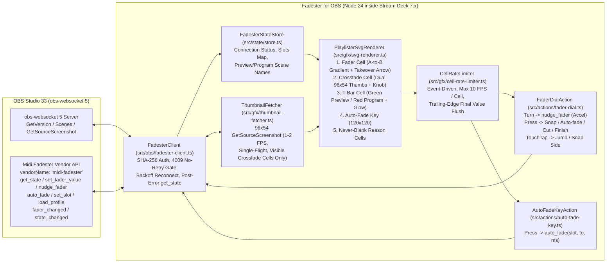

# Fadester for OBS — Implementation Plan

Status: 2026-10-27 (Phase 0 — Plan Only, Awaiting Operator Approval).
Companion to [REQUIREMENTS.md](REQUIREMENTS.md), [API-CONTRACT.md](API-CONTRACT.md), [GRAPHICS-NOTES.md](GRAPHICS-NOTES.md), [UI-NOTES.md](UI-NOTES.md), and [IDEAS.md](IDEAS.md).
Coding waits until: (1) the operator approves this plan and decisions `D-1..D-4`, and (2) Midi Fadester's `midi-fadester` vendor API (its PLAN item 6) is pushed and aligned to [API-CONTRACT.md](API-CONTRACT.md).

---

## 1. Local Machine, Stream Deck Runtime & Toolchain Audit (Verified 2026-10-27)

| Component | Verified Path / Version | Notes |
|---|---|---|
| **Workspace** | `C:\streamdeck-fadester` (`origin`: `https://github.com/jbrick2070/streamdeck-fadester`) | Branch `main`, `LICENSE` is `GPL-2.0` (`22e076a`). |
| **Elgato Stream Deck App** | `C:\Program Files\Elgato\StreamDeck\StreamDeck.exe` (`7.4.2.22730`) | Installed and verified on this machine. |
| **Bundled Node.js Runtimes** | `C:\Users\jeffr\AppData\Roaming\Elgato\StreamDeck\NodeJS\24.22.1\node.exe` (`v24.22.1`)<br>`C:\Users\jeffr\AppData\Roaming\Elgato\StreamDeck\NodeJS\20.20.2\node.exe` (`v20.20.2`) | Shipped inside the Stream Deck app so end users install nothing (`R-STK-1`). |
| **Elgato Stream Deck SDK** | `@elgato/streamdeck` **`3.0.3`** (current major), `@elgato/cli` **`1.10.3`** | Verified on npm (`engines.node >= 20.5.1`, `SDKVersion: 3`, `Nodejs.Version: "24"`). |
| **Host Node / npm (Build & Test)** | Node `v25.9.0`, npm `11.12.1` | Used for local TypeScript build (`rollup`) and headless unit tests (`vitest`). |
| **Portable OBS Studio 33.0.0** | `C:\Users\jeffr\OBS-Studio-33-Portable\bin\64bit\obs64.exe` | Target for live hardware verification with `midi-fadester.dll` (`R-TST-3`). |
| **Sister Repositories (Read-Only)** | `C:\midi-fadester` and `C:\Users\jeffr\Documents\obs-playlister` | Inspected in strictly read-only mode (`R-STD-1`). |

### 1.1 Why We Pin `@elgato/streamdeck` `3.0.3` and `Nodejs.Version: "24"` (`D-1`)
- `@elgato/streamdeck` **`3.0.3`** is the current major release of Elgato's official TypeScript SDK. It pairs with `SDKVersion: 3` and `Nodejs.Version: "24"` in `manifest.json` (`Software.MinimumVersion: "7.1"`).
- Stream Deck `7.4.2.22730` on this machine already ships Node **`v24.22.1`** inside `%APPDATA%\Elgato\StreamDeck\NodeJS\24.22.1\node.exe`, providing native `node:crypto` SHA-256 and modern ES2022 performance out of the box with zero user setup.
- If compatibility with older Stream Deck `6.9–7.0` installations is ever desired, switching `manifest.json` to `SDKVersion: 2` and `Nodejs.Version: "20"` (`v20.20.2`) requires changing only two lines in `manifest.json`.

### 1.2 Why We Recommend Our Own Small Typed `obs-websocket` 5 Client (`D-2`)
- Rather than pulling in `obs-websocket-js` (`5.0.8`), we recommend a focused, strictly-typed client of our own (`src/obs/fadester-client.ts`, ~220 lines) built directly on `ws` (which `@elgato/streamdeck` already includes) and Node's built-in `node:crypto`:
  1. **Exact Protocol Surface:** We only need `OpCode 0 Hello` → SHA-256 challenge-response → `OpCode 1 Identify` (`eventSubscriptions: (1 << 9) | (1 << 2)` = `516` for `Vendors | Scenes`) → `OpCode 2 Identified`, `OpCode 6/7` for `GetVersion`, `GetCurrentPreviewScene`, `GetCurrentProgramScene`, `GetSourceScreenshot`, and `CallVendorRequest("midi-fadester", ...)`, and `OpCode 5 Event` for `VendorEvent`, `CurrentPreviewSceneChanged`, and `CurrentProgramSceneChanged`.
  2. **Deterministic Error & Close-Code Handling:** On WebSocket close code `4009` (`AuthenticationFailed`), our client immediately transitions to `"Wrong password. Check OBS Tools > WebSocket Server Settings > Show Connect Info."` and **halts automatic retries** (`R-CON-3`). On `CallVendorRequest` status `600` after `GetVersion` succeeds, it deterministically reports `"Midi Fadester is not installed in OBS"`.
  3. **Zero Extra Runtime Dependencies:** Keeps the bundled plugin lean, eliminates third-party wrapper quirks, and makes fake-server unit and mutation testing 100% deterministic.

---

## 2. Pre-Planning Technical Audit Findings (`API-CONTRACT.md` & `GRAPHICS-NOTES.md`)

### 2.1 Two-Layer Error Reporting & Post-Error State Resync (`API-CONTRACT.md` Lines 50–55)
- In `obs-websocket` 5, transport-level failures (such as calling an unregistered vendor `"midi-fadester"` when Midi Fadester is not installed, or calling an unknown `requestType`) return `requestStatus: { result: false, code, comment }` on the outer `RequestResponse` message.
- Because `obs-websocket-api.h`'s `obs_websocket_request_callback_function` returns `void` and cannot set the outer `requestStatus`, Midi Fadester returns vendor-level validation errors (such as unknown slot ID or unknown source name) inside `responseData` as `{ error: "<sentence>", comment: "<sentence>" }`.
- **Our Client Rule (`R-API-4`):** `FadesterClient.callVendor()` checks both `requestStatus.result === false` AND `typeof responseData?.error === "string"`. On either error, it surfaces the human-readable `comment` sentence directly (never guessing) and automatically invokes `get_state` to resync local state (`API-CONTRACT.md` line 14: *"Surfaces call it on connect and after any error"*).

### 2.2 Playlister Runtime SVG Architecture on Stream Deck + (`200 × 100` & `120 × 120`)
- Each Stream Deck + dial has a `200 × 100` px touch cell; each key is a `120 × 120` px LCD (`GRAPHICS-NOTES.md`).
- Instead of relying only on rigid stock bars that cannot draw dual `96 × 54` live source thumbnails, soft-takeover pickup arrows at the bar's end, or green Preview / red Program T-bar scene labels with transition glow, we define a custom full-canvas layout (`layouts/fader-cell.json` containing a single `200 × 100` `pixmap` item named `canvas`) and render crisp SVG strings (`data:image/svg+xml;utf8,...`) at runtime via `setFeedback({ canvas })` (for dials) and `setImage(svgDataUri)` (for keys).
- **Playlister Visual Grammar (`R-GFX-1`):**
  - Dark background (`#0B1020` → `#111827` vertical panel gradient).
  - Playlister blue-to-violet gradient (`#2563EB` → `#7C3AED`) for fader bars, with source-pair tinting on A-to-B crossfades.
  - Crisp white glyphs and text (`#F8FAFC`, bold sans-serif), maximum **two lines of text** per cell, and **nothing thinner than `3 px`** (`stroke-width >= 3`, bar heights `>= 16 px`).
  - Orange accents (`#F97316` / `#D97706`) for active fader caps, the soft-takeover pickup arrow (`▲` / `▼`) at the bar's target end, and T-bar active transition glow.
  - Green (`#22C55E`) for Preview scene name (left) and Red (`#EF4444`) for Program scene name (right) in the T-bar cell.

### 2.3 Event-Driven Updates, Per-Cell Rate Cap (10 FPS), and Live Thumbnails (1–2 FPS)
- **No Polling Loops (`R-GFX-6`):** Cell redraws happen only in response to events (`fader_changed`, `state_changed`, `CurrentPreviewSceneChanged`, `CurrentProgramSceneChanged`, connection status changes, and Stream Deck action events).
- **Per-Cell 10 FPS Cap (`src/gfx/cell-rate-limiter.ts`):** Even though Midi Fadester coalesces `fader_changed` to 30/sec per slot, `GRAPHICS-NOTES.md` specifies ~10 updates/sec per cell. Our per-cell rate limiter enforces a minimum `100 ms` spacing between `setFeedback` / `setImage` calls per cell, coalescing intermediate values during a fast fader sweep and always scheduling a trailing flush so the final resting value (`0%`, `100%`, or takeover lock) is guaranteed to render.
- **1–2 FPS Live Thumbnails in Crossfade Cell (`src/gfx/thumbnail-fetcher.ts`):**
  - Active only when a visible **Fader** dial is bound to a slot with `target_mode === "crossfade_ab"`, `available === true`, and per-action `showThumbnails === true` (on by default for the crossfade cell, off on keys).
  - Requests `GetSourceScreenshot` (`imageWidth: 96, imageHeight: 54, imageFormat: "jpg", imageCompressionQuality: 75`) for `source_a` and `source_b` at **1 to 2 FPS** (`750 ms` default interval while visible, with single-flight deduplication so a slow frame never queues overlapping requests) and stops immediately on `willDisappear`, slot mode change, or disconnect.

---

## 3. Target Architecture & File Layout



### 3.1 Repository File Layout (`C:\streamdeck-fadester`)

```text
C:\streamdeck-fadester\
  API-CONTRACT.md                          Shared vendor API contract (source of truth)
  GRAPHICS-NOTES.md                        Deck graphics design notes (launch vs later phases)
  UI-NOTES.md                              Shared Fadester UI notes
  IDEAS.md                                 Future Visual Sidechain & Playlister ideas
  MIDI-FADESTER-PROPOSAL.md                Original Midi Fadester proposal notes
  LICENSE                                  GPL-2.0
  README.md                                Project overview, third-party & AI disclosures
  REQUIREMENTS.md                          Numbered requirements (R-*) & decisions (D-*)
  PLAN.md                                  This implementation plan
  package.json                             Pinned @elgato/streamdeck 3.0.3, vitest, rollup, typescript
  tsconfig.json                            Strict TypeScript configuration (ES2022)
  rollup.config.mjs                        Bundles src/plugin.ts -> com.jbrick2070.fadester-for-obs.sdPlugin/bin/plugin.js
  com.jbrick2070.fadester-for-obs.sdPlugin/
    manifest.json                          Name: "Fadester for OBS", SDKVersion: 3, Nodejs: "24", 2 launch actions
    layouts/
      fader-cell.json                      200x100 full-canvas pixmap layout for runtime Playlister SVG dial cells
    imgs/
      plugin/                              Original Playlister-styled plugin & category icons (no OBS/Elgato logos)
      actions/
        fader/                             Fader dial action icon
        auto-fade/                         Auto-fade key action icon
    ui/
      fader-dial.html                      Property Inspector for Fader (dial) + shared Connection panel
      auto-fade-key.html                   Property Inspector for Auto-fade (key) + shared Connection panel
      pi-common.js                         Shared Property Inspector controller (global connection, status, live slots)
  src/
    plugin.ts                              Entry point: registers actions, initializes FadesterClient & store
    types/
      contract.ts                          Exact TypeScript types for API-CONTRACT.md requests, Slot, events, errors
      settings.ts                          Global connection settings & per-action settings types
    obs/
      fadester-client.ts                   Typed obs-websocket 5 + midi-fadester vendor client, auth, 4009 gate, backoff
    state/
      fadester-store.ts                    Reactive state store (connection status sentence, slots, scene names)
    gfx/
      palette.ts                           Playlister family colors, gradients, >= 3 px geometry constants
      svg-renderer.ts                      Pure functions generating 200x100 dial SVGs & 120x120 key SVGs
      cell-rate-limiter.ts                 Event-driven per-cell rate limiter (max 10 FPS, trailing flush)
      thumbnail-fetcher.ts                 1-2 FPS 96x54 GetSourceScreenshot manager with single-flight guard
    actions/
      dial-math.ts                         Pure step-per-tick, velocity acceleration, press target, and tapPos math
      fader-dial.ts                        Stream Deck + Encoder action ("Fader")
      auto-fade-key.ts                     Stream Deck Keypad action ("Auto-fade")
  tests/
    helpers/
      fake-obs-server.ts                   Real-WebSocket fake obs-websocket 5 + midi-fadester server for tests
    fadester-client.test.ts                Connect, SHA-256 auth, 4009 no-retry, reconnect, all 6 requests, events, errors
    dial-math.test.ts                      Step sizes (1/2/5%), acceleration curve, press actions, touchTap coordinate math
    svg-renderer.test.ts                   Fader, Crossfade thumbnail, T-bar, Auto-fade key, Never-Blank reasons, >= 3px rule
    rate-limiter-thumbnails.test.ts        10 FPS cell cap, trailing flush, 1-2 FPS thumbnail cap, single-flight, visibility stop
    actions-integration.test.ts            End-to-end Fader dial & Auto-fade key interaction against fake-obs-server
```

---

## 4. Phased Implementation Plan, Per-Step Tests & Mutation Checks

### Phase 0 — Requirements, Plan, and README (Current Step — No Code)
1. Read `START-PROMPT.md`, `API-CONTRACT.md`, `UI-NOTES.md`, `MIDI-FADESTER-PROPOSAL.md`, `GRAPHICS-NOTES.md`, `IDEAS.md`, and `C:\midi-fadester`'s `REQUIREMENTS.md` and `PLAN.md`.
2. Write `README.md`, `REQUIREMENTS.md`, and `PLAN.md` in `C:\streamdeck-fadester`.
3. Commit and push once to `origin/main`, run post-push checks (`HEAD == origin/main`, zero 0-byte files, zero BOMs, zero banned words), and **STOP** for operator review.

---

### Phase 1 — Launch Set: `Fader` (Dial), `Auto-fade` (Key), and Launch Runtime SVG Cells

#### Step 1.1: Project Scaffold, `manifest.json`, `layouts/fader-cell.json`, and Own Icons
- Create `package.json`, `tsconfig.json`, `rollup.config.mjs`, `.gitignore`, and the `com.jbrick2070.fadester-for-obs.sdPlugin/` bundle layout.
- Author `manifest.json` with `Name: "Fadester for OBS"`, `SDKVersion: 3`, `Nodejs.Version: "24"`, `Software.MinimumVersion: "7.1"`, and the two launch actions (`com.jbrick2070.fadester-for-obs.fader` on `["Encoder"]` with `Encoder.layout: "layouts/fader-cell.json"`, and `com.jbrick2070.fadester-for-obs.auto-fade` on `["Keypad"]`).
- Create original Playlister-styled SVG/PNG icons (`imgs/`).
- **Step 1.1 Automated Tests:**
  - `manifest-hygiene.test.ts`: Verifies `manifest.json` parses cleanly, `Name === "Fadester for OBS"`, `Actions.length === 2`, `layouts/fader-cell.json` exists and defines a `200 × 100` `pixmap` canvas, all referenced icon files exist and are non-empty, and all repo files have UTF-8 without BOM, `SPDX-License-Identifier: GPL-2.0-or-later` headers on code files, and zero occurrences of the banned placeholder word.
- **Step 1.1 Mutation Checks:**
  - *Mutation 1.1a:* Change `manifest.json` `Name` away from `"Fadester for OBS"` or add a 3rd action → `manifest-hygiene.test.ts` MUST fail.
  - *Mutation 1.1b:* Inject a UTF-8 BOM (`0xEF 0xBB 0xBF`) or missing SPDX header into a `.ts` file → `manifest-hygiene.test.ts` MUST fail.

#### Step 1.2: Typed `obs-websocket` 5 Client & Fake `obs-websocket` 5 Server (`src/obs/`, `tests/helpers/`)
- Implement `tests/helpers/fake-obs-server.ts` speaking real WebSocket (`ws`) for `obs-websocket` 5 (`Hello` with optional SHA-256 auth challenge, `Identify`, `Identified`, `GetVersion`, `GetCurrentPreviewScene`, `GetCurrentProgramScene`, `GetSourceScreenshot`, `CallVendorRequest` for all 6 `midi-fadester` requests, `VendorEvent` emission, close code `4009`, transport error `600`, and vendor `{ error, comment }` responses).
- Implement `src/obs/fadester-client.ts` and `src/state/fadester-store.ts`:
  - Connection handshake, SHA-256 auth challenge response, `GetVersion` + `get_state` on connect.
  - All 6 contract requests: `get_state`, `set_fader_value`, `nudge_fader`, `auto_fade`, `set_slot`, `load_profile`.
  - Vendor events (`fader_changed`, `state_changed`) and OBS scene events (`CurrentPreviewSceneChanged`, `CurrentProgramSceneChanged`).
  - Automatic `get_state` call after any transport or vendor validation error (`R-API-4`).
  - Exponential backoff reconnect on socket drop/refusal, and **strict retry halt on `4009` wrong password** (`R-CON-3`).
- **Step 1.2 Automated Tests (`fadester-client.test.ts`):**
  - Connects without password and with password; verifies status string `"Connected: OBS 33.0.0, Midi Fadester 0.1.0"`.
  - Verifies wrong password (`4009`) sets status `"Wrong password. Check OBS Tools > WebSocket Server Settings > Show Connect Info."` and makes **0 reconnect attempts** over fake-timer advancement until `updateSettings()` or `reconnectNow()` is called.
  - Verifies OBS unreachable (`ECONNREFUSED`) sets status `"OBS is not running or the websocket is off (Tools > WebSocket Server Settings)"` and reconnects with backoff when the server starts.
  - Verifies missing vendor (`code: 600`) sets status `"Midi Fadester is not installed in OBS"` with release link metadata.
  - Exercises all 6 requests (`get_state`, `set_fader_value` with/without `release: true`, `nudge_fader`, `auto_fade`, `set_slot`, `load_profile`) and verifies exact request/response payloads.
  - Exercises vendor validation error (`{ error, comment }` on `fader_9` or unknown source in `set_slot`), verifying the exact `comment` sentence is surfaced and `get_state` is automatically called immediately afterward.
  - Exercises `fader_changed` (`midi`, `ui`, `api`, `auto_fade` origins) and `state_changed` events updating the store.
- **Step 1.2 Mutation Checks:**
  - *Mutation 1.2a:* Remove the `closeCode === 4009` guard in the reconnect scheduler → the wrong-password no-retry test MUST fail (detecting extra connection attempts).
  - *Mutation 1.2b:* Remove the post-error `this.getState()` call in `callVendor()` → the error-resync test MUST fail (verify `get_state` call count after error drops from `2` to `1`).
  - *Mutation 1.2c:* Ignore `responseData.error` when outer `requestStatus.result === true` → the vendor validation error test MUST fail.

#### Step 1.3: Playlister Runtime SVG Renderer, Per-Cell Rate Limiter, and 1–2 FPS Thumbnail Manager (`src/gfx/`)
- Implement `src/gfx/palette.ts` and `src/gfx/svg-renderer.ts`:
  - **Fader Cell (`200 × 100` SVG):** Dark Playlister background, slot label + big percent (`<= 2` lines of text), `>= 3 px` strokes, A-to-B blue-to-violet gradient bar (`#2563EB → #7C3AED`), orange fader cap, and orange soft-takeover arrow (`▲` for `"up"`, `▼` for `"down"`) at the bar's end when `takeover_pending !== "none"`.
  - **Crossfade Cell with Live Thumbnails (`200 × 100` SVG):** Two `96 × 54` `<image>` elements for `source_a` (left) and `source_b` (right) with active-mix border highlights, the A-to-B crossfade bar and orange fader knob drawn between/below them, and live percent readout. Falls back cleanly to the standard Fader cell if thumbnails are disabled on that action or before the first screenshot arrives.
  - **T-Bar Cell (`200 × 100` SVG):** Preview scene name in green (`#22C55E`) on the left, Program scene name in red (`#EF4444`) on the right, T-bar track and fill bar between them, and an orange/violet glow border (`stroke-width >= 3`) while a transition is in progress (`0 < value < 1`).
  - **Auto-Fade Key (`120 × 120` SVG):** Slot label, big live percent (`0%`–`100%`), target indicator (`→ 100%` or `→ 0%`), and Playlister blue-to-violet bottom bar.
  - **Never-Blank Status Cells (`200 × 100` and `120 × 120` SVG):**
    - `target_mode === "unassigned"` → `"Unassigned, set in OBS"`
    - `available === false` → `slot.reason` verbatim (e.g., `"Studio Mode is off"`, `"Source 'Loop 3' not found"`)
    - Disconnected → one-line connection status reason.
- Implement `src/gfx/cell-rate-limiter.ts` (event-driven, max 10 FPS / `100 ms` per cell with trailing flush) and `src/gfx/thumbnail-fetcher.ts` (1–2 FPS `GetSourceScreenshot` at `96 × 54`, single-flight deduplication, active only for visible crossfade cells with `showThumbnails: true`).
- **Step 1.3 Automated Tests (`svg-renderer.test.ts`, `rate-limiter-thumbnails.test.ts`):**
  - Verifies valid XML/SVG structure, `viewBox="0 0 200 100"` (dials) and `viewBox="0 0 120 120"` (keys), Playlister palette colors, max 2 text lines, and that every `stroke-width` attribute in generated SVGs is `>= 3`.
  - Verifies Fader cell includes takeover arrow glyph when `takeover_pending` is `"up"` or `"down"` and omits it when `"none"`.
  - Verifies T-bar cell renders Preview name in green (`#22C55E`), Program name in red (`#EF4444`), and transition glow only when `0 < value < 1`.
  - Verifies Crossfade thumbnail cell embeds both `96 × 54` `data:image/jpeg;base64,...` screenshots and the fader knob.
  - Verifies Never-Blank rule: unassigned renders `"Unassigned, set in OBS"`, unavailable renders exact `slot.reason`, disconnected renders exact connection reason, and no state ever produces an empty SVG or blank text.
  - Verifies `CellRateLimiter`: feeding 30 `fader_changed` events over `1000 ms` emits at most 10–11 renders and always flushes the final value `1.0`.
  - Verifies `ThumbnailFetcher`: fetches `GetSourceScreenshot` at `96 × 54` at `<= 2 FPS`, skips concurrent requests when one is in flight, does not fetch when `showThumbnails === false` or `target_mode !== "crossfade_ab"`, and stops immediately on `willDisappear`.
- **Step 1.3 Mutation Checks:**
  - *Mutation 1.3a:* Set any SVG `stroke-width` to `1` or `2` → `svg-renderer.test.ts` (`>= 3 px` rule assertion) MUST fail.
  - *Mutation 1.3b:* Replace `slot.reason` with a hardcoded string when `available === false` → `svg-renderer.test.ts` MUST fail.
  - *Mutation 1.3c:* Disable trailing-edge flush in `CellRateLimiter` → `rate-limiter-thumbnails.test.ts` final-value delivery test (`100%` endpoint check) MUST fail.
  - *Mutation 1.3d:* Remove the single-flight guard in `ThumbnailFetcher` while simulating a slow `GetSourceScreenshot` response → `rate-limiter-thumbnails.test.ts` MUST fail.

#### Step 1.4: Launch Actions (`Fader` Dial & `Auto-fade` Key) and Property Inspector (`src/actions/`, `ui/`)
- Implement `src/actions/dial-math.ts`:
  - `computeDialDelta(ticks, stepPerTick, acceleration, elapsedMs)`: applies `1%`, `2%` (default), or `5%` per tick with velocity acceleration (`1×`, `2×`, `3×`).
  - `resolveDialPressCommand(slotValue, pressAction)`: maps `Snap 0/100`, `Auto-fade 1 s`, `Auto-fade 2 s`, `Cut`, and `Finish T-bar` (plus `Auto-fade 3 s` on long press `>= 500 ms` per `D-3`) to exact `set_fader_value` or `auto_fade` requests.
  - `mapTouchTapToValue(tapX, targetMode)`: maps `0..200` px tap coordinate with `20 px` left/right snap zones (`x <= 20 → 0.0`, `x >= 180 → 1.0`, linear `(x - 20) / 160` in between; in Crossfade thumbnail mode, tapping the left `96 px` thumbnail snaps to `0.0` and tapping the right `96 px` thumbnail snaps to `1.0`).
- Implement `src/actions/fader-dial.ts` (`Fader`) and `src/actions/auto-fade-key.ts` (`Auto-fade`).
- Implement `ui/fader-dial.html`, `ui/auto-fade-key.html`, and `ui/pi-common.js` (host/port/password inputs, live status banner with clickable Midi Fadester link when missing, **Connect / Test** button, and live Slot dropdown showing each slot's `name`, `label`, and `reason` when unavailable).
- **Step 1.4 Automated Tests (`dial-math.test.ts`, `actions-integration.test.ts`):**
  - Verifies `computeDialDelta` for `1%`, `2%`, `5%`, clockwise/counter-clockwise ticks, and acceleration on/off.
  - Verifies all 5 press modes (`Snap 0/100`, `Auto-fade 1 s`, `Auto-fade 2 s`, `Cut`, `Finish T-bar`) and long-press `Auto-fade 3 s`.
  - Verifies `onTouchTap` coordinate mapping at left edge (`x = 10 → 0.0`), center (`x = 100 → 0.5`), right edge (`x = 190 → 1.0`), and thumbnail left/right snap.
  - End-to-end integration test with `fake-obs-server`: dropping `Fader` on a dial binds to `"crossfader"`, turning calls `nudge_fader`, pressing runs `auto_fade` / `set_fader_value`, external `fader_changed` from `"midi"` updates the dial's SVG feedback (`0%` → `42%` → `100%`), and pressing the `Auto-fade` key calls `auto_fade` while displaying live percent on the key SVG.
- **Step 1.4 Mutation Checks:**
  - *Mutation 1.4a:* Invert the `< 0.5` toggle threshold or omit `release: true` in `Finish T-bar` / `Snap 0/100` → `dial-math.test.ts` MUST fail.
  - *Mutation 1.4b:* Unsubscribe `FaderDialAction` from `fader_changed` store updates → `actions-integration.test.ts` APC40-to-dial sync test MUST fail.

#### Step 1.5: Bundle Validation & Live Hardware Verification (`streamdeck validate` + Portable OBS 33)
- Build the plugin bundle (`npm run build`), run the full automated test suite (`npm test`), validate with `@elgato/cli` (`npx streamdeck validate`), link into Stream Deck (`npx streamdeck link`), and execute the Manual Hardware Verification Checklist (Section 5) against portable OBS 33 (`C:\Users\jeffr\OBS-Studio-33-Portable`) and the physical Stream Deck +.

---

### Phases 2–4 Roadmap (Listed from `GRAPHICS-NOTES.md` and `IDEAS.md` — Not Built at Launch)

#### Phase 2 — Extended Fader & Scene Graphics (`GRAPHICS-NOTES.md` #4, #7, #11, #12)
- **Auto-Fade Countdown Cell (`#4`):** While a timed `auto_fade` is active on a slot, sweep the dial bar and render a live remaining-time countdown (`1.8 s → 0.0 s`).
- **Status Key (`#12`):** `120 × 120` key displaying OBS + APC40 connection state and a MIDI activity dot that blinks on incoming `fader_changed` (`origin: "midi"`); pressing triggers immediate Reconnect.
- **Fade-to-Black Key (`#11`):** `120 × 120` gradient square key that progressively darkens as a timed Fade-to-Black runs.
- **Scene Keys with Live Thumbnails (`#7`):** `120 × 120` scene keys with optional `1 FPS` live `GetSourceScreenshot` thumbnails (off by default on keys), framed in red (`#EF4444`) when live in Program and green (`#22C55E`) when in Preview.

#### Phase 3 — Visual Sidechain Meters, 800 px Idle Strip & VJ Performance Controls (`GRAPHICS-NOTES.md` #5, #6, #8–#10; `IDEAS.md` #1–#8)
- **Meter Dial Cells (`GRAPHICS-NOTES.md` #5, `IDEAS.md` #7):** Render bass, mid, and high bars on dial touch cells from Visual Sidechain signal events, flash on kick detections, and draw a beat-phase sweep indicator.
- **800 × 100 Idle Strip Spectrum (`GRAPHICS-NOTES.md` #6):** When dial cells are unassigned, coordinate all four `200 × 100` cells into one continuous `800 × 100` VU spectrum display between songs.
- **Safety & Performance Keys (`GRAPHICS-NOTES.md` #8–#10, `IDEAS.md` #1–#6):**
  - **Panic Key:** Red `120 × 120` key with a bold glyph that inverts while held and zeroes every strobe and flash amount at once.
  - **Freeze Key:** Snowflake glyph that turns ice-blue while holding visual analysis state.
  - **Tap Tempo & Beat Nudge:** Key displays live BPM, flashes on each tap, and pulses on the beat; companion dial nudges beat phase.
  - **Fade on the One:** Dial press or key arms an `auto_fade` quantized to the next downbeat / bar / 4 bars from the beat phase.
  - **Ride the Reactivity, Visual EQ & Recorded Rides:** Bind fader slots to Visual Sidechain reactivity drive, 8-band FFT scaling, and looping hand-drawn fader rides.

#### Phase 4 — Playlister Tie-Ins & Elgato Marketplace Submission (`IDEAS.md` #9, #10; `START-PROMPT.md`)
- **Playlister Integration (`IDEAS.md` #9, #10):** Cut-on-the-kick playlist advance and dial folder scrubbing / live still-duration fader.
- **Elgato Marketplace Release (`D-4`):** Finalize store assets, descriptions, and release package for Elgato Marketplace review.

---

## 5. Manual Hardware Verification Checklist (Real Stream Deck + & Portable OBS 33)

Target environment:
- **OBS Studio 33.0.0 Portable:** `C:\Users\jeffr\OBS-Studio-33-Portable\bin\64bit\obs64.exe` with `midi-fadester.dll` installed in `plugins\midi-fadester\`.
- **Stream Deck Desktop App:** `7.4.2.22730` with a physical **Stream Deck +** (4 rotary dials, `800 × 100` touch strip, 8 LCD keys) and **Akai APC40 mkII**.

| # | Check | Expected Result |
|---|---|---|
| `M-1` | **OBS Closed / WebSocket Off** | Close OBS. Every **Fader** dial cell and **Auto-fade** key shows the one-line reason `"OBS is not running or websocket is off"`, and the Property Inspector status reads `"OBS is not running or the websocket is off (Tools > WebSocket Server Settings)"`. |
| `M-2` | **Wrong Password (No Silent Retries)** | Start portable OBS 33 with WebSocket auth enabled; enter an invalid password in the Property Inspector. Status immediately shows `"Wrong password. Check OBS Tools > WebSocket Server Settings > Show Connect Info."` and OBS WebSocket logs show **no** repeated failed login attempts. |
| `M-3` | **Missing Midi Fadester Detection** | Temporarily rename `plugins\midi-fadester` and start OBS 33. Property Inspector shows `"Midi Fadester is not installed in OBS"` with a clickable link to Midi Fadester, and dials show `"Midi Fadester is not installed in OBS"`. Restore `plugins\midi-fadester`. |
| `M-4` | **Connected Status & Live Slot Dropdown** | With OBS 33 + Midi Fadester running, Property Inspector status turns green: `"Connected: OBS 33.0.0, Midi Fadester 0.1.0"`. Dropping **Fader** on Dial 1 binds to `Crossfader` automatically; opening the Slot dropdown lists `Crossfader`, `Fader 1..8`, and `Master` with their live labels and `reason` when unavailable. |
| `M-5` | **Never-Blank Cells (`Unassigned` & `Unavailable`)** | Bind a dial to an unassigned slot (`Fader 8`) → dial cell displays `"Unassigned, set in OBS"`. Bind a dial to `Crossfader` (`tbar`) and turn Studio Mode **off** in OBS → dial cell immediately displays `"Studio Mode is off"`. |
| `M-6` | **T-Bar Dial Cell (`tbar` Mode)** | Turn Studio Mode **on** in OBS. Dial 1 (`Crossfader`) renders the **T-bar cell**: Preview scene name in green on the left, Program scene name in red on the right, T-bar bar in between. Turn Dial 1 slowly (2% steps) and quickly (accelerated sweep): OBS T-bar moves smoothly, an orange/violet glow appears mid-transition, and reaching 100% or pressing the dial (`Finish T-bar` / `Snap 0/100`) completes the transition and updates the green/red scene names. |
| `M-7` | **Fader Cell (`layer_opacity` / `audio_volume`) & Soft-Takeover Arrow** | Bind Dial 2 to `Fader 1` (`Layer Opacity`). Dial cell shows the Playlister **A-to-B blue-to-violet gradient bar** and big percent. Turn Dial 2 to `80%`, then move physical Track Fader 1 on the APC40 mkII from `10%`: while `takeover_pending` is `"up"`, Dial 2 draws the orange **`▲`** arrow at the bar's end; as the APC40 fader crosses `80%`, the arrow clears and both surfaces track together at 30 Hz coalesced / 10 FPS rendered. |
| `M-8` | **Crossfade Cell with Live `96 × 54` Thumbnails (`crossfade_ab`)** | Configure `Fader 2` in OBS as a Two-Source Crossfade (`Cam 1 -> Loop 3`) and bind Dial 3 with **Live Thumbnails** enabled. Dial 3 renders two live `96 × 54` screenshots of `Cam 1` and `Loop 3` updating at 1–2 FPS with the fader knob between them. Tap the left thumbnail on the touch strip → snaps to `0%` (`Cam 1`); tap the right thumbnail → snaps to `100%` (`Loop 3`). |
| `M-9` | **Dial Press & Long Press Modes** | Test `Snap 0/100`, `Auto-fade 1 s`, `Auto-fade 2 s`, `Cut`, `Finish T-bar`, and `Long Press (3 s)` on Dial 1/2/3. Each press executes the exact transition or timed fade in OBS. |
| `M-10` | **Auto-Fade Key (`120 × 120` LCD)** | Drop **Auto-fade** on Key 1 (`Slot: Fader 2`, `To: 100%`, `Duration: 2 s`). Key displays the live percent (`0%`) and Playlister progress bar. Press Key 1: OBS runs the 2 s fade to `100%` while both Key 1 and Dial 3 animate to `100%`. |

---

## 6. Risk Register (`R1 .. R6`)

| ID | Risk | Mitigation |
|---|---|---|
| `R1` | **`obs-websocket` 5 Vendor Callback Cannot Set Outer `requestStatus`** | Per `API-CONTRACT.md` lines 52–54, `FadesterClient` inspects both outer `requestStatus.result === false` (transport/missing-vendor errors) and inner `responseData.error` / `responseData.comment` (vendor validation errors), and calls `get_state` after any error. |
| `R2` | **Wrong Password Causes Endless Reconnect Spam in OBS Logs** | Explicitly detect WebSocket close code `4009` (`AuthenticationFailed`), display `"Wrong password. Check OBS Tools > WebSocket Server Settings > Show Connect Info."`, and halt automatic reconnect timers until credentials change or the user clicks **Connect / Test** (`R-CON-3`). |
| `R3` | **`GetSourceScreenshot` Traffic Overwhelms `obs-websocket` or Stream Deck** | Thumbnails are `96 × 54` compressed JPEG (`quality: 75`), capped at 1–2 FPS, guarded by a single-flight lock, active only on visible dials (`willAppear` → `willDisappear`) in `crossfade_ab` mode, and toggleable per action (`R-GFX-3`, `R-GFX-6`). |
| `R4` | **Fast APC40 Fader Sweeps Flood Stream Deck `setFeedback` IPC** | Midi Fadester coalesces `fader_changed` to 30/sec per slot, and our `CellRateLimiter` caps Stream Deck `setFeedback` / `setImage` calls to 10/sec (`100 ms`) per cell with a guaranteed trailing-edge flush (`R-GFX-6`). |
| `R5` | **Stream Deck + Touch Strip Has No Drag Event for T-Bar Scrubbing** | Documented in `START-PROMPT.md`: rotary dial turning (`nudge_fader` with acceleration) handles continuous scrubbing, while `onTouchTap` uses `tapPos[0]` to jump to the tapped position or snap to the left/right source (`R-ACT-1`). |
| `R6` | **Unassigned or Unavailable Slot Leaves a Dial Seemingly Dead** | `SvgRenderer` enforces the Never-Blank Rule (`R-GFX-5`): `unassigned` shows `"Unassigned, set in OBS"`, `available: false` shows `slot.reason` verbatim (`"Studio Mode is off"`, `"Source 'X' not found"`), and disconnected cells show the connection reason. |

---

## 7. Operator Decisions for Approval (`D-1 .. D-4`)

Please confirm or adjust these four decisions before Phase 1 coding begins:

1. **`D-1` — SDK & Node.js Versions:**
   - **Recommendation:** Pin **`@elgato/streamdeck` `3.0.3`** (current major), **`@elgato/cli` `1.10.3`**, `SDKVersion: 3`, and **`Nodejs.Version: "24"`** (`Software.MinimumVersion: "7.1"`), matching the Node `v24.22.1` runtime already bundled in Stream Deck `7.4.2.22730` on this machine.
2. **`D-2` — `obs-websocket` 5 Client Library:**
   - **Recommendation:** Use **our own small, strictly-typed client (`src/obs/fadester-client.ts`, ~220 LOC)** over `ws` (bundled by `@elgato/streamdeck`) and `node:crypto` SHA-256, rather than `obs-websocket-js` (`5.0.8`).
3. **`D-3` — Dial Long-Press (`Auto-fade 3 s`):**
   - **Recommendation:** **Enable by default:** holding the dial for `>= 500 ms` triggers a **3-second auto-fade (`ms: 3000`)** to the opposite rail, configurable in the Property Inspector (`Auto-fade 3 s` default, `Finish T-bar`, or `None`).
4. **`D-4` — Elgato Marketplace Listing (Later):**
   - **Recommendation:** Ship direct `.streamDeckPlugin` packages on GitHub Releases in Phase 1 while building all icons, manifest metadata, and `streamdeck validate` checks to Elgato Marketplace rules from day one; submit to the Elgato Marketplace in Phase 4 once hardware verification across the Fadester suite is complete.
