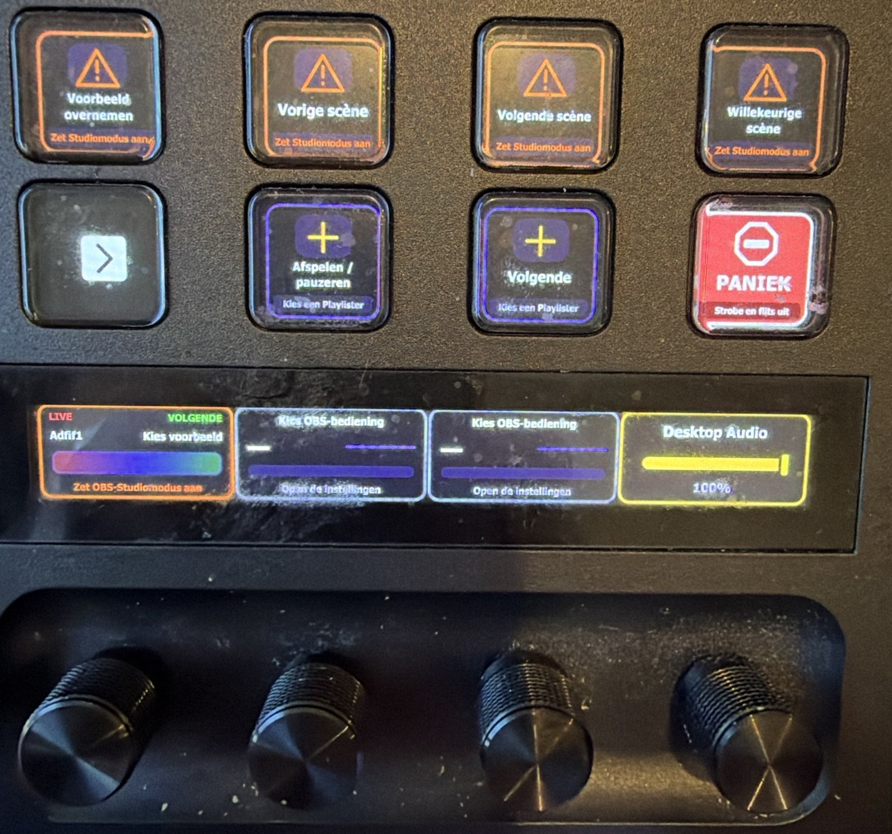

# Fadester for OBS

**Fadester for OBS 0.11.0** puts OBS Studio on your Stream Deck: scenes, transitions, sources, filters and audio on keys and dials. It talks to OBS's built-in WebSocket server, so you need no MIDI desk and no extra OBS plugin for the main controls. Fourteen ready-made layouts open from any control's settings page. Nine languages.



Needs Stream Deck 7.6 or later on Windows 10 or later or macOS 13.5 or later (Stream Deck 6.x is not supported), and OBS Studio with its WebSocket server on (tested with OBS 33). Works on a Stream Deck, Stream Deck +, Stream Deck Mini and Stream Deck Neo.

**One plugin, two products.** From 0.9.0 this plugin also carries [VJster](docs/vjster/README.md): speed and quality dials and keys that ride the video playing in Chrome or in an OBS browser source. Its seven actions sit in the same action list, named **VJster Speed** and so on. How it is built is in [docs/SUITE.md](docs/SUITE.md); VJster is still released on its own for decks with no OBS. It also runs in [OpenDeck](docs/OPENDECK.md), the free open-source alternative to Stream Deck software.

## First five minutes

**Using OpenDeck?** Follow the [OpenDeck quick start](docs/OPENDECK.md#first-five-minutes). The packaged plugin supplies a starter for the Plus, 15-key deck and Mini. The steps below are for Elgato’s Stream Deck software.

1. **Install the plugin.** Download the Fadester for OBS plugin file from the [Releases page](https://github.com/jbrick2070/streamdeck-fadester/releases/latest). Its name ends in `.streamDeckPlugin`. Double-click it. Stream Deck asks to install it: press **Install**.
2. **Turn on OBS's WebSocket server.** In OBS: **Tools > WebSocket Server Settings**, tick **Enable WebSocket server**, keep **Enable Authentication** on, and press **Show Connect Info** to see the password.
3. **Add one Fadester key.** In Stream Deck, drag **Scene & Transition** (category *Fadester for OBS*) onto a key and click it to open its settings. It starts as **Next scene**, so it is ready to press.
4. **Paste the password once.** Under **OBS connection**, paste the password and press **Save for all controls & test**. On the same computer keep host `127.0.0.1` and port `4455`. The status line under **OBS connection** says *Testing the connection…*, then *Connected: OBS 33...*; press the key and OBS moves to the next scene. Every Fadester key and dial on every layout now uses this connection; you never type it again.
5. **Open a ready-made layout.** In the same settings page, expand **Ready-made layouts**, pick one for your deck (**Scene Desk +** on a Stream Deck +, **Scene Desk 15 Keys** on a 15-key deck, **Source Desk Mini** on a Mini) and press **Open current starter layout**. The layout installs itself as an editable profile and your deck switches to it; your other profiles stay. A Studio Mode layout offers **Enable Studio Mode & open current starter layout** instead and prepares Preview for you; its button works once OBS is connected.
6. **Press the keys.** Previous, Next and Random already follow your OBS scene list; audio keys and dials already found your main audio and microphone. Change any key in its settings page whenever you like.

Stream Deck installs no profile by itself when it installs the plugin: a layout arrives the first time you open it, so your profile list stays yours. You can also import any layout's `.streamDeckProfile` file by double-clicking it ([profile library](profiles/README.md)).

**Upgrading from 0.9.x or earlier?** Fadester 0.10 uses a new plugin ID. Install it alongside the old version, enter the OBS password once for the new plugin, and open a fresh starter or replace old Fadester actions in a copy of your custom profile. Keep the old plugin until you’ve checked the new controls. The standalone VJster ID has not changed.

## Ready-made layouts

All fourteen are in [DECK-LAYOUTS.md](DECK-LAYOUTS.md), key by key. The layout's name says which OBS mode it is for: **Studio Mode**, **Regular Mode**, or **Either Mode**.

| You want to | Open | Stream Deck + | 15 keys | Mini |
|---|---|---|---|---|
| Switch scenes with Preview, then take them live | **Scene Desk (Studio Mode)** | yes | yes | |
| Switch scenes directly, no Preview | **Scene Desk (Regular Mode)** | yes | yes | |
| Show and hide the sources of one scene, fade audio | **Source Desk (Either Mode)**, or the **Half** version that leaves half the deck free | yes | yes | yes |
| Try blend modes and layer order | **Creative Layer Lab (Either Mode)** | yes | yes | |
| Drive a Playlister source (needs Playlister 0.5) | **Playlister Transport + (Either Mode)** | yes | | |
| Run a VJ set: four pages with Panic on every page | **VJ Rig (Studio Mode)** | yes | yes | |


Every layout is an editable copy: change, add or remove keys freely. Opening a layout a second time returns to your edited copy. Layouts never contain your password.

## The controls

Each control lives in the *Fadester for OBS* category of Stream Deck's action list. Drag one onto a key or dial and open its settings page.

**Scene & Transition** (key). A fixed scene, **Next scene**, **Previous scene**, **Random**, or **Current Preview**; then **Cut** or a chosen transition (OBS's current one, Fade, Fade to Black, or any transition installed in OBS). Cut and Transition work in both modes; Preview and Current Preview need Studio Mode. Numbered scene keys follow positions in your OBS scene list, so they work without setup.

**OBS Fader** (dial on a Stream Deck +). Turn to ride one audio input, or choose **Blend Live into Next scene**: the dial becomes a scene mixer with LIVE and NEXT names. Turn right all the way to take Next live, as with the APC40's crossfader; let the dial rest a moment, then turn right again for the next fade. A press takes Next live at any point. The scene mixer needs Studio Mode and two different scenes. **Dial press** is yours to choose: take Next live, next blend mode on the selected source, Normal blend, show or hide, or nothing. **Scene loop** can queue the next scene after each transition you finish, so you can walk through your scenes with one dial.

**OBS Fade** (key). Fade one audio input to 0 % or to 100 % over a chosen time, or instantly. A later move of that input cancels its running fade.

For a whole-show fade, choose **All OBS mixer inputs** under **Control** on either **OBS Fade** or **OBS Fader**. In [Fadester Companion](tourbox/README.md) (Windows, from the [Microsoft Store](https://apps.microsoft.com/detail/9PN7D3P2X7F4)), enable **All OBS mixer inputs**, choose mix-only mode if you do not use a TourBox, then **Save & start controls**. The key fades out or restores the mix, and the dial adjusts it in the steps set in Fadester Companion. Restore returns each managed input to its own level. Normal source controls do not need Fadester Companion.

**Source & Layer** (key or dial). Browse the sources of the current scene with a dial or Previous/Next keys, and show or hide the selected one. The selection is shared by every Fadester control on that scene. In Studio Mode it follows Preview; otherwise it follows the live scene; you can pin it to a fixed scene. Optional creative controls cycle blend modes (Normal, Additive, Subtract, Screen, Multiply, Lighten, Darken) and move a layer up or down; reordering stays off until you turn it on. To fade a layer, put a Color Correction filter on it and ride its opacity with **OBS Filter**.

**OBS Filter** (key or dial). Ride one filter setting on a dial: a Visual Sidechain Shader Filter's Effect mix or Reactivity, a Color Correction's opacity, or most numeric settings you give a range (modes, file paths, colours and a few safety settings are off limits). Press the dial to drop the value while held. From a key: turn a filter on or off, glide a setting to a value over a time, or step it. Choose the source and its filter once in the settings page. Writes are gentle and never touch a setting an Audio Modulator or a fader already drives.

**Playlister Transport** (key). **Previous**, **Next**, **Play/pause**, **Stop**, **Restart** or **Status** for one [Playlister](https://github.com/jbrick2070/obs-playlister) source. The key shows what OBS reports (Playing, Paused, Stopped, with the time), not just that a press was sent. Needs Playlister 0.5 or later in OBS; choose the source in the key's settings page.

**Visual Panic** (key). [Visual Sidechain](https://github.com/jbrick2070/visual-sidechain)'s own **Panic** (instant) and **Restore** (hold 0.8 s), sent through OBS's hotkeys. After Panic the key reads **PANIC SENT** until a Restore is accepted or the OBS connection drops; meanwhile no Visual Sidechain filter is written from the deck. Needs Visual Sidechain in OBS, and the key looks the same without it. So try it once before the show: hold **Restore**, which changes nothing when no Panic is on. If the key then says **Visual Sidechain missing**, OBS has no Visual Sidechain.

**OBS Scene Info Bar** (Stream Deck Neo). Shows the connection, the live scene and, in Studio Mode, the preview scene. Display only.

**Midi Fadester Fader (optional)** and **Midi Fadester Auto-fade (optional)**. For people who use [Midi Fadester](https://github.com/jbrick2070/midi-fadester) with an APC40 or another MIDI controller: a dial and a key for one of its slots. Everything else in this plugin works without Midi Fadester.

## Languages

Fadester for OBS speaks nine languages: English, German, Spanish, French, Japanese, Korean, Simplified Chinese, Traditional Chinese and Dutch. Open any control's settings page and choose under **Language**. **Automatic** follows Stream Deck's language. The choice applies to every Fadester key, dial and settings page at once and survives restarts. Stream Deck's own menus, action list, tooltips and dial hints stay in Stream Deck's language; the two Midi Fadester settings pages follow in a later release.

OBS's own words (Studio Mode, Preview, Program, Scene, Source, Transition) use OBS's translation, so the deck matches OBS. Your scene, source and filter names are shown as they are.

The translations were drafted by an AI model (Claude) and reviewed by a second one (Gemini); no native speaker has checked them yet. If something reads wrong, please open an issue or a pull request: the files are `io.github.jbrick2070.fadester-for-obs.sdPlugin/<language>.json`, with `en.json` as the English source. VJster's languages are in [docs/vjster/INSTALL.md](docs/vjster/INSTALL.md).

## Optional OBS plugins

None of these is needed for scenes, transitions, sources, audio or filters.

| Plugin | What it adds on the deck |
|---|---|
| [Playlister](https://github.com/jbrick2070/obs-playlister) 0.5 or later | The Playlister Transport keys and layout. |
| [Visual Sidechain](https://github.com/jbrick2070/visual-sidechain) | Visual Panic, and the Effect mix and Reactivity dials of the VJ Rig. |
| [Midi Fadester](https://github.com/jbrick2070/midi-fadester) | The two actions labelled *(optional)*, for an APC40 or another MIDI controller. |

The [Suite Demo Kit](demo-kit/README.md) is one OBS scene collection with media and two Stream Deck + profiles that show the plugins working together.

## Bring your own controller or robot

Fadester is not tied to the Stream Deck. Every surface in the suite drives OBS through the same few doors, and they are open to a new hardware controller, a control platform of your own, a web page, a script or a robot:

1. **Plain OBS requests** over obs-websocket for scenes, transitions, sources, audio and filters. Any platform with an OBS connection has these already; if it can host Stream Deck plugins, like [OpenDeck](docs/OPENDECK.md), run Fadester as it is.
2. **The Midi Fadester vendor API** (`CallVendorRequest`, vendor `midi-fadester`) for the 18 fader and FX slots: T-bar, crossfades, layer opacity, audio, any numeric filter setting, timed fades.
3. **The shared whole-mix protocol** (`io.github.jbrick2070.fadester.mix.v1` over `BroadcastCustomEvent`) to ride the whole mixer as one fader.
4. **Keystrokes to Fadester Companion**: anything that can press `Ctrl+Alt+Shift+F3` gets the native T-bar, Preview cueing, media, overlays, the YouTube video and the VJ layers, no TourBox required.

A robot (a cue list or an AI agent) uses the same doors through the API, or through an MCP server that passes obs-websocket requests through. [docs/ADD-YOUR-OWN-CONTROLLER.md](docs/ADD-YOUR-OWN-CONTROLLER.md) has the JSON for each door, the manners that keep a show safe, and a worked example.

## When something is off

| The key or dial says | What to do |
|---|---|
| **OBS not connected** | Start OBS. In **Tools > WebSocket Server Settings** tick **Enable WebSocket server**. Check the port is 4455 (or the one you saved under **Edit shared connection**). The settings page names the cause in full. |
| **Wrong password** | In OBS, **Tools > WebSocket Server Settings > Show Connect Info**; paste the password into any Fadester control's **OBS connection** and press **Save for all controls & test**. The plugin stops retrying until you do, so OBS's log stays clean. |
| **Scene T-bar needs OBS Studio Mode**, **Preview selection needs OBS Studio Mode** | Turn on Studio Mode in OBS (**View > Studio Mode**), or open the layout again with **Enable Studio Mode & open current starter layout**. The Regular Mode layouts have no Preview or T-bar. |
| **Choose a different Next scene** | The scene mixer needs Preview and Program to be two different scenes. Pick another scene in Preview. |
| **Choose a source**, **Choose a filter**, **Choose a Playlister** | That key or dial is not bound yet. Open its settings page and pick the source, filter or Playlister. VJ Rig and Playlister Transport keys ship unbound on purpose. |
| **Visual Sidechain missing**, **Playlister missing** | Install that OBS plugin, or switch to the scene collection that has the source. |
| **Companion offline**, **Whole mix is off** | An **All OBS mixer inputs** key or dial needs Fadester Companion. Start it, connect it to the same OBS, and turn on **All OBS mixer inputs** there. |
| **PANIC SENT** | Visual Sidechain's Panic is on. Hold **Restore** for 0.8 s to bring the effects back. |
| A key moved the live output in Studio Mode | A scene's content is shared: when Preview and Program show the same scene, layer edits change both. The dial labels that scene LIVE. |
| A numbered scene key does nothing | OBS has fewer scenes than the number. Add a scene, or pin the key to a named scene in its settings page. |

When OBS goes away, the plugin reconnects by itself and every key shows the same one-line reason.

## Documentation

- [DECK-LAYOUTS.md](DECK-LAYOUTS.md): every ready-made layout, key by key.
- [profiles/README.md](profiles/README.md): the profile library, importing by hand, and how the files are built.
- [docs/vjster/README.md](docs/vjster/README.md) and [docs/vjster/INSTALL.md](docs/vjster/INSTALL.md): VJster.
- [docs/SUITE.md](docs/SUITE.md): the one plugin that carries Fadester and VJster, and how it is built.
- [docs/OPENDECK.md](docs/OPENDECK.md): running the plugin with OpenDeck, the free open-source alternative to Stream Deck software.
- [tourbox/README.md](tourbox/README.md): Fadester Companion, the Windows app that drives OBS from a TourBox controller; [tourbox/MACOS.md](tourbox/MACOS.md) covers the experimental Mac pieces; [docs/gamepad/README.md](docs/gamepad/README.md) drives the same companion from an Xbox controller.
- [CHANGELOG.md](CHANGELOG.md): what changed in each version.
- [demo-kit/README.md](demo-kit/README.md): the Suite Demo Kit.
- [docs/ADD-YOUR-OWN-CONTROLLER.md](docs/ADD-YOUR-OWN-CONTROLLER.md): bring your own controller, platform or robot: the four doors into Fadester, with JSON.
- [API-CONTRACT.md](API-CONTRACT.md): the optional `midi-fadester` vendor API.
- [FEATURE-AUDIT.md](FEATURE-AUDIT.md): what the Midi Fadester vendor API allows and what the plugin does with it.
- [PUBLISHING.md](PUBLISHING.md): packaging and Marketplace checklist (for the maintainer).
- [LICENSE](LICENSE): GNU General Public License v2.0.

## Development

```powershell
npm test
npm run build
npm run validate
npm run pack
```

`npm run pi:harness [-- --page auto-fade-key]` serves the optional Midi Fadester settings pages against the fake OBS server. The engineering record is in `REQUIREMENTS.md`, `PLAN.md` and `TESTING.md`.

## Credits and licence

Fadester for OBS is written with AI coding tools under human direction, review and verification on real hardware. It is free software under the [GNU General Public License v2.0](LICENSE).

> **Disclaimer:** Fadester for OBS is an independent third-party plugin and is not made, endorsed, or supported by the OBS Project or Elgato.
