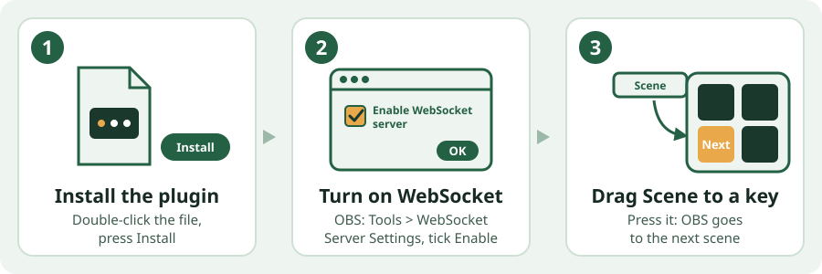

# Fadester Suite: Start Here

Which pieces of the Fadester Suite to install for your hardware, how to set up OBS Studio once, and the suite's names for things. Everything runs on your own computer (`127.0.0.1` loopback only, no cloud accounts, no analytics).

## Most people: a Stream Deck

1. **Install Fadester for OBS.** On the [Releases page](https://github.com/jbrick2070/streamdeck-fadester/releases/latest), download the file ending in `.streamDeckPlugin` and double-click it; in Stream Deck press **Install**.
2. **Turn on OBS's WebSocket server.** In OBS Studio 33's menu bar: **Tools > WebSocket Server Settings**, tick **Enable WebSocket server**, press **OK**. There is nothing to copy: the plugin reads the port and password OBS saved.
3. **Drag Scene onto a key.** In Stream Deck's action list, category *Fadester for OBS*, drag **Scene** onto a key and press it: OBS goes to the next scene. For a full deck, click the key, click the line at the foot of its settings page and open **Ready-made layouts**.

That's it. Another controller, or more pieces? Find your hardware in the table in [section 1](#1-what-do-you-have). Then work through [section 3](#3-first-run-steps-every-setup) once before a show.

## The pieces

Install only the ones your rig uses:

- **Fadester for OBS**: the Stream Deck and OpenDeck plugin (includes the 7 VJster video actions).
- **Fadester Companion**: desktop app for Xbox / XInput controllers and TourBox on Windows, and TourBox on the Mac (Apple silicon and Intel; ad-hoc signed, not notarized, physical TourBox control of OBS not yet rehearsed on a Mac), plus the whole-mix audio provider.
- **Midi Fadester**: OBS Studio 33 plugin for APC40 mkII, generic MIDI desks, a smooth in-process Studio Mode T-bar, and 18 shared fader/FX slots.
- **Visual Sidechain**: part of **Midi Fadester** since 0.9.0 (no separate install): audio-reactive shaders (with a global 3 Hz flash ceiling), Audio Modulator, tempo/bar grid, Panic / Restore visuals, and Tape Deck local/network video speed control.
- **Playlister**: OBS Studio 33 plugin for persistent multi-clip video playlists with transport controls.
- **VJster Chrome extension**: playback speed and YouTube quality in Chrome tabs.

**Several at once on Windows?** The **Fadester Suite Setup** ([`installer/`](../installer/README.md)) installs any mix in one pass. It comes with every release from 1.5.0 as `Fadester-Suite-Setup-<version>-Windows-x64.exe`, built from that release's own commit and tested by a GitHub Actions workflow; it is not code-signed yet. Each plugin and Fadester Companion keeps its own version and its own entry in **Installed apps**. It never closes OBS for you, and never replaces a newer installed component.

---

## 1. What do you have?

Find your controller and install **only** the listed items, in order. You can add optional OBS plugins later.

> **Visual Sidechain is part of Midi Fadester since 0.9.0.** Install Midi Fadester to get it; there is no separate Visual Sidechain download any more. If you have the old separate plugin, the Midi Fadester installer removes it.

| What you have | Install in this order | Install links |
|---|---|---|
| **Stream Deck** (15-key or 32-key) | 1. OBS Studio 33.x 2. **Fadester for OBS** (`.streamDeckPlugin`); ready-made layouts for the 15-key deck, none for the 32-key deck yet (drag **Scene** onto a key) 3. *(Optional)* **Visual Sidechain** (comes with Midi Fadester 0.9.0 or later), **Playlister**, **Midi Fadester**, **Fadester Companion** (only if you want whole-mix volume across every OBS mixer input), **VJster Chrome extension** | 1. [Fadester for OBS — Three steps](../README.md#three-steps-to-the-first-working-key) 2. [Visual Sidechain (in Midi Fadester)](https://github.com/jbrick2070/midi-fadester/blob/main/docs/VISUAL-SIDECHAIN.md) 3. [Playlister — Install](https://github.com/jbrick2070/obs-playlister#install) 4. [Midi Fadester — Install](https://github.com/jbrick2070/midi-fadester#install) 5. [VJster — Install](vjster/INSTALL.md#install) |
| **Stream Deck +** (4 dials + touch strip + 8 keys) | 1. OBS Studio 33.x 2. **Fadester for OBS** (`.streamDeckPlugin`) 3. *(Recommended for smooth dial T-bar without window visibility limits)* **Midi Fadester** 4. *(Optional)* **Visual Sidechain** (comes with Midi Fadester 0.9.0 or later), **Playlister**, **Fadester Companion** (whole-mix provider), **VJster Chrome extension** | 1. [Fadester for OBS — Three steps](../README.md#three-steps-to-the-first-working-key) 2. [Midi Fadester — Install](https://github.com/jbrick2070/midi-fadester#install) 3. [Visual Sidechain (in Midi Fadester)](https://github.com/jbrick2070/midi-fadester/blob/main/docs/VISUAL-SIDECHAIN.md) 4. [Playlister — Install](https://github.com/jbrick2070/obs-playlister#install) 5. [VJster — Install](vjster/INSTALL.md#install) |
| **Stream Deck Mini** (6 keys) | 1. OBS Studio 33.x 2. **Fadester for OBS** (`.streamDeckPlugin`) — its ready-made layout for the Mini is **Source Desk Mini · 6 keys** 3. *(Optional)* **Visual Sidechain** (comes with Midi Fadester 0.9.0 or later), **Playlister**, **VJster Chrome extension** | 1. [Fadester for OBS — Three steps](../README.md#three-steps-to-the-first-working-key) 2. [Visual Sidechain (in Midi Fadester)](https://github.com/jbrick2070/midi-fadester/blob/main/docs/VISUAL-SIDECHAIN.md) 3. [Playlister — Install](https://github.com/jbrick2070/obs-playlister#install) 4. [VJster — Install](vjster/INSTALL.md#install) |
| **Stream Deck Neo** (8 keys + Info Bar) | 1. OBS Studio 33.x 2. **Fadester for OBS** (`.streamDeckPlugin`) — includes **Scene Info Bar** for the Neo Info Bar and **Visual Sidechain Meter**; no ready-made layout for the Neo yet, drag **Scene** onto a key 3. *(Optional)* **Visual Sidechain** (comes with Midi Fadester 0.9.0 or later), **Playlister**, **VJster Chrome extension** | 1. [Fadester for OBS — Three steps](../README.md#three-steps-to-the-first-working-key) 2. [Visual Sidechain (in Midi Fadester)](https://github.com/jbrick2070/midi-fadester/blob/main/docs/VISUAL-SIDECHAIN.md) 3. [Playlister — Install](https://github.com/jbrick2070/obs-playlister#install) 4. [VJster — Install](vjster/INSTALL.md#install) |
| **OpenDeck** (Linux, Windows, or macOS) | 1. OBS Studio 33.x 2. **Fadester for OBS** built or packed as `.streamDeckPlugin`, installed in OpenDeck 3. *(Optional)* Starter profile generator + optional OBS plugins (**Midi Fadester**, which includes **Visual Sidechain**, and **Playlister**) | 1. [OpenDeck guide — First five minutes](OPENDECK.md#first-five-minutes) 2. [Midi Fadester — Install](https://github.com/jbrick2070/midi-fadester#install) 3. [Visual Sidechain (in Midi Fadester)](https://github.com/jbrick2070/midi-fadester/blob/main/docs/VISUAL-SIDECHAIN.md) 4. [Playlister — Install](https://github.com/jbrick2070/obs-playlister#install) |
| **A MIDI desk** (Akai APC40 mkII, APC mini mk2, MIDImix, nanoKONTROL2, Launch Control XL, or generic MIDI) | 1. OBS Studio 33.x 2. **Midi Fadester** in OBS (**Tools > Midi Fadester**) 3. *(Optional)* **Visual Sidechain** (comes with Midi Fadester 0.9.0 or later), **Playlister**, **Fadester Companion** (only if assigning Midi Fadester's Master fader to `mix_master` whole-mix control) | 1. [Midi Fadester — Install](https://github.com/jbrick2070/midi-fadester#install) 2. [Visual Sidechain (in Midi Fadester)](https://github.com/jbrick2070/midi-fadester/blob/main/docs/VISUAL-SIDECHAIN.md) 3. [Playlister — Install](https://github.com/jbrick2070/obs-playlister#install) 4. [Fadester Companion](../tourbox/README.md#first-five-minutes-game-controller) |
| **A full-size TourBox** (three rotaries, Side, Tour, C1/C2 and a D-pad) | 1. OBS Studio 33.x + **TourBox Console** 2. **Fadester Companion** (Windows Store or standalone ZIP; Mac ZIP for Apple silicon or Intel, not notarized) 3. In Fadester Companion click **Import into TourBox Console**, then turn **Auto Switch** off and select **OBS Fadester for TourBox** 4. *(Optional)* **Midi Fadester** (includes **Visual Sidechain**), **Playlister**, **VJster Chrome extension** | 1. [Fadester Companion — Connect a TourBox](../tourbox/README.md#connect-a-tourbox) 2. [Fadester Companion for Mac](../tourbox/MACOS.md) 3. [Visual Sidechain (in Midi Fadester)](https://github.com/jbrick2070/midi-fadester/blob/main/docs/VISUAL-SIDECHAIN.md) 4. [VJster — Install](vjster/INSTALL.md#install) |
| **An Xbox or XInput controller** (Windows) | 1. OBS Studio 33.x 2. **Fadester Companion** (Windows) 3. Tick **Use an Xbox or XInput game controller** on the **Setup** tab, then click **Stop** and **Start**; the right trigger then drives the Studio Mode T-bar 4. *(Optional)* **Visual Sidechain** (comes with Midi Fadester 0.9.0 or later), **Playlister**, **Midi Fadester**, **VJster Chrome extension** | 1. [Fadester Companion — First five minutes (game controller)](../tourbox/README.md#first-five-minutes-game-controller) 2. [Visual Sidechain (in Midi Fadester)](https://github.com/jbrick2070/midi-fadester/blob/main/docs/VISUAL-SIDECHAIN.md) 3. [Playlister — Install](https://github.com/jbrick2070/obs-playlister#install) |
| **Nothing** (mouse/keyboard + OBS only) | 1. OBS Studio 33.x 2. Install whichever OBS plugins match your show:    - **Playlister** for persistent playlists of clips    - **Midi Fadester**, which includes **Visual Sidechain**, for audio-reactive shaders, Audio Modulator, and Tape Deck Browser Sources | 1. [Playlister — Install](https://github.com/jbrick2070/obs-playlister#install) 2. [Visual Sidechain (in Midi Fadester)](https://github.com/jbrick2070/midi-fadester/blob/main/docs/VISUAL-SIDECHAIN.md) |

> **One VJster link owner at a time.** **Fadester for OBS**, the standalone **VJster** Stream Deck plugin and **Fadester Companion** all default to loopback port `48150` for VJster.
> - With **Fadester for OBS**, do **not** also install the standalone **VJster** plugin: `Fadester for OBS` already includes all seven VJster actions.
> - If you also run **Fadester Companion**, turn off VJster in one of them so only one program holds port `48150`. When Fadester for OBS holds the port, Fadester Companion shows a grey *VJster: on your Stream Deck* light and nothing needs fixing.

---

## 2. Which video player when

Four ways to play video with speed control. Pick by where your clips live and whether the speed must change live without restarting playback.

| Player | Plays | Speed range | Speed change | Controlled from | Pick it when |
|---|---|---|---|---|---|
| **VJster, Chrome tab** | YouTube (with quality control) or any allowed HTML5 `<video>` tab in Chrome, captured into OBS | `25%–200% (0.25x–2x)` (`400% (4x)` when YouTube offers it; `10%–1600% (0.1x–16x)` with **Extended** on) | Live, in place | **Fadester for OBS** (VJster keys and dials), **Fadester Companion** | You are capturing a browser window and want live speed or YouTube quality control |
| **VJster, OBS page** | One YouTube video (`v=`) or playlist (`list=`) inside an OBS Browser Source | `25%–200% (0.25x–2x)` (the OBS CEF 150 embed ceiling) | Live, in place; speed and play/pause only (the embed has no quality control) | **Fadester for OBS** (VJster keys and dials), **Fadester Companion** | You want YouTube inside OBS with no Chrome window |
| **Tape Deck** *(in Visual Sidechain)* | One local or network-share video file (`MP4`, `MKV`, `MOV`, `WebM`) inside a dedicated OBS Browser Source (Windows) | `25%–800% (0.25x–8x)` (`100% (1x)` normal) | Live, picture and sound, with optional **Tape pitch** and a ratio **Speed Fader** | **Fadester for OBS** (**Tape Deck** key/dial or **Filter**), Midi Fadester **Speed Fader**, OBS hotkeys, `obs-websocket` (`deck_command`). *(Fadester Companion preset support is a follow-up.)* | You want to ride the speed of one clip live from a dial, key, or MIDI fader |
| **Playlister** | Local files, folders, `.m3u` / `.m3u8` / `.pls` playlists and stream URLs, in its own **Playlister** source that plays through OBS's Media Source (Windows, Linux and macOS; on a Mac it loads and creates its source, the hands-on test is still to come) | `1%–200% (0.01x–2x)` as a source setting (`100% (1x)` normal) | **Changing Speed restarts the clip from its beginning** | **Fadester for OBS** (**Playlister** key), OBS Media Controls, OBS hotkeys, `obs-websocket` media inputs | You want a multi-clip running order with Next/Previous transport that survives edits |

---

## 3. First-run steps (every setup)

Work down this list once. **Shortcut on Stream Deck or OpenDeck:** open any **Fadester for OBS** key's settings, click the line at the foot of the page and open **Setup checklist**. It checks every line below by itself and gives a one-sentence fix for anything still off. Red there must be fixed; Studio Mode, the Fade transition and the OBS version are notes, needed only for the T-bar and Preview controls.

1. **Enable `obs-websocket` in OBS.** Open OBS Studio 33.x, click **Tools > WebSocket Server Settings**, tick **Enable WebSocket server** and click **Apply**. Leave the port and **Enable Authentication** as they are.
   - **Fadester Companion** reads OBS's saved password from OBS's local config automatically.
   - **Fadester for OBS** (Stream Deck / OpenDeck) also reads the password and the port by itself when OBS runs on the same computer (from `%APPDATA%\obs-studio\plugin_config\obs-websocket\config.json` on Windows, `~/Library/Application Support/obs-studio/plugin_config/obs-websocket/config.json` on macOS). There is nothing to fill in.
   - **OBS on another computer:** click the line at the foot of any key's settings page, open **OBS on another computer, or another port**, fill in host, port and password and click **Save for all controls & test**.
2. **Turn on Studio Mode.** In OBS click **Studio Mode** (or **View > Studio Mode**) so **Preview** sits on the left and **Program** on the right. T-bar and Preview controls need it.
3. **Select the Fade transition** in OBS's **Scene Transitions** dock. OBS's manual T-bar mixes scenes smoothly only with **Fade**.
4. **Keep OBS un-elevated and visible (Windows native T-bar).**
   - Do **not** start OBS with **Run as administrator** while Stream Deck or Fadester Companion runs as your normal Windows user: Windows UIPI blocks a normal-user process from driving an elevated OBS window's Studio Mode slider.
   - Keep OBS's main window open on the desktop (behind other windows is fine, just **not minimised** to the taskbar) when driving OBS's built-in Studio Mode T-bar without Midi Fadester. (If **Midi Fadester** owns the T-bar in-process, OBS may be minimised.)
5. **TourBox users: import the preset and turn off Auto Switch.**
   - Open **TourBox Console**, click **Import into TourBox Console** in Fadester Companion (it copies the preset's path) and paste it in Console's import window.
   - Turn **Auto Switch** off and select **OBS Fadester for TourBox**, so the one preset works whichever application is in front. (Keeping Auto Switch on instead? Link the preset to OBS, `obs64.exe` on Windows or `OBS.app` on macOS, and to Google Chrome to control videos with Chrome in front.)
6. **macOS: Accessibility per host app *(not yet verified on hardware)*.** macOS grants Accessibility per application. In **System Settings > Privacy & Security > Accessibility**, enable the app that actually drives OBS's native T-bar (`Elgato Stream Deck.app`, `OpenDeck.app`, or **Fadester Companion.app**, whose bundled helpers appear as **Fadester Companion T-bar** and **Fadester Companion Shortcuts**).

---

## 4. Names

Every piece of the Fadester Suite uses one set of English terms, so controls, settings and logs never say two names for the same thing or one name for two different things:

| Term | What it means | What it is NOT |
|---|---|---|
| **Fadester for OBS** | The Stream Deck and OpenDeck plugin, including the 7 bundled VJster actions | Not called bare `"Fadester"`, `"Stream Deck Fadester"`, or `"Stream Deck companion"` |
| **Fadester Companion** | The desktop app for Xbox / XInput controllers, TourBox, and the whole-mix audio provider | Not Bitfocus Companion, and not the Stream Deck plugin (its Windows app file is `Fadester Companion.exe`) |
| **Whole mix** | Moving every public OBS mixer input together while keeping their balance (`io.github.jbrick2070.fadester.mix.v1`, Midi Fadester `mix_master` target) | **All OBS mixer inputs** is the picker option that selects **Whole mix**; Midi Fadester's **Master** strip is a separate single-slot fader (Desktop Audio by default) |
| **Restore visuals** vs **Restore mix** | **Restore visuals** undoes Visual Sidechain's **Panic** (hold `0.8 s`); **Restore mix** returns **Whole mix** inputs to their pre-fade balance | Never bare `"Restore"` without saying whether it restores visuals or the audio mix |
| **Clean FX** vs **Clean / All FX Off** | **Clean FX** is the short label on deck keys and dials (`0 %`); **Clean / All FX Off** is the full name in settings and sentences for zeroing enabled filter slots (`reset_fx`) | Audio and layer controls stay untouched |
| **Layer 1 / Layer 2** | Two sources inside a scene (for blend modes, single-owner layer opacity, or Midi Fadester `crossfade_ab` A/B layer crossfading) | Scenes are never called layers or `LIVE` / `NEXT` |
| **Program / Preview** | OBS Studio Mode's on-air scene (**Program**) and next scene (**Preview**), matching OBS's own window labels | Never `LIVE` / `NEXT` for scenes; `crossfade_ab` and **A/B crossfader** name the two-layer crossfade mode itself |
| **Cue to start** vs **Preview** | **Cue to start** rewinds a Visual Sidechain **Tape Deck** clip to `0.0 s`; putting an OBS scene on standby in Studio Mode is always called **Preview** | Never bare `"Cue"` for putting a scene in Preview |
