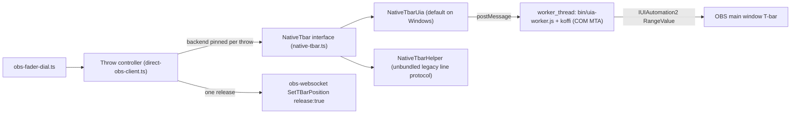

# T-bar on Windows: in-plugin UI Automation backend (Route B) — design

Status: implemented on Windows (`src/obs/uia/`, `src/obs/native-tbar.ts`, `src/obs/direct-obs-client.ts`, `scripts/native/stage-koffi.mjs`). Date: 2026-11-12. Follows [TBAR-GO-FORWARD-PLAN-2026-11-12.md](TBAR-GO-FORWARD-PLAN-2026-11-12.md) Stages 2 and 4.

## 1. Goal
The dial moves OBS's real Studio Mode T-bar from **inside** the Stream Deck plugin process. Today that needs a separate helper exe. When the throw ends, the plugin sends **one** obs-websocket release. No helper process, no flash, and no change to how the dial feels. If UI Automation (UIA) can't reach OBS, the dial falls back to today's take.

## 2. What the bench already showed (portable OBS 33.0.1 on a hidden test desktop, 2026-11-12)
- A UIA write moves the real slider and the mix together, with exact readback. Writing 1023 + `SetTBarPosition {position:1, release:true}` takes the fade. Writing 0 + `{position:0, release:true}` cancels it. In both cases the slider parks at 0 within about 7 ms.
- The slider's identity matches `NativeSlider.cpp`: class `SliderIgnoreScroll`, AutomationId `OBSApp.OBSBasic.centralwidget.canvasEditor.QWidget.SliderIgnoreScroll`, Qt, enabled, not read-only, range 0..1023, inside the `OBSBasic` main window.
- **The managed .NET UIA client stalls about 2.0 s on every write** (UIA's automatic focus). The backend must use COM `IUIAutomation2` with `put_AutoSetFocus(FALSE)`, as `NativeSlider.cpp` does. With that setting, measured through the same C++ code: a 64-step take at dial pace had median 2.5 ms, p95 3.2 ms and max 3.9 ms per write. A 256-write burst with no gaps had median 1.5 ms, p95 2.1 ms and max 3.6 ms. After the release the slider parked within 1.4–7.4 ms. All takes and cancels passed. (Hidden desktop, OBS idle. Repeat under render load on the real desktop.)
- When OBS has no Program/Preview selected, `GetCurrentSceneTransitionCursor` reads 1.0 before any fade and 0.0 after a cancelled one. Both mean "no fade running", so the cursor alone can't tell you OBS is at rest. Use the slider value plus scene names.
- On a hidden desktop, gdigrab sees OBS's Qt widgets but not its D3D displays. Flash counting has to happen on the operator's real desktop (`C:\obs-test\run-tbar-proof.cmd`).

## 3. Shape

### 3.1 Native part: direct COM `IUIAutomation2` via `koffi` (`src/obs/uia/uia-slider.ts`)
Rather than requiring a custom MSVC DLL compile on Windows or macOS CI, `src/obs/uia/uia-slider.ts` calls Win32 (`ole32.dll`, `oleaut32.dll`, `user32.dll`, `kernel32.dll`, `iphlpapi.dll`) and `IUIAutomation2` / `IUIAutomationElement` / `IUIAutomationRangeValuePattern` COM vtable slots directly through `koffi`'s prebuilt N-API binaries (`koffi.proto` + `koffi.call`).

All rules from `tourbox/native/NativeSlider.cpp` carry over unchanged:
- `CoInitializeEx(NULL, COINIT_MULTITHREADED)` on the dedicated worker thread;
- `CoCreateInstance(CLSID_CUIAutomation8, ..., IID_IUIAutomation2)` with `put_AutoSetFocus(FALSE)` verified via `get_AutoSetFocus`, plus 500 ms connection/transaction timeouts;
- `listenerPid(port)` resolves the exact local PID listening on the connected `obs-websocket` port;
- Process image must end in `\obs64.exe`;
- `EnumWindows` finds the one non-minimised (`!IsIconic`) `OBSBasic`/Qt (`OBSApp.OBSBasic`) main window owned by that PID (`E_ACCESSDENIED` reported as `"admin"`);
- `FindAll(TreeScope_Descendants, AutomationId == "OBSApp.OBSBasic.centralwidget.canvasEditor.QWidget.SliderIgnoreScroll")` finds the one enabled, on-screen, non-vertical (`EL_ORIENTATION !== 2`), non-read-only `SliderIgnoreScroll` control with range `0..1023`;
- Expected-value check before writing (`reason = "moved"` if moved by hand), readback after writing, and once a write is uncertain no further write is allowed until a fresh `read()` succeeds.

### 3.2 Thread model (`src/obs/uia/uia-worker.ts` + `NativeTbarUia`)
- One long-lived `worker_thread` per OBS connection (`bin/uia-worker.js`). It loads `koffi`, joins COM's MTA once, and keeps all COM interface pointers on that thread. Calls are synchronous inside the worker so Node's main event loop never blocks.
- Main thread ↔ worker messages carry `{seq, generation, op, expected, desired}`. Replies carry `{seq, generation, status, ...}`. Stale generations and timed-out `seq` replies are dropped.
- **Timeout ~80 ms per call** (raced on the main thread). A timeout raises `NativeTbarTimeout` (uncertain) and marks the worker *busy-tainted*: nothing else is sent until its late reply drains (up to 1.2 s), then reconciliation re-reads before clearing taint. The worker is never terminated mid-call; `worker.terminate()` runs only on shutdown after `close`.
- **Cache invalidation:** `invalidate()` bumps the generation and queues `forget` on Studio Mode transitions, scene collection changes, Studio Mode toggle takes, and disconnects; the worker also re-creates `UiaSlider` automatically if the pinned OBS process exits and restarts.
- **Latest-target coalescing:** `DirectObsClient.nudgeTbar` keeps at most one step in flight plus one pending target (`PendingTbarNudge`), accumulating signed deltas so reversals are preserved while latching `take` / `cancel` endpoints so trailing ticks in a burst cannot overwrite them.

### 3.3 Adapter: `NativeTbarUia implements NativeTbar`
Same interface (`read`, `move(from,to)`, `invalidate`, `close`) and error classes (`NativeTbarRefusal`, `NativeTbarUnavailable`, `NativeTbarUncertain`, `NativeTbarTimeout`). `defaultNativeTbar(port)` returns `NativeTbarUia` on Windows (`x64`/`arm64`) when `bin/uia-worker.js` is built; `FadesterNativeSlider.exe` remains unbundled and unused. The `move(x,x)` park-wait behaviour (24 × 25 ms polls) is preserved.

### 3.4 Endpoint sequence (one per throw)
- **Take:** confirm `move(cur, 1)` lands at `>= 921` (`1023` target) → send `SetTBarPosition {position:1, release:true}` once → confirm the slider parks at 0, Program = expected, Preview per policy (preserving mid-fade Preview cues and Scene loop) → throw complete.
- **Cancel:** confirm `move(cur, 0)` lands at `<= 102` (`0` target) → send `SetTBarPosition {position:0, release:true}` once → confirm the slider parks at 0 and Program stays unchanged.
- No websocket movement writes during a UIA throw. No Studio Mode toggle when UIA succeeds.

### 3.5 Choosing the backend, and closing failed mid-fade throws
- Chosen **at rest** before each throw (or adopted from an open real-slider fade after a mid-fade plugin restart): `"native"` if `NativeTbarUia` reads OBS's slider and the transition is `fade_transition`, otherwise `"toggle"` (today's obs-websocket throw + Studio Mode toggle take). It is **pinned** for the whole throw and never switches from `"toggle"` to `"native"` mid-throw.
- **Hand-moved slider (`reason === "moved"`):** stops the dial's throw without toggling Studio Mode under the operator's mouse; if left part-way, the next turn picks it up.
- **Unknown / mid-fade backend loss** (timeout, uncertain reply, worker exit, OBS minimised mid-fade, UIA element lost): `recoverFailedNativeThrow` stops incoming nudges, invalidates the cached UIA element, drains/re-reads the slider if reachable (`>= 921` → one take release; `<= 102` → one cancel release; `103..920` → try moving to the endpoint + release), and if OBS's manual transition still remains open (slider stuck mid-range or UIA unreachable), automatically finishes the fade via `performStudioModeToggleTake` so OBS's Transition button never stays locked.
- **UIA unavailable → today's take:** OBS minimised, OBS running as administrator (`E_ACCESSDENIED`), `koffi` unavailable, remote OBS, macOS, non-Fade transition, or OBS ≠ 33.x cleanly use today's obs-websocket throw and Studio Mode toggle take.

## 4. Packaging
- `koffi` (`3.3.7`) is declared in `package.json`, marked external for `bin/uia-worker.js` in `rollup.config.mjs`, and staged into `io.github.jbrick2070.fadester-for-obs.sdPlugin/bin/node_modules/koffi` by `scripts/native/stage-koffi.mjs` during Rollup `writeBundle`.
- Both locked Windows prebuilt tarballs (`vendor/koffi/koffi-win32-x64-3.3.7.tgz` and `vendor/koffi/koffi-win32-arm64-3.3.7.tgz`) are verified against `package-lock.json` SHA-512 digests and extracted to `bin/node_modules/koffi/build/koffi/{win32_x64,win32_arm64}/koffi.node` on both Windows and macOS builders without native compilers.
- Manifest unchanged (shared Node 24 entry point `bin/plugin.js`). `npm run build`, `npm run pack`, and `scripts/suite/package-candidate.ts` pass on both Windows and macOS.

## 5. Tests
Fake OBS (CI, no Windows UI):
- `NativeTbarUia` with a fake worker: OK / refusal / uncertain / late reply after the 80 ms timeout (busy-tainted, never replayed), stale generation dropped.
- Coalescing: 200 ticks while one write is slow → ≤ 1 in flight + 1 pending; reversal kept; the latched endpoint is not overwritten.
- Endpoint: exactly one `SetTBarPosition release:true` per throw; repeated take ticks after a finish start nothing; no `SetStudioModeEnabled` in UIA mode.
- Backend pinned: UIA lost mid-throw → Unknown → reconcile, never a toggle take.
- Fake OBS gets a "fixed-OBS" mode (the slider follows `SetTBarPosition`) for Route A.

Real OBS (Windows):
- Portable test OBS on a hidden desktop: `C:\obs-test\virtual-run.ps1` (UIA proof, latency, take/cancel). Already passing for the exe-helper path.
- Operator's OBS, **only when the operator says they are not live**: `C:\obs-test\run-tbar-proof.cmd` (refuses while streaming or recording, always ends with a release, records OBS's window), and then the real Stream Deck plugin, which holds its own connection. Run 50+ throws, reversals and holds; covered window and second monitor; OBS minimised and OBS as admin (expect fallback); plugin restart mid-fade; Studio Mode off/on between throws. Report latency (median, p95, worst) and flash frames in the recordings.

## 6. Route A status (OBS PR #13143)
CI run 41489751774 for the PR is `action_required` (first-time contributor workflow approval), so there are **no build artifacts** to download. Testing Route A means building OBS 33.0.1 with the patch ourselves on Windows. That takes VS 2022, CMake ≥ 3.28, the obs-deps prebuilt packages (downloaded by the CMake preset), Qt 6 from obs-deps, and about 30–60 GB of disk.

Effort estimate: **½–1 day** to get the first build (a clean `cmake --preset windows-x64` + build is roughly 30–60 min on this PC once the deps are cached, plus setup). Then about ½ day to run it portable on port 4456 and repeat the bench. The build is not signed and must never replace the operator's install. Mac would be a separate Xcode build, about 1 day.
