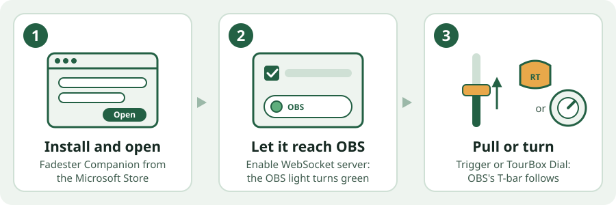

*Questa è una traduzione delle guide rapide inglesi, fatta con un modello di IA e controllata da un secondo modello; nessun madrelingua l’ha ancora rivista.*

# Guida rapida: Fadester Companion e VJster

[Fadester Companion](#companion) · [Controller di gioco](#gamepad) · [VJster](#vjster) · [VJster: installazione](#vjster-install) · [VJster con TourBox](#vjster-tourbox)

## Fadester Companion: un controller di gioco o un TourBox per OBS Studio

Fadester Companion ti permette di mixare le scene di OBS Studio su Windows con un controller Xbox o un altro controller XInput, un TourBox di dimensioni standard, o entrambi. Il grilletto destro del controller, o il Dial piatto del TourBox, muove il T-bar della Modalità studio di OBS.

1. **Installa e apri.** Scarica **Fadester Companion** da [Microsoft Store](https://apps.microsoft.com/detail/9PN7D3P2X7F4) e aprilo dal menu Start. (Dallo ZIP: estrai tutto in una cartella che terrai e apri **Fadester Companion.exe**.)
2. **Collegalo a OBS.** In OBS apri **Strumenti → Impostazioni del server WebSocket**, seleziona **Abilita server WebSocket**, lascia attivo **Abilita autenticazione** e fai clic su **OK**. La spia **OBS** in alto in Fadester Companion diventa verde. Arancione? Fai clic sul pulsante accanto: **Attiva** accende la Modalità studio, **Mostrami** mostra i clic in OBS.
3. **Scegli il controller e fai la dissolvenza.** Nella scheda **Configurazione**, sotto **2 Scegli il controller**, seleziona **Usa un controller Xbox o XInput** (lascia la **Modalità facile**), poi fai clic su **Ferma** e **Avvia** in basso a sinistra. Con un TourBox segui invece [Collegare un TourBox](../../../tourbox/README.md#connect-a-tourbox) (in inglese). Premi giù sul D-pad (TourBox: gira **Scroll**) per mettere la scena successiva in anteprima, poi tira il grilletto destro (TourBox: gira il **Dial** piatto): il T-bar di OBS segue e, tirato fino in fondo, l’anteprima passa al Programma.

Tutto qui.

[Guida completa (in inglese)](../../../tourbox/README.md)

## Controller di gioco

Comanda OBS con un controller Xbox (o qualsiasi pad compatibile XInput): il grilletto destro è un vero T-bar, i pulsanti mettono una scena in anteprima e mandano l’anteprima al Programma. Funziona dentro Fadester Companion su Windows.

1. **Collega il controller e attiva la connessione di OBS.** Collega il controller (USB o Xbox Wireless; a Windows non serve un altro driver). In OBS apri **Strumenti → Impostazioni del server WebSocket**, seleziona **Abilita server WebSocket**, lascia selezionato **Abilita autenticazione** e fai clic su **OK**.
2. **Apri Fadester Companion** ([Microsoft Store](https://apps.microsoft.com/detail/9PN7D3P2X7F4), poi il menu Start; [guida alla configurazione (in inglese)](../../../tourbox/README.md)). La spia **OBS** in alto diventa verde (arancione: fai clic su **Mostrami** accanto). Se la spia **Controller** dice che è collegato ma non in uso, fai clic su **Usalo**. Altrimenti, nella scheda **Configurazione**, sotto **2 Scegli il controller**, seleziona **Usa un controller Xbox o XInput**, lascia attiva la **Modalità facile** e fai clic su **Avvia** se la spia **Controlli** non è verde.
3. **Fai la dissolvenza.** In OBS 33 attiva la **Modalità studio**, scegli la transizione **Dissolvenza** (Fade) e premi giù sul D-pad per mettere la scena successiva in anteprima. Tira il grilletto destro a metà: il T-bar di OBS segue. Rilascia: torna indietro. Tira fino in fondo: l’anteprima passa al Programma.

Tutto qui. Le spie in alto mostrano *Controller: connesso* e *Controlli: attivi*.

[Guida completa (in inglese)](../../gamepad/README.md)

## VJster

**VJster 1.5.0** regola la velocità di un video di YouTube dal tuo Stream Deck: gira una manopola e il video accelera o rallenta mentre è in riproduzione; un tasto imposta 0.5x, 1x o 2x. Funziona in una scheda di Chrome, in una sorgente browser di OBS o in entrambe; nulla esce da questo computer.

1. **Procurati i tasti.** Hai **Fadester for OBS 0.9.0 o successivo**? Contiene già le sette azioni di VJster: salta questo passo. Altrimenti fai doppio clic su `com.jbrick2070.vjster.streamDeckPlugin` e accetta i profili inclusi (**VJster Live +** e **VJster Dual +** per Stream Deck +, **VJster Live** per 15 tasti, **VJster Mini**).
2. **Aggiungi l’estensione di Chrome.** Aggiungi [VJster dal Chrome Web Store](https://chromewebstore.google.com/detail/daohboebokfmamkblejcpbblfnaijgnb). La sua pagina delle opzioni si apre una volta.
3. **Provalo.** Trascina **VJster Speed** su una manopola o **VJster Speed Preset** su un tasto (Stream Deck mostra i nomi delle azioni in inglese; nel plugin VJster sono **Speed** e **Speed Preset**, oppure passa a un profilo VJster). Riproduci un video di YouTube in Chrome. In pochi secondi la striscia VELOCITÀ (SPEED in inglese) o il tasto 1x mostra che è in riproduzione. Gira la manopola.

Tutto qui. Se la striscia dice **ESTENSIONE SPENTA** (EXTENSION OFF in inglese), vedi *When something is off* in [INSTALL.md](../../vjster/INSTALL.md#when-something-is-off) (in inglese).

[Guida completa (in inglese)](../../vjster/README.md)

## VJster: installazione

VJster permette al tuo Stream Deck, al tuo TourBox o al tuo controller di gioco di cambiare la velocità e la qualità di un video di YouTube in Chrome.

1. **Procurati i tasti.** Installa [Fadester for OBS](https://github.com/jbrick2070/streamdeck-fadester/releases/latest) in Stream Deck: il suo elenco di azioni ha già le sette azioni **VJster**. (Usi un TourBox o un controller di gioco? Installa [Fadester Companion](https://apps.microsoft.com/detail/9PN7D3P2X7F4) e avvia i suoi controlli.)
2. **Aggiungi l’estensione di Chrome.** Aggiungi [VJster dal Chrome Web Store](https://chromewebstore.google.com/detail/daohboebokfmamkblejcpbblfnaijgnb) (Chrome 116 o successivo).
3. **Provalo.** Metti **VJster Speed** su un tasto o una manopola e riproduci un video di YouTube in Chrome. In pochi secondi il tasto mostra il video in riproduzione; gira la manopola e il video segue. Una scheda già aperta: ricaricala una volta.

Tutto qui. OBS non deve essere aperto.

[Guida completa (in inglese)](../../vjster/INSTALL.md)

## VJster con TourBox

L’unica estensione di Chrome di VJster funziona da Stream Deck, OpenDeck e TourBox. Con un TourBox è Fadester Companion stesso a gestire il collegamento con l’estensione.

1. **Prepara il TourBox.** Installa Fadester Companion e importa il suo preset: [Collegare un TourBox](../../../tourbox/README.md#connect-a-tourbox) (in inglese).
2. **Aggiungi l’estensione di Chrome.** Aggiungi [VJster dal Chrome Web Store](https://chromewebstore.google.com/detail/daohboebokfmamkblejcpbblfnaijgnb) e riproduci un video di YouTube in Chrome.
3. **Gira il Knob in rilievo.** La velocità del video segue. Tocca **Side** per tornare a 1x.

Tutto qui. OBS può restare chiuso.

[Guida completa (in inglese)](../../vjster/TOURBOX.md)
