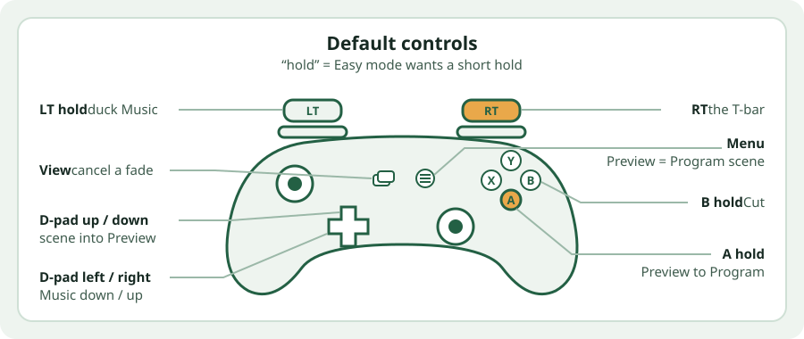

*本文是英文快速入门的翻译，由 AI 模型完成并经第二个模型检查，尚未经过母语人士审阅。*

# 快速入门：Fadester Companion 与 VJster

[Fadester Companion](#companion) · [游戏手柄](#gamepad) · [VJster](#vjster) · [VJster：安装](#vjster-install) · [用 TourBox 控制 VJster](#vjster-tourbox)

## Fadester Companion：用游戏手柄或 TourBox 控制 OBS Studio

Fadester Companion 让你在 Windows 上用 Xbox 或其他 XInput 游戏手柄、全尺寸 TourBox，或两者一起，混合 OBS Studio 的场景。手柄的右扳机或 TourBox 的平面 Dial 会推动 OBS 工作室模式自带的 T-bar。

1. **安装并打开。** 从 [Microsoft Store](https://apps.microsoft.com/detail/9PN7D3P2X7F4) 获取 **Fadester Companion**，然后从开始菜单打开。（使用 ZIP：把全部内容解压到一个会长期保留的文件夹，然后打开 **Fadester Companion.exe**。）
2. **连接 OBS。** 在 OBS 中打开 **工具 → WebSocket 服务器设置**，勾选 **启用 WebSocket 服务器**，保持 **启用身份验证** 开启，然后点击 **确定**。Fadester Companion 顶部的 **OBS** 指示灯会变绿。是琥珀色？点击旁边的按钮：**开启** 会打开工作室模式，**演示给我看** 会演示在 OBS 中要点哪里。
3. **选择控制器并转场。** 在 **设置** 选项卡的 **2 选择控制器** 下，勾选 **使用 Xbox 或 XInput 游戏手柄**（保持 **简易模式**），然后点击左下角的 **停止**，再点击 **启动**。使用 TourBox 时，请改为按照 [连接 TourBox](../../../tourbox/README.md#connect-a-tourbox)（英文）操作。按方向键下（TourBox：转动 **Scroll**）把下一个场景放入预览，然后扣右扳机（TourBox：转动平面 **Dial**）：OBS 的 T-bar 随之移动，扣到底时预览切换到节目。

就这样。

[完整指南（英文）](../../../tourbox/README.md)

## 游戏手柄

用 Xbox 手柄（或任何兼容 XInput 的手柄）控制 OBS：右扳机就是真正的 T-bar，按钮可以把场景放入预览，并把预览切换到节目。它在 Windows 上的 Fadester Companion 中运行。

1. **接上手柄并开启 OBS 的连接。** 接上手柄（USB 或 Xbox 无线；Windows 不需要额外驱动）。在 OBS 中打开 **工具 → WebSocket 服务器设置**，勾选 **启用 WebSocket 服务器**，保持勾选 **启用身份验证**，然后点击 **确定**。
2. **打开 Fadester Companion**（从 [Microsoft Store](https://apps.microsoft.com/detail/9PN7D3P2X7F4) 获取，然后从开始菜单打开；[设置指南（英文）](../../../tourbox/README.md)）。顶部的 **OBS** 指示灯会变绿（琥珀色：点击旁边的 **演示给我看**）。如果 **手柄** 指示灯显示已插入但未启用，请点击 **启用**。否则在 **设置** 选项卡的 **2 选择控制器** 下勾选 **使用 Xbox 或 XInput 游戏手柄**，保持勾选 **简易模式**，如果 **控制** 指示灯不是绿色，就点击 **启动**。
3. **转场。** 在 OBS 33 中开启 **工作室模式**，选择 **淡入淡出**（Fade）转场，然后按方向键下把下一个场景放入预览。把右扳机扣到一半：OBS 的 T-bar 随之移动。松开：它会退回。扣到底：预览切换到节目。

就这样。顶部的指示灯会显示 *手柄：已连接* 和 *控制：已开启*。

[完整指南（英文）](../../gamepad/README.md)

## VJster

**VJster 1.5.0** 让你用 Stream Deck 控制 YouTube 视频的速度：转动旋钮，视频在播放中加快或放慢；按一个键即可设为 0.5x、1x 或 2x。它可用于 Chrome 标签页、OBS 浏览器源或两者；任何数据都不会离开这台电脑。

1. **获取按键。** 已有 **Fadester for OBS 0.9.0 或更高版本**？其中已经包含七个 VJster 操作，可以跳过这一步。否则双击 `com.jbrick2070.vjster.streamDeckPlugin`，并同意安装附带的配置文件（适用于 Stream Deck + 的 **VJster Live +** 和 **VJster Dual +**，适用于 15 键的 **VJster Live**，以及 **VJster Mini**）。
2. **添加 Chrome 扩展。** 添加 [Chrome Web Store 中的 VJster](https://chromewebstore.google.com/detail/daohboebokfmamkblejcpbblfnaijgnb)。它的选项页面会打开一次。
3. **试一试。** 把 **VJster 速度** 拖到旋钮上，或把 **VJster 速度预设** 拖到按键上（在 VJster 插件中名为 **速度** 和 **速度预设**，也可以切换到某个 VJster 配置文件）。在 Chrome 中播放一个 YouTube 视频。几秒内，速度 触控条（或 1x 键）会显示正在播放。转动旋钮。

就这样。如果触控条上显示 **扩展未开启**，请参阅 [INSTALL.md](../../vjster/INSTALL.md#when-something-is-off) 中的 *When something is off*（英文）。

[完整指南（英文）](../../vjster/README.md)

## VJster：安装

有了 VJster，你的 Stream Deck、TourBox 或游戏手柄就能改变 Chrome 中 YouTube 视频的速度和画质。

1. **获取按键。** 在 Stream Deck 中安装 [Fadester for OBS](https://github.com/jbrick2070/streamdeck-fadester/releases/latest)：它的操作列表中已经有七个 **VJster** 操作。（使用 TourBox 或游戏手柄？请安装 [Fadester Companion](https://apps.microsoft.com/detail/9PN7D3P2X7F4) 并启动其控制。）
2. **添加 Chrome 扩展。** 添加 [Chrome Web Store 中的 VJster](https://chromewebstore.google.com/detail/daohboebokfmamkblejcpbblfnaijgnb)（Chrome 116 或更高版本）。
3. **试一试。** 把 **VJster 速度** 放到按键或旋钮上，然后在 Chrome 中播放一个 YouTube 视频。几秒内按键会显示正在播放的视频；转动旋钮，视频随之变化。已经打开的标签页请刷新一次。

就这样。OBS 不需要打开。

[完整指南（英文）](../../vjster/INSTALL.md)

## 用 TourBox 控制 VJster

同一个 VJster Chrome 扩展可用于 Stream Deck、OpenDeck 和 TourBox。使用 TourBox 时，由 Fadester Companion 自己承担与扩展的连接。

1. **设置 TourBox。** 安装 Fadester Companion 并导入其预设：[连接 TourBox](../../../tourbox/README.md#connect-a-tourbox)（英文）。
2. **添加 Chrome 扩展。** 添加 [Chrome Web Store 中的 VJster](https://chromewebstore.google.com/detail/daohboebokfmamkblejcpbblfnaijgnb)，然后在 Chrome 中播放一个 YouTube 视频。
3. **转动凸起的 Knob。** 视频速度随之变化。轻按 **Side** 恢复 1x。

就这样。OBS 可以关闭。

[完整指南（英文）](../../vjster/TOURBOX.md)
