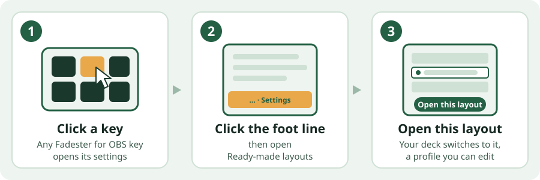

# Fadester for OBS: snelstarts

*Dit is een vertaling van de Engelse snelstarts, gemaakt met een AI-model en gecontroleerd door een tweede AI-model; er heeft nog geen moedertaalspreker naar gekeken.*

[Fadester for OBS](#fadester-for-obs) · [Begin hier](#start-here) · [Kant-en-klare layouts](#layouts) · [OpenDeck](#opendeck) · [Eén plugin met VJster](#suite) · [Indelingsbestanden met de hand](#profiles)

Stream Deck is er niet in het Nederlands: de actielijst toont de Engelse namen (bijvoorbeeld **Scene**). De toetsen en instellingenpagina's van Fadester for OBS zijn Nederlands zodra je dat kiest onder **Taal**.

## Fadester for OBS

Fadester for OBS zet OBS Studio op je Stream Deck: scènes, overgangen, bronnen, filters en audio op toetsen en draaiknoppen.

1. **Installeer de plugin.** Download op de [releasepagina](https://github.com/jbrick2070/streamdeck-fadester/releases/latest) het bestand dat eindigt op `.streamDeckPlugin` en dubbelklik erop. Bevestig de installatie in Stream Deck.
2. **Zet de WebSocket-server van OBS aan.** In OBS: **Tools → WebSocket-serverinstellingen**, zet de server aan en klik op **OK**. Laat de authenticatie zoals ze is: er valt niets over te nemen.
3. **Sleep Scene naar een toets.** Sleep in de actielijst van Stream Deck, categorie *Fadester for OBS*, **Scene** naar een toets. Die begint als **Volgende scène**: druk erop en OBS gaat naar de volgende scène.

Klaar. Staat OBS op dezelfde computer, dan meldt de plugin zich vanzelf aan. Zolang OBS niet verbonden is, zegt de toets wat je moet doen, bijvoorbeeld **Zet OBS-WebSocket aan** of **Start OBS**.

[Volledige handleiding (Engels)](../../README.md)

## Fadester Suite: begin hier

Welke delen van de Fadester Suite je voor je hardware installeert, en hoe je OBS één keer instelt. De meeste mensen hebben een Stream Deck:

1. **Installeer Fadester for OBS.** Download het `.streamDeckPlugin`-bestand van de [releasepagina](https://github.com/jbrick2070/streamdeck-fadester/releases/latest), dubbelklik erop en installeer het in Stream Deck.
2. **Zet de WebSocket-server van OBS aan.** In OBS Studio 33: **Tools → WebSocket-serverinstellingen**, server aan, **OK**. De plugin leest de poort en het wachtwoord die OBS heeft bewaard.
3. **Sleep Scene naar een toets** en druk erop: OBS gaat naar de volgende scène. Voor een vol deck klik je op de toets, dan op de regel onderaan de instellingenpagina, en open je **Kant-en-klare layouts**.

Klaar. Een andere controller, of meer onderdelen? De tabel staat in de volledige handleiding.

[Volledige handleiding (Engels)](../../docs/START-HERE.md)

## Fadester for OBS: kant-en-klare layouts

Veertien indelingen voor de Stream Deck +, de Stream Deck met 15 toetsen en de Stream Deck Mini. Elke indeling opent als een profiel dat je kunt aanpassen.

1. **Klik op een Fadester for OBS-toets** in Stream Deck: de instellingen gaan open.
2. **Klik op de regel onderaan de pagina** (die toont de versie en de verbinding) en open **Kant-en-klare layouts**.
3. **Kies een indeling en klik op Deze indeling openen.** Je deck schakelt over naar die indeling.

Klaar. Staat OBS op dezelfde computer met de WebSocket-server aan, dan maakt de plugin zelf verbinding; alle indelingen gebruiken die ene verbinding.

[Volledige handleiding (Engels)](../../DECK-LAYOUTS.md)

## Fadester for OBS en VJster met OpenDeck

[OpenDeck](https://github.com/nekename/OpenDeck) is een gratis opensourceprogramma dat Stream Deck-plugins draait zonder de Stream Deck-software van Elgato. Fadester for OBS werkt er zonder aanpassingen in.

1. **Start OpenDeck.** Sluit het deck aan, sluit de Stream Deck-software en start [OpenDeck](https://github.com/nekename/OpenDeck/releases). Voor deze plugin is [Node.js](https://nodejs.org/) 24 of nieuwer nodig.
2. **Installeer Fadester.** Installeer in de pluginbeheerder van OpenDeck **Fadester for OBS** als die erin staat, of gebruik de knop om vanuit een bestand te installeren met de [Fadester-download](https://github.com/jbrick2070/streamdeck-fadester/releases/latest/download/io.github.jbrick2070.fadester-for-obs.streamDeckPlugin).
3. **Kies je indeling** in de profiellijst onder de naam van het deck: **Scene Desk + (Regular Mode)** voor de Plus, **Scene Desk 15 Keys (Regular Mode)** voor 15 toetsen, **Source Desk Mini (Either Mode)** voor de Mini. Op andere modellen sleep je **Scene** naar een toets.

Klaar, zodra de WebSocket-server van OBS aan staat (**Tools → WebSocket-serverinstellingen**). Staat OBS op dezelfde computer, dan meldt Fadester zich aan met het bewaarde wachtwoord.

[Volledige handleiding (Engels)](../../docs/OPENDECK.md)

## Fadester for OBS en VJster in één plugin

Fadester for OBS is één plugin met negentien acties: twaalf van Fadester en zeven van VJster.

1. **Installeer Fadester for OBS één keer**, in Stream Deck of in OpenDeck (zie hierboven).
2. **De acties van VJster staan in dezelfde lijst**, categorie *Fadester for OBS*: **VJster Speed**, **VJster Quality** enzovoort.
3. **Voeg de Chrome-extensie toe:** [VJster in de Chrome Web Store](https://chromewebstore.google.com/detail/daohboebokfmamkblejcpbblfnaijgnb). Die praat met de plugin via poort 48150.

Klaar. Laat VJster in maar één programma draaien: deze plugin, de losse VJster-plugin of Fadester Companion.

[Volledige handleiding (Engels)](../../docs/SUITE.md)

## De Fadester-indelingsbibliotheek: een bestand met de hand importeren

Het makkelijkst open je een indeling via **Kant-en-klare layouts** (zie hierboven). Zo importeer je een bestand met de hand:

1. **Dubbelklik op het bestand.** Kies het `.streamDeckProfile` voor je deck; Stream Deck importeert het als nieuw profiel.
2. **Verbind OBS (meestal niets te doen).** Staat OBS op dezelfde computer, dan meldt Fadester zich vanzelf aan. Anders: open de instellingen van een Fadester-toets, klik op de regel onderaan de pagina, open **OBS op een andere computer, of een andere poort**, vul host, poort en wachtwoord in en klik op **Opslaan voor alle toetsen en draaiknoppen & testen**.
3. **Druk op de toetsen.** Scènetoetsen volgen je scènelijst in OBS; de knoppen voor muziek, microfoon en Aux hebben je audio-ingangen gevonden.

Klaar.

[Volledige handleiding (Engels)](../../profiles/README.md)
