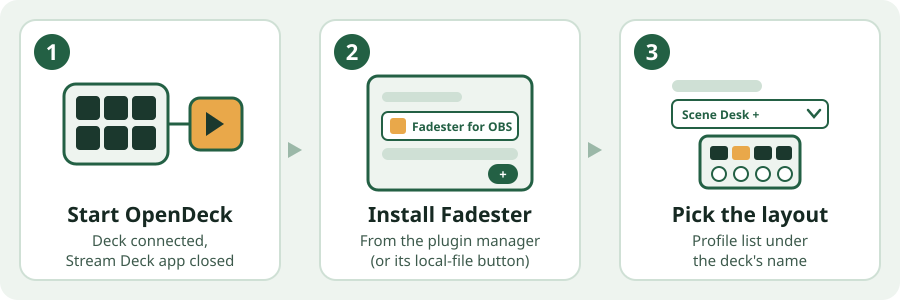

# Fadester for OBS: guias rápidos

*Esta é uma tradução dos guias rápidos em inglês, feita com um modelo de IA e verificada por um segundo modelo de IA; ainda não foi revisada por um falante nativo.*

[Fadester for OBS](#fadester-for-obs) · [Comece aqui](#start-here) · [Layouts prontos](#layouts) · [OpenDeck](#opendeck) · [Um plugin com o VJster](#suite) · [Arquivos de layout à mão](#profiles)

O Stream Deck não tem português: a lista de ações dele mostra os nomes em inglês (por exemplo **Scene**). As teclas e as páginas de configurações do Fadester for OBS ficam em português quando você escolhe em **Idioma**.

## Fadester for OBS

O Fadester for OBS coloca o OBS Studio no seu Stream Deck: cenas, transições, fontes, filtros e áudio em teclas e dials.

1. **Instale o plugin.** Na [página de versões](https://github.com/jbrick2070/streamdeck-fadester/releases/latest), baixe o arquivo que termina em `.streamDeckPlugin` e clique duas vezes nele. Confirme a instalação no Stream Deck.
2. **Ative o servidor WebSocket do OBS.** No OBS: **Ferramentas → Configurações do servidor WebSocket**, ative o servidor e clique em **OK**. Deixe a autenticação como está: não há nada para copiar.
3. **Arraste Scene para uma tecla.** Na lista de ações do Stream Deck, categoria *Fadester for OBS*, arraste **Scene** para uma tecla. Ela começa como **Próxima cena**: pressione e o OBS vai para a próxima cena.

Pronto. Com o OBS no mesmo computador, o plugin se conecta sozinho. Enquanto o OBS não estiver conectado, a tecla diz o que fazer, por exemplo **Ative WebSocket no OBS** ou **Abra o OBS**.

[Guia completo (em inglês)](../../README.md)

## Fadester Suite: comece aqui

Quais partes da Fadester Suite instalar para o seu hardware e como configurar o OBS uma vez. A maioria usa um Stream Deck:

1. **Instale o Fadester for OBS.** Baixe o arquivo `.streamDeckPlugin` da [página de versões](https://github.com/jbrick2070/streamdeck-fadester/releases/latest), clique duas vezes e instale no Stream Deck.
2. **Ative o servidor WebSocket do OBS.** No OBS Studio 33: **Ferramentas → Configurações do servidor WebSocket**, ative o servidor, **OK**. O plugin lê a porta e a senha que o OBS salvou.
3. **Arraste Scene para uma tecla** e pressione: o OBS vai para a próxima cena. Para encher o deck, clique na tecla, depois na linha no rodapé da página de configurações dela, e abra **Layouts prontos**.

Pronto. Outro controle ou mais partes? A tabela está no guia completo.

[Guia completo (em inglês)](../../docs/START-HERE.md)

## Fadester for OBS: layouts prontos

Catorze layouts para o Stream Deck +, o Stream Deck de 15 teclas e o Stream Deck Mini. Cada um abre como um perfil que você pode editar.

1. **Clique em uma tecla do Fadester for OBS** no Stream Deck: as configurações dela se abrem.
2. **Clique na linha no rodapé da página** (ela mostra a versão e a conexão) e abra **Layouts prontos**.
3. **Escolha um layout e clique em Abrir este layout.** O seu deck muda para ele.

Pronto. Com o OBS no mesmo computador e o servidor WebSocket ativo, o plugin se conecta sozinho; todos os layouts usam essa conexão.

[Guia completo (em inglês)](../../DECK-LAYOUTS.md)

## Fadester for OBS e VJster com o OpenDeck

O [OpenDeck](https://github.com/nekename/OpenDeck) é um programa livre e de código aberto que roda plugins do Stream Deck sem o software Stream Deck da Elgato. O Fadester for OBS funciona nele sem alterações.

1. **Inicie o OpenDeck.** Conecte o deck, feche o software Stream Deck e inicie o [OpenDeck](https://github.com/nekename/OpenDeck/releases). Este plugin precisa do [Node.js](https://nodejs.org/) 24 ou mais recente.
2. **Instale o Fadester.** No gerenciador de plugins do OpenDeck, instale o **Fadester for OBS** se ele aparecer, ou use o botão de instalar a partir de um arquivo com o [download do Fadester](https://github.com/jbrick2070/streamdeck-fadester/releases/latest/download/io.github.jbrick2070.fadester-for-obs.streamDeckPlugin).
3. **Escolha o seu layout** na lista de perfis abaixo do nome do deck: **Scene Desk + (Regular Mode)** para o Plus, **Scene Desk 15 Keys (Regular Mode)** para 15 teclas, **Source Desk Mini (Either Mode)** para o Mini. Em outros modelos, arraste **Scene** para uma tecla.

Pronto, assim que o servidor WebSocket do OBS estiver ativo (**Ferramentas → Configurações do servidor WebSocket**). Com o OBS no mesmo computador, o Fadester se conecta com a senha salva.

[Guia completo (em inglês)](../../docs/OPENDECK.md)

## Fadester for OBS e VJster em um só plugin

O Fadester for OBS é um plugin com dezenove ações: doze do Fadester e sete do VJster.

1. **Instale o Fadester for OBS uma vez**, no Stream Deck ou no OpenDeck (veja acima).
2. **As ações do VJster estão na mesma lista**, categoria *Fadester for OBS*: **VJster Speed**, **VJster Quality** e assim por diante.
3. **Adicione a extensão do Chrome:** [VJster na Chrome Web Store](https://chromewebstore.google.com/detail/daohboebokfmamkblejcpbblfnaijgnb). Ela conversa com o plugin pela porta 48150.

Pronto. Mantenha o VJster ativo em um só programa: este plugin, o plugin VJster separado ou o Fadester Companion.

[Guia completo (em inglês)](../../docs/SUITE.md)

## A biblioteca de layouts do Fadester: importar um arquivo à mão

O jeito mais fácil é abrir um layout em **Layouts prontos** (veja acima). Para importar um arquivo à mão:

1. **Clique duas vezes no arquivo.** Escolha o `.streamDeckProfile` do seu deck; o Stream Deck o importa como um perfil novo.
2. **Conecte o OBS (normalmente não há nada a fazer).** Com o OBS no mesmo computador, o Fadester se conecta sozinho. Se não, abra as configurações de uma tecla do Fadester, clique na linha no rodapé da página, abra **OBS em outro computador ou em outra porta**, preencha host, porta e senha e clique em **Salvar para todos os controles e testar**.
3. **Pressione as teclas.** As teclas de cena seguem a sua lista de cenas do OBS; os controles de música, microfone e Aux já encontraram as suas entradas de áudio.

Pronto.

[Guia completo (em inglês)](../../profiles/README.md)
