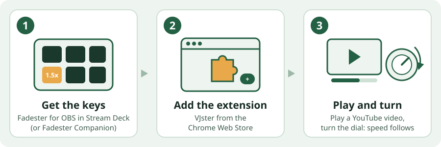

# VJster

**VJster 1.5.0** rides the speed of a YouTube video from your Stream Deck: turn a dial and the video speeds up or slows down while it plays; press a key for 0.5x, 1x or 2x; nudge in 0.05 steps to match a beat. It works on a video in a Chrome tab, inside an OBS browser source, or both at once. Nothing leaves this computer, and it needs no OBS connection.

## First five minutes

1. **Get the keys.** Have **Fadester for OBS 0.9.0 or later**? It already has the seven VJster actions: skip this step. Otherwise double-click `com.jbrick2070.vjster.streamDeckPlugin` and say yes to the bundled profiles (**VJster Live +** and **VJster Dual +** for Stream Deck +, **VJster Live** for 15 keys, **VJster Mini**).
2. **Add the Chrome extension.** Add [VJster from the Chrome Web Store](https://chromewebstore.google.com/detail/daohboebokfmamkblejcpbblfnaijgnb). Its options page opens once.
3. **Try it.** Drag **VJster Speed** onto a dial or **VJster Speed Preset** onto a key (in the VJster plugin: **Speed** and **Speed Preset**, or switch to a VJster profile). Play a YouTube video in Chrome. Within a few seconds the SPEED strip (or the 1x key) shows it playing. Turn the dial.

That's it. If the strip says **EXTENSION OFF**, see *When something is off* in [INSTALL.md](INSTALL.md).

**Install only one of them.** With Fadester for OBS, install only the Chrome extension: do not add the VJster plugin too, because both would want the same link port. Install steps, the OBS page, languages and uninstall: [INSTALL.md](INSTALL.md).

## The controls

| Action | Does |
|---|---|
| **Speed** (dial) | Turn for speed, hold and turn for fine steps, press for 1x, tap the strip to play or pause. |
| **Quality** (dial) | Step through the video's quality levels; press or tap for Auto. YouTube only. |
| **Speed Preset** (key) | One fixed speed. Lights up while it is the speed playing. |
| **Speed Step** (key) | Faster or slower by one step. |
| **Quality Preset** (key) | One fixed quality level, or Auto. |
| **Pin Tab** (key) | Keep controlling the current Chrome tab whatever else plays. Press again to let go. |
| **Play / Pause** (key) | Play or pause the video. |

Each action's **Control** setting picks what it drives: **Chrome tab**, **OBS page**, or **Both**. Both sends every turn and press to both and shows Chrome's state.

## The three parts

| Part | What it does |
|---|---|
| The keys and dials | In Fadester for OBS 0.9.0 or later, or in the VJster plugin for decks without Fadester. They also serve the OBS page. |
| The Chrome extension | Controls the video in a Chrome tab. |
| The OBS page | A browser source for OBS that plays one YouTube video at the speed the deck sets (0.25x to 2x). |

## Languages

The plugin, its keys and its settings page, the Chrome extension and the OBS page all come in the same thirteen languages: English, German, Spanish, French, Italian, Japanese, Korean, Dutch, Brazilian Portuguese, Russian, Turkish, Simplified Chinese and Traditional Chinese. On the deck, choose under **Language** on the settings page (Automatic follows Stream Deck's language). The Chrome extension follows Chrome's language and the OBS page uses the language in its address. Details and how to send corrections: [INSTALL.md](INSTALL.md).

## Licence

GPL-2.0-or-later, like Fadester for OBS. VJster is an independent project and is not made, endorsed or supported by Google, YouTube, the OBS Project or Elgato.
